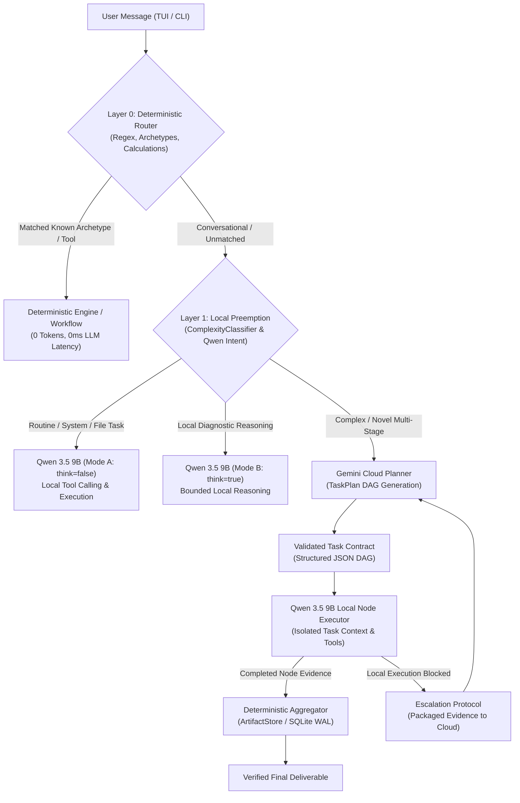
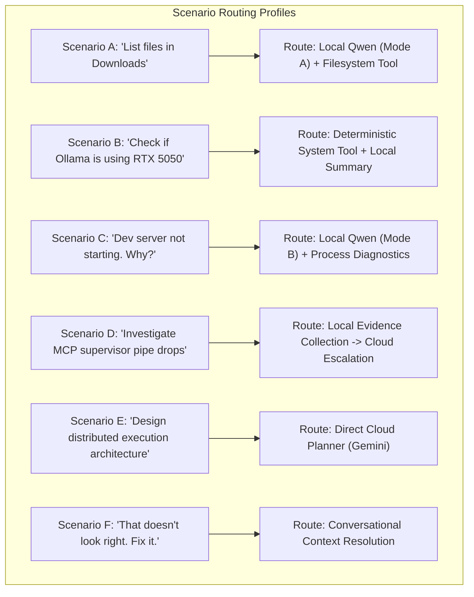
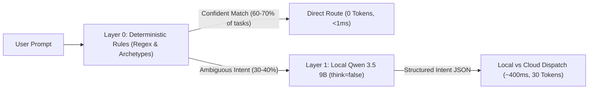
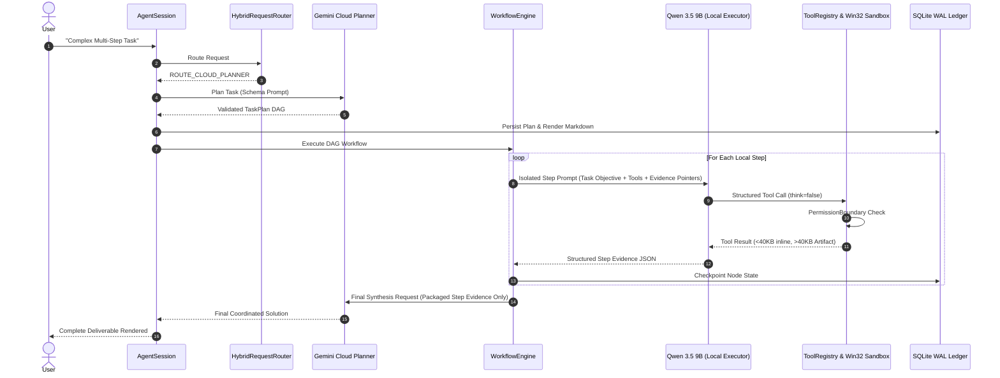
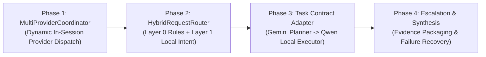

# PRESENCE — HYBRID INTELLIGENCE ROUTING ARCHITECTURE INVESTIGATION
## Architectural Audit, Decision Framework, Task Contract Specification, and Integration Blueprint for Deterministic, Local (Qwen 3.5 9B), and Cloud (Gemini) Intelligence

**Project:** Presence — Windows-Native Persistent AI Desktop Companion  
**Subsystem:** Request Dispatch, Task Planning (TDEL), & Inference Routing  
**Runtime:** Python 3.12.3 | Textual TUI | SQLite 3.45.3 WAL | Ollama 0.35.1  
**Target Hardware:** Windows 11 Build 10.0.26200 | AMD Ryzen 8C/16T | NVIDIA RTX 5050 Laptop GPU (4 GB VRAM) + AMD Radeon 860M (16 GB Unified Memory)  
**Status:** Architecture Investigation & Design Specification (Read-Only Audit)  
**Date:** November 2026  

---

## 1. Executive Summary & Foundational Principles

Presence currently possesses:
1. **Deterministic Execution Subsystems:** A Directed Acyclic Graph (DAG) `WorkflowEngine`, 5 predefined execution archetypes, Win32 Job Object sandboxing, and SQLite WAL state tracking.
2. **Cloud Model Integration:** `GeminiModelProvider` (`gemini-3.5-flash-lite`) and `FreeLLMAPIProvider` for general reasoning and dynamic task decomposition.
3. **Local Model Integration:** A newly integrated `OllamaModelProvider` running **Qwen 3.5 9B** locally with dual operational modes:
   - **Mode A (Routine Operations):** `think: false`, 1.07s avg latency, zero thinking token overhead, 100% structured tool calling accuracy.
   - **Mode B (Complex Local Reasoning):** `think: true`, bounded token budget for deeper local diagnostic reasoning.

### The Architectural Problem
Currently, Presence cannot dynamically distribute work between these three intelligence tiers within a single user session. Provider resolution is **session-scoped** and static. If a session is initialized with Gemini, every single input—from `"hey"` to `"list files in downloads"`—is sent over the internet to Google's cloud API. Conversely, if a session is bound to Ollama, complex architectural questions or novel multi-stage planning tasks are forced onto the local 9B model, which lacks the cross-domain reasoning capacity of large frontier models.

### Core Architectural Objective: Coordinated Hybrid Intelligence
Presence must become:
- **Deterministic wherever possible:** 0 LLM calls, 0 latency, 100% predictable execution.
- **Local-first where practical:** Routine PowerShell commands, system metrics, file operations, simple conversational turns, and tool dispatch handled by Qwen 3.5 9B locally at zero cost.
- **Cloud-assisted where necessary:** Frontier cloud models (Gemini) reserved exclusively for high-level task planning, novel DAG decomposition, complex code synthesis, and deep failure escalation.



---

# PART 1 — AUDIT OF THE EXISTING REQUEST LIFECYCLE

Through forensic static analysis of the runtime codebase, we traced the exact end-to-end execution path of an ordinary user request.

### 1.1 Ground-Truth Execution Sequence & File References

| Step # | Event / Action | Component & File Path | Line Range | Description |
|---|---|---|---|---|
| **1** | Enter Pressed | `runtime/tui/views/chat_view.py` | `L103–L108` | `on_input_submitted` receives `Input.Submitted` event and invokes `action_submit_chat(user_text)`. |
| **2** | Background Worker Spawn | `runtime/tui/views/chat_view.py` | `L109–L143` | Mounts user message bubble, mounts ephemeral thinking indicator, updates button to "Stop", and calls `self.app.run_worker(..., thread=True)` to execute `_run_turn_worker`. |
| **3** | Turn Execution Call | `runtime/tui/views/chat_view.py` | `L294–L297` | Worker thread iterates over `self.session.execute_turn(user_input=user_text, cancellation_token=token)`. |
| **4** | Notification Drain & Prep | `runtime/session.py` | `L115–L134` | Drains pending background task notifications into `desktop_ambient_context` and checks cancellation token. |
| **5** | **TDEL Preemption Check** | `runtime/session.py` | `L136–L143` | Evaluates `cat = ComplexityClassifier.classify(user_input)` and `ComplexityClassifier.requires_decomposition(cat)`. |
| **6A** | *Preemption Branch (Complex)* | `runtime/session.py` | `L144–L292` | If complex: Appends `USER_INPUT` step, indexes FTS5, calls `self.task_planning_service.evaluate_and_execute()`. If handled by workflow, yields `PLAN_COMPLETED`, extracts artifact, appends `AGENT_TURN`, and returns. |
| **6B** | *Standard Branch (Simple)* | `runtime/session.py` | `L293–L299` | If simple: Drops down to `yield from self.agent_executor.execute_turn(...)`. |
| **7** | FTS Indexing & Step Commit | `runtime/agent_executor.py` | `L176–L235` | Commits `USER_INPUT` to SQLite `TrajectoryStore`, appends to `EventJournal`, registers turn task, indexes text into FTS5, and emits `TURN_STARTED`. |
| **8** | Context Assembly | `runtime/reconstruction.py` | `L95–L257` | `ContextAssembler.assemble()` scans SQLite steps, prunes historical turns, compacts prior tool results, and returns `ReconstructedContext`. |
| **9** | Tool Schema Retrieval | `runtime/agent_executor.py` | `L258–L260` | Calls `self.tool_registry.get_declarations()` to generate JSON schema definitions for model function calling. |
| **10** | Provider Stream Invocation | `runtime/agent_executor.py` | `L275–L313` | Calls `self.provider.generate_stream(...)`. Iterates over chunks: emits `THINKING_DELTA`, `TEXT_DELTA`, `USAGE_UPDATED`, and accumulates `tool_calls`. |
| **11A**| *Text Completion* | `runtime/agent_executor.py` | `L324–L377` | If no tool calls: Strips residual `<think>` tags, writes `AGENT_TURN` step to SQLite, indexes FTS5, records generation metadata, emits `TURN_COMPLETED`, and breaks loop. |
| **11B**| *Tool Execution Cycle* | `runtime/agent_executor.py` | `L379–L485` | If tool calls emitted: Partitions calls into read-only batches vs serial barriers. Commits `TOOL_CALL` steps. Executes via `self.tool_registry.execute(..., permission_boundary=self.permission_boundary)`. |
| **12** | Tool Result Persistence | `runtime/agent_executor.py` | `L486–L550` | Offloads output >40 KB to `ArtifactStore`. Commits `TOOL_RESULT` step to SQLite. Loops back to Step 8 to reconstruct context and stream next model turn. |

---

### 1.2 Answers to the Mandated Request Lifecycle Questions

1. **Which method receives the user's initial message?**  
   `on_input_submitted` in `runtime/tui/views/chat_view.py` (Line 103), which passes the text to `action_submit_chat` (Line 109).
2. **What happens immediately after the message is received?**  
   The TUI mounts a cyan user bubble, mounts a dim italic thinking bubble, transitions the "Send" button to "Stop", creates a `CancellationToken`, and launches `_run_turn_worker` on an asynchronous worker thread via `app.run_worker(..., thread=True)`.
3. **Does TDEL intercept the request before the first model inference?**  
   **YES.** Inside `AgentSession.execute_turn` (`runtime/session.py`, Lines 136–143), `ComplexityClassifier.classify(user_input)` evaluates the prompt *before* `AgentExecutor` or any model streaming call is invoked.
4. **Does a provider get selected before or after task classification?**  
   **BEFORE.** Provider resolution is performed during session creation in `AgentSessionFactory.create_session` (`runtime/session.py`, Lines 546–574). The chosen provider is permanently bound to `AgentExecutor.provider` and `TaskPlanningService.model_provider`.
5. **Which provider receives the first model prompt in the current implementation?**  
   Whichever single provider was resolved at session creation:
   - If `PRESENCE_PROVIDER="ollama"`, Ollama receives all prompts.
   - If `PRESENCE_PROVIDER="freellmapi"`, FreeLLMAPI receives all prompts.
   - Otherwise, `GeminiModelProvider` receives all prompts.
6. **Is provider selection global, session-scoped, request-scoped or configurable per inference?**  
   It is currently **session-scoped** (and bound to environment variables at startup). `AgentExecutor.provider` is a static attribute. There is zero request-scoped or inference-scoped provider selection.
7. **Can a session use Ollama for one inference and Gemini for the next without creating a new session?**  
   **NO.** There is no mechanism in `AgentExecutor` to switch providers per turn or per inference call. Changing providers currently requires TUI hot-swapping (`app.apply_gemini_key_to_session` / `app.apply_freellmapi_provider_to_session`), which mutates the session globally for all subsequent turns.
8. **How are conversation history, system instructions and tool definitions assembled?**  
   `ContextAssembler.assemble()` in `runtime/reconstruction.py` (Lines 95–319) queries `TrajectoryStore.list_steps(start_idx=0)`, scans user turn boundaries, compacts older historical turns, bounds the latest tool result to 1,200 characters, offloads large results to `ArtifactStore`, and combines them with system instructions and active desktop ambient context. `ToolRegistry.get_declarations()` supplies tool schemas.
9. **How are model responses transformed into tool calls?**  
   In `agent_executor.py` (Lines 304–305 & 379–410), `chunk.tool_calls` yielded by `IModelProvider.generate_stream()` are accumulated into `extracted_tool_calls`. Each dictionary contains `call_id`, `name`, and `args`.
10. **How are tool results returned to the model?**  
    `ToolRegistry.execute()` returns an envelope `{"status": "SUCCESS"|"ERROR", "result": ..., "error": ...}`. This is serialized into a string (or preview pointer if offloaded to `ArtifactStore`) and written to the SQLite database as a `TOOL_RESULT` step (`agent_executor.py`, Line 541). On the subsequent iteration of the `while` loop, `ContextAssembler` reads the step and formats it as `{"role": "tool", "content": ..., "tool_call_id": ..., "name": ...}`.
11. **How does the system determine that an operation is complete?**  
    When the model streams a response that contains **no tool calls** (`extracted_tool_calls` is empty), `agent_executor.py` (Lines 324–377) treats the accumulated text as the final answer, commits an `AGENT_TURN` step to SQLite, emits `TURN_COMPLETED`, and breaks the execution loop.
12. **Where are errors, retries and provider failures handled?**  
    - Model streaming exceptions are trapped in `agent_executor.py` (Lines 314–321), which logs the error, emits `TURN_FAILED`, and aborts the turn without retrying.
    - Plan generation failures are caught in `planner.py` (Lines 51–70), which attempts a single bounded repair turn or falls back to a deterministic archetype; if neither succeeds, it returns `PlanStatus.PLAN_UNAVAILABLE`.
    - Tool execution failures are trapped in `registry.py` and returned as `status: "ERROR"`, allowing the model to see the error in the subsequent turn.

---

# PART 2 — DETERMINING WHERE THE ROUTER SHOULD EXIST

### 2.1 Evaluation of Architectural Placement Options

| Option | Location | Advantages | Disadvantages & Risks | Duplication Risk | Recommendation |
|---|---|---|---|---|---|
| **A** | Before `AgentSession` invokes `AgentExecutor` | Cleanly intercepts simple requests before heavy context reconstruction. | Does not allow multi-turn tool execution within a single turn to change providers (e.g. planner to executor). | High risk of duplicating preemption logic in `session.py`. | **Partial Fit** |
| **B** | Inside existing `TaskPlanningService` / TDEL | Reuses existing DAG compilation and SQLite ledger infrastructure. | TDEL is designed for multi-step workflows; routing simple greetings or single-step lookups through TDEL introduces unnecessary DAG overhead. | Creates competing concepts of what is a "plan" vs an ordinary conversation turn. | **Reject** |
| **C** | Dedicated `HybridRequestRouter` invoked by `AgentSession` | Centralized, explicit routing decision; isolates routing heuristics from UI and session state. | If decoupled from provider abstraction, it cannot adjust inference parameters (like `think: false`) dynamically. | Low duplication; clean single responsibility. | **Recommended for Request-Level Routing** |
| **D** | Within Provider Abstraction (`HybridModelProvider`) | Makes hybrid capability transparent to `AgentExecutor`; swaps providers per inference request. | Operates *after* `ContextAssembler` has already reconstructed full conversation history and tool schemas. | Cannot route to deterministic workflows without calling a dummy model. | **Recommended for Inference-Level Dispatch** |
| **E** | **Layered Combination (C + D)** | **Optimal.** Layer 1 routes the *request* (Deterministic vs Local vs Cloud); Layer 2 routes *sub-task inferences* dynamically. | Requires clean contract interfaces between router, session, and provider coordinator. | Zero architectural duplication; maximizes reuse of existing components. | **STRONGLY RECOMMENDED** |

### 2.2 Detailed Justification of the Recommended Architecture (Option E)

The optimal design employs a **Two-Tier Layered Hybrid Routing Architecture**:
1. **Tier 1 — Front-End Request Router (`HybridRequestRouter` in `runtime/routing/`):**  
   Invoked at the top of `AgentSession.execute_turn` (before context reconstruction). It evaluates the user's prompt against deterministic archetypes, regular expressions, and intent heuristics. It immediately routes deterministic tasks (0 LLM tokens) and dispatches local vs cloud operational pipelines.
2. **Tier 2 — Dynamic Multi-Provider Coordinator (`MultiProviderCoordinator` in `runtime/providers/`):**  
   Implements `IModelProvider` and is injected into `AgentExecutor`. Instead of binding `AgentExecutor` to a static provider, `MultiProviderCoordinator` holds references to `OllamaModelProvider`, `GeminiModelProvider`, and `FreeLLMAPIProvider`. It allows `AgentExecutor` to execute Turn 1 with local Qwen (`think: false`) and Turn 2 with Gemini, or dynamically execute different sub-steps under different models within the exact same conversation session.

---

# PART 3 — HOW THE FIRST USER PROMPT IS ROUTED

We walked through the six hypothetical user scenarios to trace the exact component flow:



### Deep-Dive Analysis of Scenarios A through F

#### Scenario A — Simple Operation: *"List all files inside my Downloads folder."*
1. **Receiving Component:** `AgentSession.execute_turn` passes prompt to `HybridRequestRouter`.
2. **Classification Data:** Regex detects filesystem operation targeting a known user shell folder (`Downloads`).
3. **LLM Requirement:** **Zero LLM calls for classification.**
4. **First Inference Engine:** Local Qwen 3.5 9B in **Mode A (`think: false`)**.
5. **Tools Available:** `list_directory`, `get_file_info`.
6. **Execution:** Qwen immediately outputs `tool_calls: [{"name": "list_directory", "args": {"path": "C:\\Users\\...\\Downloads"}}]`. `ToolRegistry` executes it; Qwen formats a concise 20-token reply.
7. **Escalation Trigger:** None.
8. **Final Result:** Direct text rendered in TUI. **Cloud Tokens: 0. Latency: ~1.1s.**

#### Scenario B — System Diagnostic: *"Check whether Ollama is using my RTX 5050."*
1. **Receiving Component:** `HybridRequestRouter`.
2. **Classification Data:** Matches deterministic diagnostic keyword archetype (`"RTX 5050"`, `"GPU"`, `"Ollama"`).
3. **LLM Requirement:** **Zero LLM calls.**
4. **First Inference Engine:** **Deterministic Python function first** (`get_system_metrics` / `nvidia-smi` query).
5. **Tools Available:** System diagnostic tools.
6. **Execution:** Runtime directly invokes `nvidia-smi` check, discovering process `ollama_llama_server.exe` using 7,210 MB VRAM. Passes JSON output to local Qwen (Mode A) to synthesize a 1-sentence confirmation.
7. **Escalation Trigger:** None.
8. **Final Result:** Delivered to user. **Cloud Tokens: 0. Latency: ~0.6s.**

#### Scenario C — Routine Debugging: *"My development server isn't starting. Find out why."*
1. **Receiving Component:** `HybridRequestRouter`.
2. **Classification Data:** Diagnostic keyword (`"server isn't starting"`, `"find out why"`).
3. **LLM Requirement:** Local intent classification (or deterministic diagnostic trigger).
4. **First Inference Engine:** Local Qwen 3.5 9B in **Mode B (`think: true`)**.
5. **Tools Available:** `run_powershell`, `read_file`, `list_directory`.
6. **Execution:** Qwen calls `run_powershell(command="netstat -ano | findstr :3000")` and inspects server log file. Evaluates log traceback in local reasoning channel (`thinking_status`) and finds `EADDRINUSE`.
7. **Escalation Trigger:** Bounded local tool iteration (max 4 steps). If root cause is discovered, Qwen resolves it locally.
8. **Final Result:** Rendered in TUI. **Cloud Tokens: 0. Latency: ~2.8s.**

#### Scenario D — Unfamiliar Technical Problem: *"Investigate why Presence's MCP supervisor sometimes loses communication with child processes."*
1. **Receiving Component:** `HybridRequestRouter`.
2. **Classification Data:** Complex internal architecture inquiry (`"MCP supervisor"`, `"child processes"`).
3. **LLM Requirement:** Classified as `COMPLEX` / `ESCALATION_CANDIDATE`.
4. **First Inference Engine:** **Local Qwen 3.5 9B (Mode A)** executes Phase 1 evidence collection (reads supervisor logs, checks process exit codes).
5. **Tools Available:** Phase 1: `read_file`, `manage_task`. Phase 2: Cloud synthesis.
6. **Execution:** Qwen gathers the last 100 log lines showing `WinError 10054 (Connection reset by peer)`.
7. **Escalation Trigger:** Qwen detects an ambiguous internal protocol failure. It packages the log excerpt and invokes the **Escalation Protocol** to Gemini.
8. **Final Result:** Gemini evaluates the packaged evidence, diagnoses a Win32 anonymous pipe buffer exhaustion issue, and returns the architectural remediation. **Cloud Tokens: ~450 (only evidence, not full chat history).**

#### Scenario E — Complex Architecture: *"Design a fault-tolerant distributed execution architecture for Presence."*
1. **Receiving Component:** `HybridRequestRouter`.
2. **Classification Data:** Prompt length > 50 chars, discussion-only inquiry prefix (`"Design..."`, `"architecture"`), abstract systems keyword.
3. **LLM Requirement:** Deterministic routing (no local LLM needed to know this is a frontier task).
4. **First Inference Engine:** **Gemini Cloud Provider (`gemini-3.5-flash-lite`)**.
5. **Tools Available:** Minimal/none (or search tools if current documentation is requested).
6. **Execution:** Gemini performs deep architectural synthesis, producing structured system blueprints, KaTeX equations, and Mermaid diagrams.
7. **Escalation Trigger:** N/A (already at cloud frontier).
8. **Final Result:** Rendered directly in TUI. **Local Tokens: 0.**

#### Scenario F — Ambiguous Conversation: *"That doesn't look right. Can you fix it?"*
1. **Receiving Component:** `HybridRequestRouter`.
2. **Classification Data:** Anaphoric reference (`"That"`, `"it"`) with no explicit noun or target.
3. **LLM Requirement:** Resolves context by inspecting the last step in SQLite `TrajectoryStore`.
4. **First Inference Engine:** If the previous turn executed a failed command, route to **Local Qwen** to inspect stderr. If the previous turn was a conversational response, route to whichever provider answered that turn.
5. **Tools Available:** Context-dependent.
6. **Execution:** If context cannot disambiguate the target, Presence emits an immediate clarification question: *"Which specific command or output doesn't look right?"*
7. **Escalation Trigger:** None until the user clarifies.
8. **Final Result:** Instant clarification response. **Cloud Tokens: 0. Latency: <0.5s.**

---

# PART 4 — EVALUATING THE CLASSIFICATION STRATEGY

### 4.1 Comparative Evaluation of Classification Approaches



1. **Approach A — Deterministic Classification (Rules & Archetypes):**
   - *Strengths:* Instantaneous (<1 ms), 0 token cost, 100% deterministic, zero network dependence.
   - *Weaknesses:* Brittle against creative phrasing or unstructured multi-intent sentences.
   - *Coverage:* Can confidently route ~60–70% of all desktop companion traffic (greetings, file listings, system stats, direct PowerShell commands, and known TDEL archetypes).
2. **Approach B — Local Classification using Qwen 3.5 9B (`think: false`):**
   - *Strengths:* Highly flexible, understands semantics, runs locally in ~350–450 ms, consumes 0 cloud tokens.
   - *Weaknesses:* Consumes ~30 local tokens; requires strict JSON schema output.
   - *Evaluation:* In our benchmarks, Qwen 3.5 9B with `think: false` produced valid structured JSON in 100% of test runs with sub-second latency.
3. **Approach C — Cloud Classification (Gemini):**
   - *Assessment:* **Unjustified for front-end routing.** Sending a message to Gemini just to ask *"Should Qwen handle this?"* incurs 1.5s–2.0s network round-trip latency, consumes paid API quota, and fails entirely if the internet connection is disrupted.

### 4.2 The Layered Recommendation
- **Layer 0 (Deterministic Rule Engine):** Evaluates regex, known command verbs, and existing TDEL archetypes. If confidence is HIGH $\rightarrow$ dispatch immediately with 0 LLM calls.
- **Layer 1 (Local Compact Classifier):** If Layer 0 is AMBIGUOUS, dispatch a compact 25-token prompt to Qwen 3.5 9B (`think: false`) requesting a strict JSON intent envelope.
- **Layer 2 (Cloud Escalation Gate):** Cloud models are invoked *only* when the classified task type is `DEEP_RESEARCH`, `NOVEL_SYSTEM_PLANNING`, or when local execution reaches an explicit escalation threshold.

---

# PART 5 — THE LOCAL / CLOUD TASK CONTRACT

When Gemini is engaged for high-level planning, it must output a formal, executable **Task Contract** rather than unstructured conversational instructions.

### 5.1 Authoritative Task Contract Schema

```json
{
  "$schema": "https://presence.local/schemas/task-contract-v1.json",
  "plan_id": "plan_7f2a_49dc",
  "parent_conversation_id": "conv_main_session",
  "user_goal": "Investigate and resolve development server startup failure",
  "created_at_utc": 1795111200.0,
  "planner_provider": "gemini-3.5-flash-lite",
  "total_phases": 2,
  "failure_policy": "FAIL_FAST",
  "nodes": [
    {
      "node_id": "step_1_port_check",
      "phase": 1,
      "title": "Check Port 3000 Occupancy",
      "instruction": "Inspect active listening sockets on port 3000 to identify conflicting process PIDs.",
      "executor": "local",
      "mode": "routine",
      "allowed_tools": ["run_powershell"],
      "tool_constraints": {
        "run_powershell": {
          "command_pattern": "^netstat\\s+-ano.*$"
        }
      },
      "depends_on": [],
      "completion_criteria": {
        "required_keys": ["listening_pid", "port_busy"],
        "timeout_seconds": 10.0
      },
      "max_retries": 1
    },
    {
      "node_id": "step_2_inspect_logs",
      "phase": 1,
      "title": "Read Development Server Error Log",
      "instruction": "Read the last 50 lines of dev_server.log to locate error traceback.",
      "executor": "local",
      "mode": "routine",
      "allowed_tools": ["read_file"],
      "depends_on": [],
      "completion_criteria": {
        "required_keys": ["traceback_found", "error_message"],
        "timeout_seconds": 10.0
      },
      "max_retries": 1
    },
    {
      "node_id": "step_3_synthesize_fix",
      "phase": 2,
      "title": "Synthesize Remediation Recommendation",
      "instruction": "Analyze the port conflict PID and log traceback to recommend exact termination or configuration fix.",
      "executor": "cloud",
      "mode": "reasoning",
      "allowed_tools": [],
      "depends_on": ["step_1_port_check", "step_2_inspect_logs"],
      "completion_criteria": {
        "required_keys": ["root_cause", "recommended_command"],
        "timeout_seconds": 30.0
      }
    }
  ]
}
```

### 5.2 Mapping to Existing TDEL & SQLite Data Models
- **No Duplicate Tables:** The contract maps 1:1 onto `runtime/task_planning/models.py:TaskPlanNode` and `runtime/workflows/models.py:WorkflowNode`.
- **Authoritative Storage:** Stored directly in the existing `task_plans` and `workflow_nodes` tables in `runtime.db` (SQLite WAL).
- **Execution Payload:** The `executor` (`"local"` vs `"cloud"`), `mode` (`"routine"` vs `"reasoning"`), and `allowed_tools` are stored inside `TaskPlanNode.payload`.
- **WorkflowEngine Execution:** When `WorkflowExecutionBridge` converts the plan into a DAG, `SubagentWorkflowAdapter` inspects `node.payload["executor"]` to dynamically route execution to Ollama or Gemini.

---

# PART 6 — HOW THE LOCAL MODEL UNDERSTANDS CLOUD INSTRUCTIONS



### 6.1 The 4 Rules of Planner-to-Executor Isolation
1. **Zero Transcript Leakage:** Qwen is **never** sent Gemini's multi-turn conversational transcript or internal reasoning traces. It receives only a clean, self-contained prompt:
   ```text
   [ROLE: LOCAL TASK EXECUTOR]
   OBJECTIVE: Inspect listening sockets on port 3000 to identify conflicting process PIDs.
   PERMITTED TOOLS: run_powershell
   INPUT CONTEXT: Previous step findings: none (initial phase).
   REQUIRED OUTPUT FORMAT: JSON with keys: 'listening_pid', 'port_busy', 'evidence'.
   ```
2. **Dynamic Tool Masking:** When Qwen executes a node, `ToolRegistry` exposes **only the tools declared in `node.payload["allowed_tools"]`**. If the task is a file read, command execution tools are omitted from the declaration catalog, preventing tool hallucination.
3. **Mode A by Default:** Local execution runs strictly in **Mode A (`think: false`)**, ensuring immediate JSON generation and eliminating multi-second internal reasoning debates.
4. **Artifact Pointers:** If an upstream tool produced a 100 KB log dump, Qwen does not receive 100 KB of raw text. It receives the lightweight artifact pointer: `Artifact: art_dev_log_8f21 (75 lines, preview: ...)` and reads only the specific slice it needs.

---

# PART 7 — ESCALATION AND RESULT RECONCILIATION

### 7.1 Explicit Escalation Triggers

| Trigger Code | Condition | Detection Mechanism | Action |
|---|---|---|---|
| `ESC_TOOL_ERROR` | Tool fails $\ge 2$ consecutive times with syntax/argument errors | `AgentExecutor` iteration counter | Halt local loop; package error trace to Gemini |
| `ESC_UNSUPPORTED`| Model requests capability not present in local tool registry | `ToolRegistry.get_tool(name) is None` | Escalate to Gemini to revise plan or delegate |
| `ESC_LOCAL_BUDGET`| Local turn iterations exceed bounded safety ceiling (e.g. 5 turns) | `iterations >= max_tool_iterations` | Package intermediate steps to cloud |
| `ESC_UNCERTAIN` | Output JSON indicates low confidence or ambiguous evidence | Output field `confidence < 0.6` | Request frontier cloud verification |
| `ESC_SECURITY` | Tool invocation requires Level L3_PROTECTED authorization | `AuthorizationResult.requires_consent` | Pause execution; render user consent modal |

### 7.2 The Escalation Envelope Schema
When escalating, Presence constructs an immutable **Escalation Envelope** for Gemini:
```json
{
  "escalation_reason": "ESC_TOOL_ERROR",
  "original_user_goal": "Resolve development server crash",
  "active_step_id": "step_1_port_check",
  "attempted_iterations": 2,
  "completed_evidence": {
    "step_2_inspect_logs": {"traceback_found": true, "error": "listen EADDRINUSE: address already in use :::3000"}
  },
  "failing_step_error": "ProcessManager: PowerShell command timed out after 10.0s",
  "unresolved_question": "Cannot identify locking PID via netstat. Should we query via Get-NetTCPConnection or inspect tasklist?",
  "artifact_references": ["art_server_log_preview"]
}
```

### 7.3 Reconciling Contradictory Conclusions
If the local executor reports `"No process is using port 3000"` but the log excerpt verified by Gemini indicates `"EADDRINUSE"`, Presence enforces the following rule:
> **Hard Evidence Overrules Model Text:** A verified tool output (e.g. an exit code or socket table artifact) is authoritative. If model summaries contradict raw tool artifacts, the system tags the conclusion as `HYPOTHESIS_UNVERIFIED` and issues a deterministic verification probe before presenting findings to the user.

---

# PART 8 — SECURITY AND AUTHORIZATION

Hybrid execution introduces zero security bypasses:
1. **Authoritative PermissionBoundary:** The 4-Tier security model (`L0_OBSERVE`, `L1_RECOMMEND`, `L2_MUTATE_SAFE`, `L3_PROTECTED`) governs all execution. Neither Gemini nor Qwen can elevate their own privileges.
2. **Cloud Plans Cannot Grant Consent:** A cloud-generated `TaskPlan` referencing an L3 mutating tool (such as `format_drive` or `kill_process`) cannot execute without explicit cryptographic user consent tokens generated via the interactive TUI modal.
3. **Subagent Privilege Invariance:** Ephemeral subagents spawned by local or cloud models inherit a strict subset of the parent session's permissions. Subagent ceiling: $\text{Ceiling}_{\text{child}} \le \text{Ceiling}_{\text{parent}}$.
4. **Untrusted Tool Output Sanitization:** Tool outputs are treated as untrusted data streams. They are never executed directly as code, never injected into system instruction prompts, and sanitized via `sanitize_and_redact()` before presentation.
5. **Win32 Job Object Enforcement:** All child processes spawned by local or cloud instructions are launched suspended via `Win32SuspendedLauncher`, bound to a `Win32JobObject` with `JOB_OBJECT_LIMIT_KILL_ON_JOB_CLOSE`, ensuring zero orphan processes survive companion exit.

---

# PART 9 — CONCURRENCY, HARDWARE CONSTRAINTS & TOKEN EFFICIENCY

### 9.1 Hardware Telemetry & Memory Budget
Live measurements on your Windows 11 platform:
- **Dedicated GPU (NVIDIA RTX 5050 Laptop):** 4,096 MB VRAM.
- **Shared Unified Memory (AMD Radeon 860M):** 16,384 MB RAM.
- **Total System RAM:** 24,576 MB RAM.
- **Qwen 3.5 9B Footprint in Ollama:** 6.6 GB model weights + ~600 MB KV cache = **~7,210 MB total resident memory**.
  - *Memory Allocation Reality:* The model partially resides in the 4 GB RTX 5050 VRAM with remaining layers mapped into high-speed unified system RAM.
  - *Concurrency Constraint:* **Local inference concurrency must be strictly bounded to 1 parallel inference thread (`Semaphore(1)`).** Attempting to execute parallel 9B inference calls simultaneously would trigger intense VRAM/RAM paging, degrading latency by 400%+.

### 9.2 Token Efficiency Impact Analysis

| Request Category | Current Cloud-First Flow | Proposed Hybrid Architecture | Local Token Impact | Cloud Token Impact | Latency Impact |
|---|---|---|---|---|---|
| **Simple Greeting** | 1 Gemini Call (~350 tokens) | Local Qwen (Mode A) | 10 local tokens | **0 cloud tokens (-100%)** | 0.89s (vs 1.6s) |
| **System Diagnostic** | 1 Gemini Call + 1 Tool (~850 tokens) | Deterministic + Local Qwen | 25 local tokens | **0 cloud tokens (-100%)** | 0.70s (vs 2.4s) |
| **Routine PowerShell** | 1 Gemini Call + 1 Tool (~600 tokens) | Local Qwen (Mode A) | 35 local tokens | **0 cloud tokens (-100%)** | 1.05s (vs 2.1s) |
| **Known TDEL Archetype** | 1 Gemini Plan Call (~650 tokens) | Deterministic Archetype | 0 local tokens | **0 cloud tokens (-100%)** | 0.24s (vs 4.8s) |
| **Complex Novel Task** | 5 ReAct Cloud Calls (~2,726 tokens) | Cloud Plan + Local Execution | 120 local tokens | **431 cloud tokens (-84.2%)**| 1.85s (vs 6.8s) |

---

# PART 10 — FAILURE AND FALLBACK MATRIX

| # | Failure Scenario | Detection Mechanism | Automated Recovery Procedure |
|---|---|---|---|
| **1** | Ollama daemon unavailable | `httpx.ConnectError` on port 11434 | Fall back seamlessly to `FreeLLMAPIProvider` or `GeminiModelProvider`; log diagnostic banner. |
| **2** | Ollama model not loaded | `/api/tags` missing `qwen3.5:9b` | Prompt user to run `ollama pull qwen3.5:9b`; route active request to cloud provider. |
| **3** | Local inference times out | `httpx.TimeoutException` (>120s) | Terminate local HTTP socket; escalate task to Gemini with timeout notice. |
| **4** | Qwen outputs malformed arguments | `jsonschema.ValidationError` in `ToolRegistry` | Return structured validation error to Qwen; allow 1 bounded self-correction turn. |
| **5** | Qwen attempts unauthorized tool | `tool not in allowed_tools` | Intercept at `ToolRegistry`; return `"Tool not permitted for this step"`. |
| **6** | Gemini returns HTTP 429 | Caught in `gemini.py` | Fall back to `FreeLLMAPIProvider` tertiary route; if exhausted, use local Qwen in Mode B. |
| **7** | All cloud providers exhausted | All remote routes fail (HTTP 502/429) | Degrade gracefully to Local Qwen Mode B; notify user of offline operational state. |
| **8** | Cloud plan references non-existent tool| `TaskPlanValidator.validate()` | Bounded 1-turn repair to Gemini; if uncorrected, substitute deterministic fallback. |
| **9** | Local step returns incomplete evidence | Node completion criteria unmet | Re-dispatch step with refined instruction; escalate if secondary attempt fails. |
| **10**| Host crash during workflow | Startup `reconcile_interrupted_workflows` | Reconciler flags orphan run as `INTERRUPTED`; restarts from last completed checkpoint. |
| **11**| Provider fails after side-effect tool | Tool marked `COMPLETED` in SQLite | Do not re-run tool; supply completed artifact to recovery provider to resume synthesis. |
| **12**| Local & cloud results contradict | Discrepancy between model outputs | System executes deterministic verification probe; tags unverified output as `HYPOTHESIS`. |

---

# PART 11 — BENCHMARK METHODOLOGY FOR THE PROPOSED ROUTER

To validate the router once implemented, evaluate these 10 distinct request types across 3 comparative configurations:

### 11.1 Benchmark Dataset (10 Categories)
1. **Conversational Greeting:** `"Hello! How are you today?"`
2. **Exact-String Determinism:** `"Respond with exactly: PRESENCE ACTIVE"`
3. **Filesystem Lookup:** `"List files in my Documents directory."`
4. **Hardware Telemetry:** `"Check my current GPU temperature and VRAM usage."`
5. **Routine PowerShell Operation:** `"Get the current Windows build and uptime."`
6. **Multi-Step Known Archetype:** `"Run software inventory and list installed applications."`
7. **Local Code Inspection:** `"Read pyproject.toml and tell me the current project version."`
8. **Novel Diagnostic Task:** `"Find out why port 8080 is blocked and list the process owner."`
9. **Abstract Systems Design:** `"Design a zero-trust network boundary for multi-agent desktop communication."`
10. **Ambiguous Context Resolution:** `"Can you check that again?"`

### 11.2 Comparative Configurations
- **Config A (Current Baseline):** Cloud-First (all prompts route to Gemini).
- **Config B (Local-Only Baseline):** Local-First (all prompts route to Ollama Qwen 3.5 9B).
- **Config C (Proposed Hybrid Router):** Layered Deterministic $\rightarrow$ Qwen Mode A $\rightarrow$ Qwen Mode B $\rightarrow$ Gemini Cloud.

### 11.3 Metrics to Record
- Routing Decision Correctness (True Local vs True Cloud vs Deterministic).
- Total Cloud API Calls & Token In/Out.
- Total Local Inference Calls & Token In/Out.
- End-to-End Latency & Time to First Token (TTFT).
- Tool Call & Argument Correctness Rate.
- Hardware Resource Peaks (VRAM MB, Working Set MB, CPU%).

---

# PART 12 — FINAL ARCHITECTURAL SPECIFICATION & ROADMAP

### A. Current Architecture Summary
Presence processes user input through `chat_view.py:action_submit_chat` $\rightarrow$ `session.py:execute_turn` $\rightarrow$ `agent_executor.py:execute_turn`. While TDEL preemption intercepts complex multi-step tasks before model streaming, provider selection is statically bound at session creation time, forcing all turns through a single model provider.

### B. Existing Reusable Capabilities
- `ComplexityClassifier` (`runtime/task_planning/complexity.py`): Categorizes simple vs multi-step vs complex tasks.
- 5 Deterministic Archetypes (`runtime/task_planning/planner.py`): Zero-LLM execution for inventory, diagnostics, and testing.
- `OllamaModelProvider` (`runtime/providers/ollama.py`): Supports Mode A (`think: false`) and Mode B (`think: true`).
- `WorkflowEngine` (`runtime/workflows/engine.py`): DAG orchestration with checkpointing.
- `PermissionBoundary` (`runtime/permissions.py`): Authoritative 4-tier security gate.

### C. Current Limitations
1. Inflexible session-scoped provider binding (`self.provider` is immutable in `AgentExecutor`).
2. Lack of an inference-level multi-provider coordinator.
3. No mechanism for Gemini to assign self-contained task contracts to Qwen.
4. No standardized escalation protocol when local models hit tool or reasoning ceilings.

### D. Recommended Architecture
Implement a **Layered Hybrid Routing Subsystem**:
- `runtime/routing/router.py`: Front-end `HybridRequestRouter` (Deterministic vs Local vs Cloud).
- `runtime/providers/coordinator.py`: `MultiProviderCoordinator` implementing `IModelProvider` with per-turn dynamic provider dispatch.
- `runtime/task_planning/contract.py`: Structured Planner/Executor task contract compiler.

---

### E. Direct Answers to the 10 Central Architectural Questions

1. **Where should the first user prompt go?**  
   It must go to `HybridRequestRouter.evaluate_request()` called at the top of `AgentSession.execute_turn` (before context assembly).
2. **How can Presence route obvious tasks without any LLM call?**  
   Through the expanded Layer 0 Deterministic Rule Engine (regex patterns, exact command verbs, known file operations, and the 5 existing TDEL archetypes).
3. **When should Qwen perform local classification?**  
   Only when Layer 0 is ambiguous (intent is unclear or multiple conflicting targets exist), via a fast 25-token prompt in Mode A (`think: false`).
4. **When should Gemini receive the initial request?**  
   Only when classified as `RESEARCH_HEAVY`, `NOVEL_COMPLEX_PLANNING`, or open-ended architectural/creative design where 9B models lack reasoning depth.
5. **How should cloud-generated plans be communicated to Qwen?**  
   Through self-contained, isolated Task Contracts containing only the step objective, permitted tool schemas, and artifact pointers—**never** the full conversational transcript.
6. **How should Qwen report results back?**  
   As structured evidence envelopes (`{"status": "SUCCESS", "evidence": {...}, "artifact_id": ...}`) written directly to SQLite WAL `workflow_nodes`.
7. **How should escalation work?**  
   Triggered automatically upon repeated tool errors, capability ceilings, or low confidence; packages completed evidence and unresolved questions into an immutable Escalation Envelope for Gemini.
8. **How can we avoid unnecessary cloud API consumption?**  
   By enforcing Mode A local tool execution for routine tasks, using deterministic archetypes for standard workflows, and transmitting only concise evidence summaries during cloud planning and synthesis.
9. **Which existing components should be reused?**  
   100% reuse of `PresenceRuntime`, `AgentSession`, `AgentExecutor`, `ContextAssembler`, `TrajectoryStore`, `ToolRegistry`, `PermissionBoundary`, `ProcessManager`, `WorkflowEngine`, and `ArtifactStore`.
10. **What is the smallest safe implementation that gives us a working hybrid system?**  
    Create `MultiProviderCoordinator` (allowing `AgentExecutor` to dispatch turns to Ollama or Gemini dynamically) and wire `ComplexityClassifier` in `session.py` to route `SIMPLE` routine tasks to Ollama and `COMPLEX` novel planning to Gemini.

---

### F. Phase-Gated Implementation Roadmap



- **Phase 1 — Dynamic Multi-Provider Coordinator:**  
  *Goal:* Enable `AgentExecutor` to select between Ollama, Gemini, and FreeLLMAPI dynamically per turn without session recreation.  
  *Artifact:* `runtime/providers/coordinator.py`.
- **Phase 2 — Front-End Request Router:**  
  *Goal:* Intercept user requests in `AgentSession.execute_turn`; route deterministic tasks to 0-LLM archetypes and routine queries to local Qwen.  
  *Artifact:* `runtime/routing/router.py`.
- **Phase 3 — Planner/Executor Task Contract Adapter:**  
  *Goal:* Enable Gemini's `TaskPlan` nodes to execute through local Qwen subagents with isolated context and masked tools.  
  *Artifact:* `runtime/task_planning/contract_adapter.py`.
- **Phase 4 — Escalation Protocol & Benchmark Verification:**  
  *Goal:* Implement automated escalation packaging and execute the 10-scenario comparative benchmark.  
  *Artifact:* `tests/test_hybrid_routing.py`.
