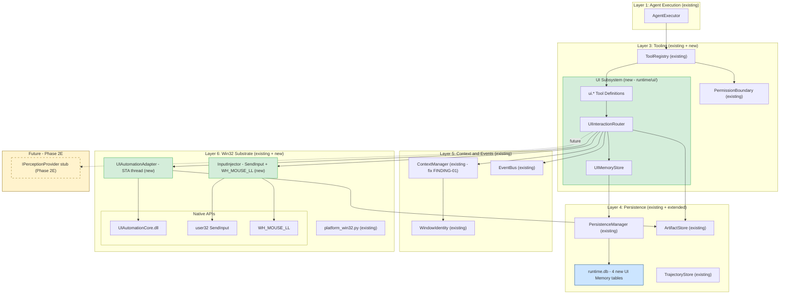
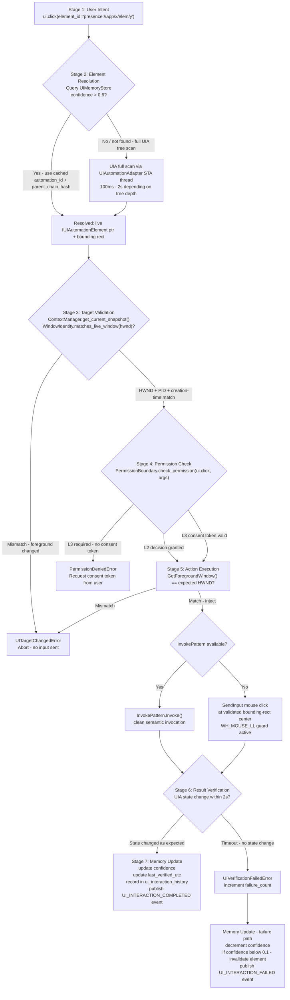

# PRESENCE — Phase 2D: UI Interaction & Persistent UI Memory
## Architectural Design Document

**Repository:** `C:\Users\chait\OneDrive\Documents\projects\tweaking`  
**Branch:** `implementation/phase-2c-context-and-foreground-awareness`  
**HEAD at authoring:** `652100c`  
**Status:** Design-only. No existing Python files modified. No commits created.  
**Prerequisites read:** `PRESENCE_ARCHITECTURE_MAP.md` (810 lines), all runtime source modules, all verified native-capability test results.

---

## Table of Contents

1. [Problem Definition](#1-problem-definition)
2. [Existing Infrastructure Analysis](#2-existing-infrastructure-analysis)
3. [Component Reuse Matrix](#3-component-reuse-matrix)
4. [New Components Required](#4-new-components-required)
5. [Unnecessary Components](#5-unnecessary-components)
6. [Recommended Architecture](#6-recommended-architecture)
7. [UI Memory Data Model](#7-ui-memory-data-model)
8. [Interaction Lifecycle](#8-interaction-lifecycle)
9. [Security and Privacy](#9-security-and-privacy)
10. [Performance and Resource Budget](#10-performance-and-resource-budget)
11. [Failure Modes](#11-failure-modes)
12. [Minimal Implementation Sequence](#12-minimal-implementation-sequence)
13. [Open Architectural Decisions](#13-open-architectural-decisions)
14. [Final Architectural Recommendation](#14-final-architectural-recommendation)

---

## 1. Problem Definition

### 1.1 The UI Interaction Gap

Presence currently understands user intent expressed in natural language and can call tools to fulfil that intent. What it cannot do is reliably find, identify, and act on controls inside running Windows applications.

The gap has three distinct layers:

**Semantic gap.** The model understands "click the Send button in Outlook." The runtime has no mechanism to translate that description into a live control handle in Outlook's window.

**Identity gap.** Windows UI controls are identified at runtime by transient handles — `HWND`, UIA element references, automation IDs — that are invalidated when a window is closed, resized, or the application is updated. There is no persistent identity for a UI element that survives across sessions.

**Verification gap.** After an action is taken (a click, a keypress), there is no mechanism to confirm that the application responded as expected.

### 1.2 The Learning Cycle

A one-shot UIA scan is expensive (100 ms–2 s depending on tree size). An architecture that re-scans from scratch on every interaction cannot achieve acceptable latency.

The correct design is a learning loop:

```
First encounter:
  UIA full scan → identify element → record structural identity → store in UI Memory

Subsequent uses:
  UI Memory lookup (< 10 ms) → verify element still matches live window
  → execute action → record outcome → update confidence

On failure:
  Confidence drop → trigger rediscovery → update UI Memory record
  → next call succeeds from updated record
```

This loop is the core justification for the UI Memory subsystem. Without it, UI interaction is a tool that works once and degrades silently. With it, UI interaction improves with use and self-heals after application updates.

### 1.3 Persistent vs. Transient Identity

| Identity Type | Lifetime | Examples | Storage |
|---|---|---|---|
| `HWND` | Window session | `HWND` returned by `GetForegroundWindow()` | Never persisted |
| UIA element ptr | UIA COM session | `IUIAutomationElement*` | Never persisted |
| Automation ID | App version | `AutomationId` property | UI Memory (`ui_elements`) |
| Parent chain hash | App version | SHA-256 of ancestor `AutomationId` chain | UI Memory (`ui_elements`) |
| `WindowIdentity` | Runtime session (HWND + PID + creation-time) | `ContextSnapshot.foreground_window` | Never persisted |
| Element URI | Permanent | `presence://app/{uuid}/elem/{uuid}` | UI Memory — primary key |

The design keeps only structural identifiers in persistent storage. All runtime handles are transient and must be re-acquired on every use.

---

## 2. Existing Infrastructure Analysis

The following analysis is based on direct source-code reading of each module. Integration status reflects what has been verified in the codebase, not what specifications describe.

### 2.1 ToolRegistry (`runtime/tools/registry.py`)

**What it does.** Maintains a registry of `ToolDefinition` objects keyed by name. `register(tool_def, boundary)` auto-registers the tool's permission policy with the `PermissionBoundary`. `get_tool(name)` returns a definition. `build_default_tools()` registers the standard tool set.

**Integration status.** Fully implemented and wired. `ToolRegistry` is instantiated in `lifecycle.py` and passed to `AgentExecutor`.

**Reuse decision.** Reuse as-is. UI tools register through the same `ToolDefinition` path. No structural changes required.

**Modification needed.** None to `ToolRegistry` itself. A new `register_ui_tools(registry, router, boundary)` function (in `runtime/ui/tools.py`) calls `registry.register()` for each UI tool during startup.

### 2.2 PermissionBoundary (`runtime/permissions.py`)

**What it does.** Implements a 4-tier permission model (L0 = unrestricted, L1 = rate-limited, L2 = user-confirmable, L3 = explicit consent token required). `issue_consent_token()` generates an HMAC-SHA256 token with RFC 8785 canonicalization. `verify_consent_token()` validates it. `check_permission(tool_name, args)` returns a `PermissionDecision`.

**Integration status.** Fully implemented and wired.

**Reuse decision.** Reuse as-is. UI action authority tiers map cleanly to existing levels (see Section 9).

**Modification needed.** None to `PermissionBoundary`. New default policies for `ui.*` tools are registered via `ToolRegistry.register()` during startup.

### 2.3 ContextManager and WindowIdentity (`runtime/context/manager.py`, `runtime/context/models.py`)

**What it does.** `ContextManager` maintains a volatile snapshot of the current foreground window via `Win32ForegroundWindowSource`. `get_current_snapshot()` returns the most recent `ContextSnapshot`. `WindowIdentity.matches_live_window()` validates that an `HWND` still belongs to the expected process (using HWND + PID + process creation time tick count).

**Integration status — FINDING-01 (blocker).** `Win32ForegroundWindowSource.start()` is not called during `PresenceRuntime` startup. The `ContextManager` instance exists but its observer is never activated. `get_current_snapshot()` will return a stale or empty snapshot at runtime. This was identified during the architecture audit.

**Reuse decision.** Reuse after fixing FINDING-01. `WindowIdentity.matches_live_window()` is precisely what the UI subsystem needs to validate the target window immediately before input injection. No new foreground observer is needed.

**Modification needed.** Fix `lifecycle.py` to call `Win32ForegroundWindowSource.start()` during runtime startup (Stage 2D.0). No changes to `ContextManager` or `WindowIdentity` classes.

### 2.4 PersistenceManager (`runtime/persistence.py`)

**What it does.** Manages a single WAL-mode SQLite database at `%LOCALAPPDATA%\Presence\data\runtime.db`. Uses `CREATE TABLE IF NOT EXISTS` for schema creation. Three existing tables: `runtime_config`, `runtime_recovery`, `system_metrics`. Exposes `get_connection()` and async helpers.

**Integration status.** Fully implemented and wired.

**Reuse decision.** Extend with four new UI Memory tables. No second database, no second connection pool. The same `runtime.db` file receives the new tables. The `CREATE TABLE IF NOT EXISTS` pattern already in use makes additive schema extension safe.

**Modification needed.** `UIMemoryStore.__init__()` calls `CREATE TABLE IF NOT EXISTS` for the four new tables via the existing `PersistenceManager.get_connection()`. No changes to `PersistenceManager` itself.

### 2.5 TrajectoryStore (`runtime/trajectory.py`)

**What it does.** Records conversation steps (`StepType.TOOL_CALL`, `StepType.TOOL_RESULT`, `StepType.AGENT_MESSAGE`, etc.) into a SQLite trajectory table. Provides replay and inspection.

**Integration status.** Implemented. Used by `AgentExecutor`.

**Reuse decision.** Reuse as-is. UI interaction outcomes are recorded as `TOOL_CALL` / `TOOL_RESULT` steps in the trajectory, which is exactly the correct place. The trajectory is not an element database; do not store element identities here.

**Modification needed.** None.

### 2.6 ArtifactStore (`runtime/artifacts/store.py`)

**What it does.** Stores binary content above 40 KB threshold to disk under `%LOCALAPPDATA%\Presence\artifacts\`, using SHA-256 addressing and atomic writes. Returns an `ArtifactRef` with a URI for retrieval. Provides chunked streaming read.

**Integration status.** Implemented.

**Reuse decision.** Reuse as-is. UIA element trees for complex applications (e.g., Visual Studio, Chrome with many tabs) regularly exceed 40 KB when serialised to JSON. The `ui.get_element_tree` tool will route large trees through `ArtifactStore` automatically.

**Modification needed.** None.

### 2.7 EventBus (`runtime/events.py`)

**What it does.** Synchronous publish/subscribe with error-isolated handlers. `publish(event_type, payload)` calls all subscribed handlers. Handlers that raise exceptions are caught and logged — they do not interrupt other subscribers.

**Integration status.** Implemented and wired.

**Reuse decision.** Reuse as-is. Add new event-type string constants for UI lifecycle events. No changes to the `EventBus` class.

**Modification needed.** Add constants (in `runtime/ui/tools.py` or a `runtime/ui/events.py` constants file):
- `UI_ELEMENT_DISCOVERED` — first time an element is added to UI Memory
- `UI_INTERACTION_COMPLETED` — successful `ui.click` or `ui.type_text`
- `UI_INTERACTION_FAILED` — failed action with reason code
- `UI_ELEMENT_INVALIDATED` — element confidence dropped below threshold

### 2.8 `platform_win32.py`

**What it does.** `Win32JobObject` (process containment), `Win32SuspendedLauncher` (child-process launch), `Win32SingleInstanceMutex` (single-instance guard), `get_process_memory_info()`.

**Integration status.** Implemented.

**Reuse decision.** Extend with UIA COM bootstrapping utilities, or implement these in the new `runtime/ui/uia_adapter.py`. Given the size of the UIA ctypes COM interface, isolating it in `runtime/ui/` is cleaner. `platform_win32.py` gains only a `get_window_dpi()` helper and a `get_foreground_hwnd()` wrapper if needed.

**Modification needed.** Minimal — a `get_window_dpi(hwnd)` helper may be added to `platform_win32.py` if it is not already available via pywin32.

### 2.9 IModelProvider (`runtime/providers/base.py`)

**What it does.** Defines a streaming text-generation interface: `generate(prompt, history) -> AsyncIterator[str]`.

**Integration status.** Implemented. `GeminiProvider` extends it.

**Reuse decision.** Do NOT reuse for visual perception. The streaming-token interface is semantically wrong for object detection, bounding-box regression, or accessibility-tree extraction from screenshots. Visual perception requires a separate `IPerceptionProvider` interface that returns structured element descriptions, not token streams.

**Modification needed.** None to `IModelProvider`. Phase 2D stubs an `IPerceptionProvider` interface without implementing it.

### 2.10 MCPSupervisor and Win32JobObject

**What it does.** `MCPSupervisor` manages out-of-process MCP server child processes inside `Win32JobObject` containment.

**Integration status.** Implemented.

**Reuse decision.** Reuse as-is for any future out-of-process vision model sidecar. No changes needed for Phase 2D (vision is deferred to Phase 2E).

**Modification needed.** None.

---

## 3. Component Reuse Matrix

| Component | Location | Phase 2D Decision | Modification Required | Reason |
|---|---|---|---|---|
| `ToolRegistry` | `runtime/tools/registry.py` | Reuse as-is | None | UI tools register via `ToolDefinition.register()` |
| `PermissionBoundary` | `runtime/permissions.py` | Reuse as-is | None | 4-tier model covers UI action authority |
| `ContextManager` | `runtime/context/manager.py` | Reuse after FINDING-01 fix | Fix startup wiring in `lifecycle.py` | Foreground validation required before input injection |
| `WindowIdentity` | `runtime/context/models.py` | Reuse as-is | None | `matches_live_window()` is the exact validation primitive needed |
| `PersistenceManager` | `runtime/persistence.py` | Extend (additive) | 4 new tables in existing `runtime.db` | UI Memory backed by existing WAL SQLite |
| `TrajectoryStore` | `runtime/trajectory.py` | Reuse as-is | None | Interaction outcomes go in `TOOL_CALL`/`TOOL_RESULT` steps |
| `ArtifactStore` | `runtime/artifacts/store.py` | Reuse as-is | None | Large UIA trees (> 40 KB) stored automatically |
| `EventBus` | `runtime/events.py` | Reuse as-is | Add event-type constants | No structural changes to `EventBus` class |
| `platform_win32.py` | `runtime/platform_win32.py` | Minor extension | Optional `get_window_dpi()` helper | DPI query at observation time |
| `Win32JobObject` | `runtime/platform_win32.py` | Reuse as-is | None | Vision sidecar containment (Phase 2E) |
| `Win32SuspendedLauncher` | `runtime/platform_win32.py` | Reuse as-is | None | Vision sidecar launch (Phase 2E) |
| `IModelProvider` | `runtime/providers/base.py` | Do not reuse | None | Wrong interface for perception |
| `MCPSupervisor` | `runtime/mcp/supervisor.py` | Reuse as-is | None | Sidecar management (Phase 2E) |

---

## 4. New Components Required

All new files are created under `runtime/ui/`. No existing files outside `runtime/ui/` are modified except the FINDING-01 fix in `lifecycle.py` and the optional `get_window_dpi()` helper in `platform_win32.py`.

### 4.1 `runtime/ui/uia_adapter.py` — UIAutomationAdapter

**Purpose.** Provides a safe, synchronous interface to Windows UI Automation from an asyncio runtime.

**Core design constraint.** UIA COM requires Single-Threaded Apartment (STA) model. UIA calls may block if the target application's message pump is hung. These two facts mandate a dedicated STA worker thread — the asyncio event loop thread must never make UIA calls directly.

**Architecture.**

```
asyncio coroutine
  → submit task to STA thread queue (non-blocking)
  → STA thread: CoInitialize(COINIT_APARTMENTTHREADED) [once at startup]
  → STA thread: execute UIA call with per-call timeout guard
  → result returned via threading.Future
  → asyncio coroutine awaits Future (non-blocking on event loop)
```

**Native access path.** Confirmed working (verified during audit):
- `UIAutomationCore.dll` loads via `ctypes.WinDLL`
- `CoCreateInstance(CLSID_CUIAutomation8)` via `ole32.CoCreateInstance` using GUID struct
- UIA init latency: ~5.65 ms (one-time). `GetRootElement`: ~0.15 ms.
- `comtypes` and `pywinauto` are **not available**. All UIA access uses raw ctypes COM vtable calls.

**Interface (sketch).**

```python
class UIAutomationAdapter:
    def start(self) -> None: ...          # starts STA thread, CoInitializes
    def stop(self) -> None: ...           # posts shutdown sentinel, joins thread

    async def find_element_by_automation_id(
        self, root_hwnd: int, automation_id: str, timeout_s: float = 5.0
    ) -> UIElement | None: ...

    async def find_elements_by_control_type(
        self, root_hwnd: int, control_type: str, timeout_s: float = 5.0
    ) -> list[UIElement]: ...

    async def get_bounding_rect(
        self, element: UIElement
    ) -> BoundingRect | None: ...

    async def get_clickable_point(
        self, element: UIElement
    ) -> tuple[int, int] | None: ...

    async def invoke_pattern(
        self, element: UIElement, timeout_s: float = 5.0
    ) -> bool: ...

    async def get_value(self, element: UIElement) -> str | None: ...
    async def set_value(self, element: UIElement, value: str) -> bool: ...

    async def get_element_tree(
        self, root_hwnd: int, max_depth: int = 6, timeout_s: float = 10.0
    ) -> dict: ...
```

**Timeout guard.** Every STA thread call is wrapped in a `concurrent.futures.ThreadPoolExecutor` future with a wall-clock timeout. If the target app does not respond within `timeout_s`, the call is cancelled and `UITimeoutError` is raised. The STA thread itself is not killed — it loops waiting for the next task.

**Memory budget.** UIA STA thread: approximately +3 MB RSS at init (confirmed during audit). This is a one-time cost paid at startup.

### 4.2 `runtime/ui/ui_memory.py` — UIMemoryStore

**Purpose.** Persistent element identity store. Answers the question: "Have we successfully interacted with this element before? If so, what are its structural identifiers?"

**Backend.** Four new tables in the existing `runtime.db` SQLite database via `PersistenceManager.get_connection()`. Full schema in Section 7.

**Interface (sketch).**

```python
class UIMemoryStore:
    async def get_or_create_app(self, exe_path: str) -> AppRecord: ...
    async def find_element(
        self, app_id: str, control_type: str,
        automation_id: str = "", name_pattern: str = ""
    ) -> ElementRecord | None: ...
    async def record_element(self, app_id: str, props: ElementProperties) -> ElementRecord: ...
    async def record_observation(
        self, element_id: str, layout_key: str, obs: ObservationData
    ) -> None: ...
    async def record_interaction(
        self, element_id: str, action: str, success: bool,
        error_detail: str = "", conversation_id: str = ""
    ) -> None: ...
    async def update_confidence(
        self, element_id: str, layout_key: str, success: bool
    ) -> None: ...
    async def invalidate_element(self, element_id: str) -> None: ...
```

**App identity.** An application is identified by: executable path + SHA-256 of the executable file (for version tracking) + window class prefix. The combination is stable across process restarts but changes on application update (triggering a re-discovery cycle).

**Element identity URI.** `presence://app/{uuid}/elem/{uuid}`. The URN scheme is chosen to be:
- Unique across applications and sessions
- Stable as a foreign key
- Human-readable in logs
- Distinct from HTTP URLs (not a network resource)

### 4.3 `runtime/ui/interaction_router.py` — UIInteractionRouter

**Purpose.** Orchestrates the full 7-stage interaction lifecycle (Section 8). Owns the sequencing of: element resolution → target validation → permission check → action execution → result verification → memory update → event publication.

**Interface (sketch).**

```python
class UIInteractionRouter:
    async def inspect_window(self, hwnd: int) -> WindowInspection: ...
    async def find_element(self, description: ElementQuery) -> ResolvedElement: ...
    async def click(self, element_id: str, conversation_id: str) -> InteractionResult: ...
    async def type_text(
        self, element_id: str, text: str,
        conversation_id: str, is_sensitive: bool = False
    ) -> InteractionResult: ...
```

**Dependencies.** `UIAutomationAdapter`, `UIMemoryStore`, `InputInjector`, `ContextManager`, `PermissionBoundary`, `EventBus`, `ArtifactStore`.

**Cancellation.** All coroutines accept `asyncio.CancelledError` propagation. In-flight `InputInjector` operations are signalled to abort via a cancellation event before the coroutine returns.

### 4.4 `runtime/ui/input_injector.py` — InputInjector

**Purpose.** Sends synthesized mouse and keyboard events to Windows via `user32.SendInput`. Enforces two safety invariants before and during every injection:

1. **Foreground validation:** `GetForegroundWindow()` must return the expected `HWND` immediately before the first `SendInput` call. If not, the injection is aborted.
2. **Physical interrupt guard:** A `WH_MOUSE_LL` low-level mouse hook is installed for the duration of each injection sequence. If physical mouse movement is detected, the injection is cancelled and `UIUserInterruptedError` is raised.

**Coordinate system.** All coordinates are in absolute physical device pixels (not DPI-scaled logical coordinates). The DPI in use at observation time is stored in `ui_element_observations.dpi_scale_pct`. The injector re-queries `GetDpiForWindow(hwnd)` before computing the injection point to detect DPI changes between observation and use.

**Interface (sketch).**

```python
class InputInjector:
    async def click(
        self, x: int, y: int, expected_hwnd: int,
        button: str = "left", double: bool = False
    ) -> None: ...

    async def type_text(
        self, text: str, expected_hwnd: int,
        is_sensitive: bool = False
    ) -> None: ...

    async def key_chord(
        self, keys: list[str], expected_hwnd: int
    ) -> None: ...
```

**Note on `WH_MOUSE_LL`.** The low-level hook callback runs on the thread that called `SetWindowsHookEx`. This must be the STA thread or a dedicated message-pump thread — not the asyncio event loop thread. The hook is installed immediately before the `SendInput` sequence and removed immediately after, minimising the window of hook overhead.

### 4.5 `runtime/ui/tools.py` — UI Tool Definitions

**Purpose.** Defines and registers all Phase 2D tools into the existing `ToolRegistry`. Called once during runtime startup.

**Tools registered.**

| Tool | Authority | Description |
|---|---|---|
| `ui.inspect_window` | L0 | Return structural summary of foreground window's UIA tree |
| `ui.find_element` | L0 | Resolve an element description to a persistent element URI |
| `ui.get_element_tree` | L0 | Return full UIA subtree (routed through ArtifactStore if > 40 KB) |
| `ui.click` | L2 | Click a resolved element (L3 if target is a destructive dialog action) |
| `ui.type_text` | L2 | Type text into a focused element (L3 if `is_sensitive=True`) |

**Registration pattern.**

```python
def register_ui_tools(
    registry: ToolRegistry,
    router: UIInteractionRouter,
    boundary: PermissionBoundary
) -> None:
    registry.register(ToolDefinition(
        name="ui.click",
        description="Click a UI element identified by its element URI.",
        parameters_schema={...},
        handler=router.click,
        default_permission_level=PermissionLevel.L2,
    ), boundary)
    # ... similarly for each tool
```

### 4.6 `runtime/ui/perception.py` — IPerceptionProvider (Interface Stub, Phase 2E)

**Purpose.** Define the interface contract for visual perception so that the Phase 2E implementation has a clear target. Not implemented in Phase 2D.

```python
from abc import ABC, abstractmethod
from dataclasses import dataclass

@dataclass
class PerceivedElement:
    control_type: str
    bounding_rect: tuple[int, int, int, int]
    label: str
    confidence: float

class IPerceptionProvider(ABC):
    @abstractmethod
    async def perceive_window(
        self, hwnd: int
    ) -> list[PerceivedElement]: ...
```

This stub is the only artifact of Phase 2E planning that belongs in Phase 2D code. It costs one file and prevents the Phase 2E implementer from designing an incompatible interface after the fact.

---

## 5. Unnecessary Components

The following are explicitly not needed for Phase 2D and must not be introduced.

| Rejected Component | Reason |
|---|---|
| Second SQLite database or second database engine | The existing WAL-mode `runtime.db` via `PersistenceManager` accepts new tables cleanly. A second database adds connection management, WAL checkpoint coordination, and migration surface with no benefit. |
| Second ToolRegistry | `ToolRegistry` is generic. UI tools register identically to any other tool. A parallel registry would orphan the permission system integration. |
| Second PermissionBoundary | The existing 4-tier model covers every UI action authority tier. A parallel system would create an authority gap — actions not covered by the existing boundary are unaudited. |
| Second foreground-window observer | `ContextManager` + `Win32ForegroundWindowSource` already provides this. The only action required is fixing FINDING-01 (startup wiring). |
| New EventBus | `EventBus` is a general-purpose publish/subscribe bus. New event-type constants extend it; a parallel bus fragments the event graph. |
| Second ArtifactStore | The existing `ArtifactStore` with its 40 KB threshold handles UIA tree payloads correctly. |
| CDP / browser-specific adapter | Phase 2D covers native Windows UIA. Browser-specific automation (via Chrome DevTools Protocol) is a Phase 2E concern. |
| Always-on screenshot capture or screen recording | No continuous recording. Screenshots are taken only on explicit L3-authorized `ui.get_screenshot` calls, not in Phase 2D. |
| Vision model training pipeline | Out of scope entirely. If a visual perception component is added in Phase 2E, it uses a pre-trained model — it does not train one. |
| Application-specific adapters | UIA provides a semantic abstraction over all standard Windows controls. Per-application adapters are a last resort for applications with broken accessibility trees, not a Phase 2D concern. |
| Separate process supervisor for UIA | The UIA adapter runs on a dedicated STA thread within the existing process. It does not need a separate supervisor — the STA thread failure is detected via the `threading.Future` timeout. |

---

## 6. Recommended Architecture

**Selected option: UIA-First with Minimal Vision (Option A)**

Rationale:
- UIA is confirmed working via native ctypes COM (5.65 ms init, 0.15 ms `GetRootElement`) — no unproven dependencies.
- `comtypes`, `pywinauto`, and `uiautomation` Python module are not available. The access path is raw ctypes COM — which works and was verified.
- Visual perception adds memory, latency, inference cost, and infrastructure complexity with zero available infrastructure today.
- The correct long-term architecture is a hybrid (UIA semantic fast path + visual fallback) — but Phase 2D should deliver UIA-only, with the visual fallback as Phase 2E.



**Style key:**
- Green fill = new component (Phase 2D)
- Blue fill = existing component extended with new tables
- Yellow/dashed = future (Phase 2E, not built in Phase 2D)
- No fill = existing component reused as-is

---

## 7. UI Memory Data Model

Four tables are added to the existing `runtime.db` via `UIMemoryStore.__init__()`. All use `CREATE TABLE IF NOT EXISTS` — identical to the pattern in `PersistenceManager`. No migration infrastructure is required; the tables are created on first startup.

### 7.1 Schema

```sql
-- Application identity registry
CREATE TABLE IF NOT EXISTS ui_applications (
    app_id              TEXT PRIMARY KEY,        -- presence://app/{uuid}
    exe_path            TEXT NOT NULL,
    exe_sha256          TEXT,                    -- SHA-256 of executable for version tracking
    product_name        TEXT,
    product_version     TEXT,
    window_class_prefix TEXT,                    -- e.g. 'Chrome_WidgetWin_1'
    first_seen_utc      REAL NOT NULL,           -- Unix timestamp
    last_seen_utc       REAL NOT NULL
);

-- Persistent element identity
CREATE TABLE IF NOT EXISTS ui_elements (
    element_id          TEXT PRIMARY KEY,        -- presence://app/{uuid}/elem/{uuid}
    app_id              TEXT NOT NULL REFERENCES ui_applications(app_id),
    control_type        TEXT NOT NULL,           -- Button, Edit, MenuItem, ListItem, etc.
    automation_id       TEXT,                    -- UIA AutomationId (may be empty string)
    name_pattern        TEXT,                    -- Accessible Name or simple regex
    parent_chain_hash   TEXT,                    -- SHA-256 of ancestor AutomationId chain
    is_invalidated      INTEGER DEFAULT 0,       -- 1 = invalidated, needs rediscovery
    created_utc         REAL NOT NULL,
    updated_utc         REAL NOT NULL
);
CREATE INDEX IF NOT EXISTS idx_ui_elements_app
    ON ui_elements(app_id, control_type, automation_id);

-- Per-layout positional observations
CREATE TABLE IF NOT EXISTS ui_element_observations (
    obs_id              INTEGER PRIMARY KEY AUTOINCREMENT,
    element_id          TEXT NOT NULL REFERENCES ui_elements(element_id),
    layout_key          TEXT NOT NULL,           -- 'windowed:1920x1200:dpi96'
    bounding_left       INTEGER,
    bounding_top        INTEGER,
    bounding_right      INTEGER,
    bounding_bottom     INTEGER,
    clickable_x         INTEGER,                 -- physical device pixels
    clickable_y         INTEGER,                 -- physical device pixels
    window_width        INTEGER,                 -- window client area at time of observation
    window_height       INTEGER,
    dpi_scale_pct       INTEGER,                 -- DPI as percentage (96 DPI = 100)
    confidence          REAL DEFAULT 0.5,        -- 0.0 (unreliable) to 1.0 (verified)
    success_count       INTEGER DEFAULT 0,
    failure_count       INTEGER DEFAULT 0,
    last_verified_utc   REAL NOT NULL,
    UNIQUE(element_id, layout_key)
);

-- Interaction audit trail
CREATE TABLE IF NOT EXISTS ui_interaction_history (
    id                  INTEGER PRIMARY KEY AUTOINCREMENT,
    element_id          TEXT,                    -- NULL for window-level actions
    action              TEXT NOT NULL,           -- click, type, invoke, inspect
    success             INTEGER NOT NULL,        -- 1 = success, 0 = failure
    error_detail        TEXT,
    conversation_id     TEXT,                    -- links to TrajectoryStore
    performed_utc       REAL NOT NULL
);
CREATE INDEX IF NOT EXISTS idx_ui_interaction_history_elem
    ON ui_interaction_history(element_id, performed_utc DESC);
```

### 7.2 Persistent vs. Runtime-Only State

| Data | Persistent | Runtime-only | Rationale |
|---|---|---|---|
| `element_id` URI | Yes | - | Primary key across sessions |
| `automation_id` | Yes | - | Stable structural identifier |
| `parent_chain_hash` | Yes | - | Disambiguates elements with same AutomationId |
| `bounding_rect` | Yes (per layout) | - | Cached for fast path, invalidated on failure |
| `confidence` score | Yes | - | Drives fast-path vs. full-scan decision |
| `HWND` | No | Yes | Invalidated every session |
| UIA element ptr (`IUIAutomationElement*`) | No | Yes | COM object lifetime is window-session |
| `WindowIdentity` | No | Yes | Validated on every action |
| Live element tree | No | Yes | Re-queried per interaction |
| In-flight `SendInput` sequence | No | Yes | Ephemeral |

### 7.3 Layout Key Format

`layout_key` encodes the conditions under which a positional observation was made:

```
windowed:{screen_width}x{screen_height}:dpi{dpi_pct}
```

Examples:
- `windowed:1920x1200:dpi100` — 1920×1200 screen, 96 DPI (= 100%)
- `windowed:3840x2160:dpi150` — 4K screen, 144 DPI (= 150%)

A new observation row is inserted for each distinct layout key. This means observations survive DPI and resolution changes rather than being silently wrong.

### 7.4 Confidence Scoring

Confidence starts at 0.5 on first observation. Each successful interaction increments it by 0.1 (capped at 1.0). Each failure decrements it by 0.2. When confidence falls below 0.3, the observation is treated as unreliable and a full UIA scan is triggered. When confidence falls below 0.1, `is_invalidated` is set to 1 and the element requires explicit rediscovery.

This is a simple linear scheme. It is not a probabilistic model. It is easy to reason about and correct in code review.

---

## 8. Interaction Lifecycle

The 7-stage lifecycle applies to every `ui.click` and `ui.type_text` call. Read-only tools (`ui.inspect_window`, `ui.find_element`, `ui.get_element_tree`) follow a subset of these stages (1–3 only, with no input injection).



### Physical Interrupt Guard Timing

The `WH_MOUSE_LL` hook is installed immediately before the first `SendInput` call and removed immediately after the last call in the sequence. The guard is not installed during stages 1–5 or stage 7. This minimises the duration of hook overhead on the system message queue.

---

## 9. Security and Privacy

### 9.1 Authority Tier Mapping

| Tool | Default Tier | Upgrade Condition | Rationale |
|---|---|---|---|
| `ui.inspect_window` | L0 | — | Read-only; no data leaves the process |
| `ui.find_element` | L0 | — | Read-only resolution |
| `ui.get_element_tree` | L0 | — | Read-only; large payloads go to ArtifactStore, not LLM context |
| `ui.click` | L2 | L3 if target is a dialog with irreversible action | Reversible UI state change |
| `ui.type_text` | L2 | L3 if `is_sensitive=True` | Keyboard injection; sensitive text (passwords, card numbers) requires consent |

### 9.2 Input Injection Safety

Two invariants are enforced before every `SendInput` sequence:

1. `GetForegroundWindow()` must return the exact `HWND` of the expected target window (checked immediately before the first `SendInput` call, not before stage 1).
2. No physical mouse movement must be in progress. The `WH_MOUSE_LL` callback sets an atomic cancellation flag; `SendInput` checks this flag between events in a multi-step sequence.

If either invariant is violated, the injection is aborted. No synthesised events are sent to the wrong window.

### 9.3 Privacy Constraints

**Accessible names and element text** are `PERSONAL_CONTEXT` sensitivity in the existing `ContextSensitivity` model. They are not automatically injected into the LLM prompt. The agent receives element identifiers (URIs), not raw accessible content, unless the agent explicitly requests it and the user has authorised it.

**Full accessibility trees** are never sent to an external model. They are stored in `ArtifactStore` (local disk only) and referenced by URI. The agent can read a tree via `ui.get_element_tree` for local reasoning, but the tree is not transmitted externally.

**Screenshots** are not taken in Phase 2D. If `ui.get_screenshot` is added in a later phase, it requires L3 consent and must not persist to `ArtifactStore` without explicit user authorisation.

**UI Memory stores structural identifiers only.** `automation_id`, `control_type`, `name_pattern`, and `parent_chain_hash` are stored. Live text values (what is typed into a text box, what is currently selected in a combo box) are transient and are never written to `ui_elements` or `ui_element_observations`.

### 9.4 Named-Pipe IPC (inherited from Phase 2C)

The named pipe `\\.\pipe\PresenceEventBridge` retains its Phase 2C DACL: `D:(A;;GRGW;;;{SID-of-runtime-process-user})(D;;GA;;;WD)`. The UI subsystem does not use the named pipe for inter-thread communication — it uses `threading.Queue` on the STA thread. The pipe is unaffected by Phase 2D.

---

## 10. Performance and Resource Budget

### 10.1 Latency Targets

| Operation | Target | Basis |
|---|---|---|
| UI Memory lookup (SQLite indexed) | < 10 ms | SQLite WAL indexed read on local disk |
| UIA STA thread init (once at startup) | ~8 ms | Measured: CoInitialize + CoCreateInstance = 5.65 ms |
| UIA element locate — learned (automation_id known) | 20–80 ms | UIA element search with known ID, no full tree walk |
| UIA element locate — first discovery (partial tree walk) | 100–500 ms | Depends on tree depth and app complexity |
| UIA element locate — full tree (Chrome, VS Code) | 500 ms–2 s | Large application trees; cache after first scan |
| `InvokePattern.Invoke()` | < 10 ms | Synchronous UIA call |
| `SendInput` physical click (single event) | < 5 ms | Win32 input injection |
| Result verification (UIA state check) | 10–50 ms | Poll for state change, up to 2 s timeout |
| **Fast path total (learned element + InvokePattern)** | **~50–150 ms** | Aspirational; not a hard SLA |
| **First-discovery path** | **300 ms–2 s** | Not suitable for real-time guarantees |

The 200 ms sub-round-trip target from Phase 2D inception is achievable only on the learned-element fast path with `InvokePattern`. It is explicitly not achievable on first-discovery paths. This distinction must be communicated to users of the `ui.*` tools.

### 10.2 Memory Budget

| Component | Approximate RSS delta |
|---|---|
| UIA STA thread (init + CoCreateInstance) | +3 MB (measured) |
| `UIMemoryStore` (disk-backed SQLite) | Negligible (< 1 MB in-process) |
| `InputInjector` (hook + queue) | < 1 MB |
| `UIInteractionRouter` (orchestration) | < 1 MB |
| Vision model (Phase 2E, deferred) | Not loaded in Phase 2D |
| **Total Phase 2D UI subsystem** | **~5 MB** |

This budget is consistent with the Phase 2C runtime profile. No large model weights are loaded in Phase 2D.

### 10.3 Thread Budget

| Thread | Purpose | Count |
|---|---|---|
| asyncio event loop | Existing — `PresenceRuntime` main loop | 1 |
| UIA STA thread | `UIAutomationAdapter` — dedicated COM STA | 1 (new) |
| `WH_MOUSE_LL` message pump | Required for low-level hook; can share STA thread | 0 (share STA) or 1 (new) |
| ThreadPool workers | `concurrent.futures` for STA task dispatch | 1 (unbounded expansion not needed) |

Sharing the `WH_MOUSE_LL` message pump with the STA thread is feasible because the hook is installed only during active input sequences, and the STA thread runs a Windows message loop via `PeekMessage`/`DispatchMessage` during wait periods. This avoids a third thread.

---

## 11. Failure Modes

### 11.1 Element Not in Accessibility Tree

**Trigger.** Target application does not expose the control via UIA (custom-drawn canvas, legacy Win32 control with no UIA provider, broken accessibility implementation).

**Detection.** `UIAutomationAdapter.find_element_by_automation_id()` returns `None` after a full tree scan.

**Response.** Raise `UIElementNotAccessibleError`. Return structured error to agent with the application's control type inventory so the agent can reason about alternatives. Visual fallback (Phase 2E) is the long-term resolution.

**UI Memory update.** No new element record created. Interaction history records the failure.

### 11.2 Ambiguous Element Match

**Trigger.** Multiple UIA elements match `name_pattern` with the same `control_type` (e.g., two "Close" buttons in the same window).

**Detection.** `find_elements_by_control_type()` returns a list with more than one match and `automation_id` is empty for both.

**Response.** Raise `UIAmbiguousElementError` with the list of candidates. Return candidates to agent for disambiguation (by position, parent container, or index). Do not arbitrarily pick the first match.

### 11.3 Stale Coordinates

**Trigger.** Window was resized, element was repositioned, or DPI changed between the stored observation and the current use.

**Detection.** `GetForegroundWindow()` returns the expected HWND and `WindowIdentity.matches_live_window()` succeeds, but the click hits the wrong control. Detected via result verification failure.

**Response.** Raise `UICoordinateStaleError`. Trigger a fresh UIA element locate call to get the current bounding rect. Update `ui_element_observations` with the new bounding rect. Retry the action once with the refreshed coordinates.

**Preventive measure.** The `layout_key` system (Section 7.3) ensures observations from one DPI/resolution context are not silently reused at a different DPI/resolution — a new observation row is created instead.

### 11.4 Foreground Window Changed

**Trigger.** Another window was brought to foreground between stage 1 (intent parsing) and stage 3 (target validation), or between stage 5 begin and the actual `SendInput` call.

**Detection.** `GetForegroundWindow()` returns a different HWND, or `WindowIdentity.matches_live_window()` fails (PID mismatch or creation-time mismatch).

**Response.** Raise `UITargetChangedError`. Abort immediately. No synthesised input is sent. Log the actual foreground window identity for diagnostics. Do not retry automatically.

### 11.5 Application Update Invalidates Automation IDs

**Trigger.** Application is updated between sessions; developer changed `AutomationId` values for some controls.

**Detection.** `find_element_by_automation_id()` returns `None` for a previously known `automation_id`. `failure_count` crosses threshold.

**Response.** Mark element as invalidated (`is_invalidated = 1`). Trigger full tree scan to attempt re-discovery by `name_pattern`. If found, update `automation_id` and `parent_chain_hash` in `ui_elements`. If not found, raise `UIElementInvalidatedError` and return to agent.

### 11.6 DPI Change Between Sessions

**Trigger.** Display DPI changed (monitor swap, resolution change, accessibility settings).

**Detection.** `GetDpiForWindow(hwnd)` returns a value different from `dpi_scale_pct` stored in the matching observation row.

**Response.** Not an error. Create a new `ui_element_observations` row for the new `layout_key`. The existing observation row for the old layout is retained. The new observation row starts with `confidence = 0.5`.

### 11.7 UIA Timeout (Application Hung)

**Trigger.** Target application's message pump is unresponsive (application is hung, displaying "Not Responding").

**Detection.** The STA thread's UIA call does not return within `timeout_s` (default 5 seconds).

**Response.** Cancel the future from the STA thread. Raise `UITimeoutError`. Never block indefinitely. The STA thread itself is not killed — it is an idle worker waiting for the next task. The timed-out UIA call is abandoned on the STA thread (the COM call may eventually return; this is an acceptable leak for the hung-app scenario).

**Note.** A truly unresponsive UIA call that never returns will leak the STA thread worker until the runtime exits. This is acceptable for a hung-app scenario; a production implementation may add a secondary watchdog that restarts the STA thread if it has been blocked for more than 30 seconds.

### 11.8 User Physical Interruption

**Trigger.** The user physically moves the mouse or presses a key while the agent is executing a `SendInput` sequence.

**Detection.** `WH_MOUSE_LL` callback fires during an active injection sequence (physical mouse input detected).

**Response.** Set atomic cancellation flag. The `InputInjector` checks this flag between events in the sequence. Raise `UIUserInterruptedError`. Record the incomplete interaction in `ui_interaction_history` with `success = 0`. Publish `UI_INTERACTION_FAILED` event.

**Philosophy.** Physical user input always wins. The agent never fights the user for input focus.

### 11.9 Failed Result Verification

**Trigger.** The action completed (no UIA error, no timeout, `SendInput` succeeded), but the application UI state did not change as expected within 2 seconds.

**Detection.** UIA state polling returns unchanged values after the timeout window.

**Response.** Raise `UIVerificationFailedError`. Increment `failure_count` on the observation. Record in `ui_interaction_history` with `success = 0`. Publish `UI_INTERACTION_FAILED` event. The agent receives the error and may choose to retry, ask the user, or escalate.

---

## 12. Minimal Implementation Sequence

The four stages are ordered so each is independently testable. Stage N does not require Stage N+1. The sequence is designed to deliver useful, shippable functionality at each stage boundary.

### Stage 2D.0 — Fix Phase 2C Integration Gaps (Blocker for safe input injection)

**Scope.** This stage does not add new UI capability. It fixes two known gaps that block Stage 2D.3.

**Work items:**

1. **FINDING-01 fix.** In `lifecycle.py` (or `PresenceRuntime.__init__`), add:
   ```python
   await self.context_manager.start()   # starts Win32ForegroundWindowSource
   ```
   during the runtime startup sequence, before `AgentExecutor` is started.

2. **FINDING-03 fix.** The `get_memory_info` `AttributeError` in `main.py:296` (identified during audit). Fix the attribute name to match the actual `psutil` API.

3. **Context passing.** Confirm that `AgentExecutor.execute_turn()` receives the current `ContextSnapshot` from `ContextManager.get_current_snapshot()` before each turn, so the agent has foreground window context.

**Tests.** Existing Phase 2C tests must continue to pass. Run a live chat session and confirm the context snapshot includes the correct foreground window identity.

**Completion criterion.** `ContextManager.get_current_snapshot()` returns a valid `ContextSnapshot` with a non-null `foreground_window` during a live Presence session.

### Stage 2D.1 — UIAutomationAdapter on STA Thread

**Scope.** Build `runtime/ui/uia_adapter.py`. No persistent storage. No tools registered. No input injection.

**Work items:**

1. STA thread lifecycle: `start()`, `stop()`, `_run_sta_loop()`.
2. COM init: `CoInitialize(COINIT_APARTMENTTHREADED)` on STA thread. `CoCreateInstance(CLSID_CUIAutomation8)` → `IUIAutomation` vtable.
3. Implement `find_element_by_automation_id`, `find_elements_by_control_type`, `get_bounding_rect`, `get_clickable_point`, `invoke_pattern`, `get_value`.
4. Per-call timeout guard via `threading.Event` + `concurrent.futures.Future`.
5. `UIElement` dataclass: `automation_id`, `control_type`, `name`, `bounding_rect`, `is_enabled`, `is_offscreen`.

**Tests.** `tests/test_uia_adapter.py`:
- Open Notepad. Assert `find_element_by_automation_id` locates the edit control.
- Assert `get_bounding_rect` returns a non-zero rect.
- Assert `invoke_pattern` can trigger the File menu item.
- Assert timeout guard fires for a fake hung call within 1 second.
- Stress: 1000 consecutive `find_element` calls on Notepad — no memory leak (measure RSS before and after).

### Stage 2D.2 — UIMemoryStore and Read-Only Tools

**Scope.** Build `runtime/ui/ui_memory.py`. Create 4 tables in existing `runtime.db`. Register `ui.inspect_window`, `ui.find_element`, `ui.get_element_tree` tools (all L0).

**Work items:**

1. `UIMemoryStore.__init__()` creates all 4 tables via `PersistenceManager.get_connection()`.
2. `get_or_create_app()`, `find_element()`, `record_element()`, `record_observation()`.
3. App identity hashing: `exe_path` + `exe_sha256` + `window_class_prefix` → deterministic `app_id` UUID.
4. `UIInteractionRouter` (read-only subset): `inspect_window()`, `find_element()`.
5. `register_ui_tools()` registers the 3 L0 tools into `ToolRegistry`.
6. Wire `register_ui_tools()` into `lifecycle.py` startup.
7. Add event constants: `UI_ELEMENT_DISCOVERED`.

**Tests.** `tests/test_ui_memory.py`:
- Call `ui.inspect_window` on a running Notepad. Assert response contains control type list.
- Assert `ui_applications` and `ui_elements` rows were created in `runtime.db`.
- Call `ui.find_element` again. Assert second call returns in < 10 ms (UI Memory fast path, no UIA scan).
- Assert `ui.get_element_tree` for Chrome returns an `ArtifactRef` (tree > 40 KB routed to `ArtifactStore`).

### Stage 2D.3 — Input Injection and Interaction Tools

**Scope.** Build `runtime/ui/input_injector.py` and complete `runtime/ui/interaction_router.py`. Register `ui.click` (L2) and `ui.type_text` (L2). Full 7-stage lifecycle active.

**Work items:**

1. `InputInjector`: `SendInput` mouse click + keyboard injection via `user32`.
2. `WH_MOUSE_LL` hook: install before first `SendInput`, remove after last. Atomic cancellation flag.
3. Foreground validation in `InputInjector.click()`: `GetForegroundWindow()` check immediately before injection.
4. `UIInteractionRouter`: full 7-stage lifecycle. `click()`, `type_text()`.
5. Result verification: UIA state polling loop, 2 s timeout, `UIVerificationFailedError` on timeout.
6. `update_confidence()`, `record_interaction()` wired to UIMemoryStore.
7. Register `ui.click`, `ui.type_text` with `PermissionBoundary` at L2.
8. Add event constants: `UI_INTERACTION_COMPLETED`, `UI_INTERACTION_FAILED`, `UI_ELEMENT_INVALIDATED`.

**Tests.** `tests/test_ui_interaction.py`:
- Full end-to-end: `ui.find_element` → `ui.click` on Notepad File menu. Assert menu opens (UIA state change).
- `ui.type_text` into Notepad edit area. Assert text appears (UIA `Value` property updated).
- **Adversarial:** Physical mouse movement during active injection → assert `UIUserInterruptedError` raised and no input sent after interruption.
- **Adversarial:** Foreground window changes between stage 1 and stage 5 → assert `UITargetChangedError`, no `SendInput` called.
- Confidence score after 5 consecutive successes on same element > 0.9. Assert UI Memory query uses fast path.
- Confidence score after 3 consecutive failures on same element < 0.1. Assert `is_invalidated = 1` in DB.

---

## 13. Open Architectural Decisions

These decisions require human review and explicit approval before Stage 2D.1 implementation begins. Each includes a recommendation and the consequence of deferring the decision.

### Decision 1 — UIA STA Thread Lifecycle

**Question.** Single long-lived STA thread vs. per-call STA thread pool.

**Options.**
- **A (recommended).** Single long-lived STA thread, started at runtime init, stopped at runtime shutdown. All UIA calls are submitted to its task queue.
- **B.** Per-call STA thread: spawn a new STA thread for each UIA operation, `CoInitialize` / `CoUninitialize` per thread.

**Recommendation.** Option A. The 5.65 ms `CoInitialize` + `CoCreateInstance` cost is paid once at startup, not per call. A single long-lived thread also simplifies the UIA object lifetime (the `IUIAutomation` COM object lives as long as the thread's apartment). Per-call threads (Option B) would pay the init cost on every `ui.inspect_window` call and complicate COM object cache management.

**Consequence of choosing B.** Approximately +6 ms added to every UIA call. Acceptable only if the runtime runs in a highly resource-constrained environment where holding a persistent STA thread is unacceptable.

**Consequence of deferring.** Thread safety ambiguity at implementation — developers may accidentally make UIA calls on the event loop thread.

### Decision 2 — Physical Interrupt Guard Scope

**Question.** Should `WH_MOUSE_LL` guard against mouse input only, or should a `WH_KEYBOARD_LL` hook also be installed to guard against physical keyboard input?

**Options.**
- **A.** Mouse-only guard (`WH_MOUSE_LL`).
- **B (recommended).** Mouse + keyboard guard (`WH_MOUSE_LL` + `WH_KEYBOARD_LL`).

**Recommendation.** Option B. A user pressing Escape or Ctrl+Z during a `SendInput` keyboard sequence (e.g., `ui.type_text`) is a clear physical interrupt. The guard should be symmetric: physical input of any kind cancels synthetic input of any kind.

**Consequence of choosing A.** Keyboard injection sequences can be partially interrupted by the user pressing physical keys, resulting in a mix of synthesised and physical keystrokes in the target application.

**Consequence of deferring.** The injector ships with inconsistent interrupt semantics (mouse guarded, keyboard not).

### Decision 3 — Vision Model Topology (Phase 2E Planning)

**Question.** When visual perception is added in Phase 2E, should the vision model run in-process (ONNX Runtime, same process as Presence runtime) or out-of-process (Job Object sidecar managed by MCPSupervisor)?

**Options.**
- **A.** In-process ONNX Runtime.
- **B.** Out-of-process Job Object sidecar (like MCP servers).
- **C (recommended).** Defer entirely to Phase 2E; stub `IPerceptionProvider` only.

**Recommendation.** Option C for Phase 2D. Do not make this decision now. The `IPerceptionProvider` stub (Section 4.6) preserves the option for either A or B in Phase 2E without locking the architecture.

**Consequence of deferring.** Applications with custom-drawn UI (some game clients, custom canvas apps) cannot be interacted with until Phase 2E. This is an acceptable Phase 2D scope boundary.

### Decision 4 — Coordinate System for Stored Observations

**Question.** Store bounding rects in physical device pixels, or in DPI-normalized logical coordinates?

**Options.**
- **A (recommended).** Physical device pixels. Store `dpi_scale_pct` at observation time. Re-query DPI at use time.
- **B.** DPI-normalized logical coordinates (device-independent pixels). Convert at storage and at use.

**Recommendation.** Option A. Win32 `GetWindowRect`, `GetCursorPos`, and `SendInput` all operate in physical pixels at the MOUSEEVENTF_ABSOLUTE scale. Storing physical pixels avoids a conversion step and eliminates the risk of rounding errors accumulating through two DPI conversions. The `layout_key` already encodes the DPI at observation time, so a DPI change is detected and a new observation is created.

**Consequence of choosing B.** Additional conversion logic at every observation store and every use. No accuracy benefit for a single-monitor system; marginal benefit only on multi-monitor systems with per-monitor DPI.

**Consequence of deferring.** The first implementation may choose whichever convention is locally convenient, creating inconsistency between the memory store and the injector.

### Decision 5 — Element Identity URI Scheme

**Question.** Use hierarchical `presence://app/{uuid}/elem/{uuid}` or a flat `presence-elem:{uuid}` scheme?

**Options.**
- **A (recommended).** Hierarchical: `presence://app/{uuid}/elem/{uuid}`. Encodes the parent app identity in the URI.
- **B.** Flat: `presence-elem:{uuid}`. Simpler; app identity is a separate column.

**Recommendation.** Option A. The hierarchical URI allows an agent to extract the app UUID from the element URI without a database query, which is useful for logging and debugging. It also makes the URI self-describing in traces and event payloads.

**Consequence of changing later.** All stored element URIs require a migration. Decide before Stage 2D.2 writes any rows.

---

## 14. Final Architectural Recommendation

### Q1: What can be reused without modification?

`ToolRegistry`, `PermissionBoundary`, `ArtifactStore`, `TrajectoryStore`, `EventBus`, `WindowIdentity`, `Win32JobObject`, `Win32SuspendedLauncher`, `MCPSupervisor`. These ten components require zero changes to their class implementations.

### Q2: What must be extended?

**`PersistenceManager` (additive).** Four new tables added to existing `runtime.db`. No changes to `PersistenceManager` itself; `UIMemoryStore.__init__()` creates the tables via the existing connection.

**`platform_win32.py` (optional minor extension).** A `get_window_dpi(hwnd: int) -> int` helper may be added if `win32gui` does not already expose `GetDpiForWindow` conveniently.

**`EventBus` (additive constants).** Four new event-type string constants added. No changes to the `EventBus` class.

**`lifecycle.py` (blocker fix).** Two lines added to fix FINDING-01 (start `Win32ForegroundWindowSource`) and wire `register_ui_tools()`.

### Q3: What must be built from scratch?

Five new files in `runtime/ui/`:

| File | Purpose |
|---|---|
| `runtime/ui/uia_adapter.py` | `UIAutomationAdapter` on dedicated STA thread; raw ctypes COM |
| `runtime/ui/ui_memory.py` | `UIMemoryStore`; 4 SQLite tables in existing `runtime.db` |
| `runtime/ui/interaction_router.py` | `UIInteractionRouter`; full 7-stage lifecycle |
| `runtime/ui/input_injector.py` | `InputInjector`; `SendInput` + `WH_MOUSE_LL` physical interrupt guard |
| `runtime/ui/tools.py` | `register_ui_tools()`; 5 tool definitions |
| `runtime/ui/perception.py` | `IPerceptionProvider` interface stub (Phase 2E placeholder) |

One new test file per stage: `tests/test_uia_adapter.py`, `tests/test_ui_memory.py`, `tests/test_ui_interaction.py`.

### Q4: What to explicitly avoid?

A second database, a second tool registry, a second permission system, a second foreground-window observer, a new event bus, a second artifact store, CDP or browser-specific adapters (Phase 2E), always-on screenshot capture, any form of vision model training, and application-specific adapters for individual applications.

### Q5: Smallest viable implementation?

Stage 2D.1 (UIA adapter) + Stage 2D.2 (UIMemoryStore + read-only tools) constitute a useful, shippable, non-destructive capability: the agent can inspect running Windows applications, resolve element identities, and cache structural information — without injecting any input.

This is the safest first deployment boundary: it delivers real value (application inspection, element discovery, structural memory) with zero risk of unintended input injection.

### Q6: Long-term architecture?

Option C — Hybrid UIA-first with optional visual fallback:

- **Phase 2D (this document):** UIA semantic interaction for all standard Windows controls.
- **Phase 2E:** Optional CDP adapter for browser automation within Chromium-based browsers. Optional local visual perception sidecar (`IPerceptionProvider` via ONNX Runtime or Job Object) for applications with broken or absent accessibility trees.
- **Phase 2F (future):** Cross-platform abstraction if Presence expands beyond Windows.

The Phase 2D architecture explicitly preserves the ability to add Phase 2E without redesigning Phase 2D. The `IPerceptionProvider` stub and the `Win32JobObject` / `MCPSupervisor` infrastructure make Phase 2E an additive extension.

### Q7: Blockers in current architecture?

**FINDING-01** is a hard blocker for Stage 2D.3 (input injection). `ui.click` requires a valid `ContextSnapshot` from `ContextManager.get_current_snapshot()` to validate the target window. `Win32ForegroundWindowSource.start()` must be called in `lifecycle.py` before this works. This is a 2-line fix but it must be done in Stage 2D.0.

**FINDING-03** (`get_memory_info` AttributeError in `main.py:296`) is a separate bug that may crash the runtime. Fix it in Stage 2D.0.

Neither blocker requires architectural changes — both are wiring or attribute-name bugs.

### Q8: Can implementation begin without architectural duplication?

**Yes.** Every new component in Phase 2D adds new files in `runtime/ui/`. The only changes to existing files are:

1. `lifecycle.py`: 2 lines to fix FINDING-01 + 1 call to `register_ui_tools()`.
2. `main.py:296`: 1 line to fix FINDING-03.
3. Optionally `platform_win32.py`: 1 helper function.

No existing Python class is restructured. No existing test is broken. No second registry, database, or permission system is introduced. The architecture is strictly additive.

---

*Document authored on the `implementation/phase-2c-context-and-foreground-awareness` branch at HEAD `652100c`. No code changes were made during authoring. This document is the sole deliverable of the Phase 2D design task.*
