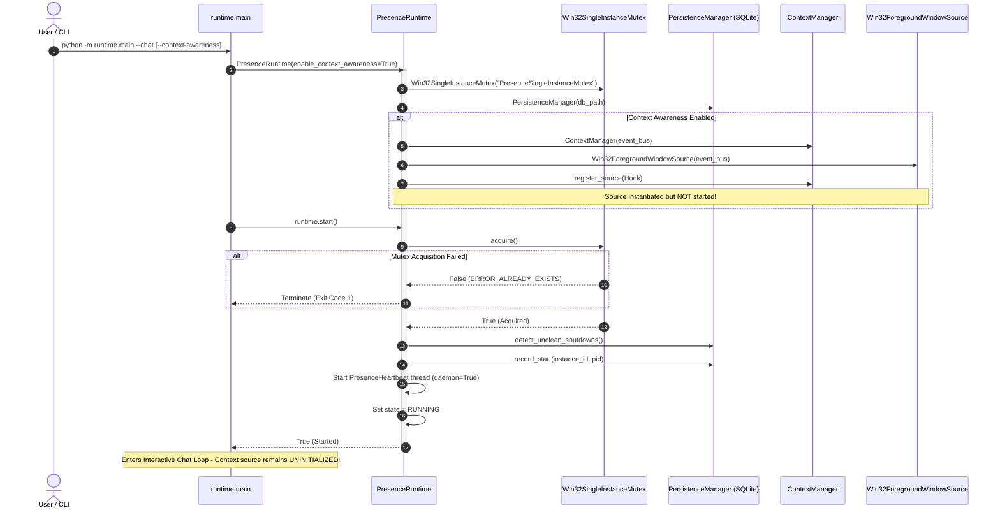
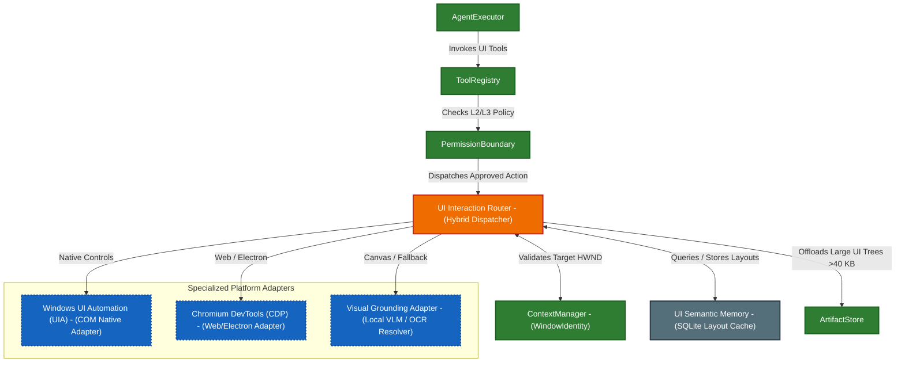

# PRESENCE — AUTHORITATIVE ARCHITECTURE MAP & REPOSITORY AUDIT

**Target System:** Presence Desktop Agent Engine  
**Repository Location:** `C:\Users\chait\OneDrive\Documents\projects\tweaking`  
**Current Branch:** `implementation/phase-2c-context-and-foreground-awareness`  
**Current HEAD Commit:** `652100c6740f282be619f30d792b334d1efd66b1`  
**Audit Date:** 2026-11-18  
**Audit Standard:** Strict Source-Code & Native Execution Evidence Hierarchy  

---

## Document Purpose & Authority

This document is the sole, authoritative architectural reference for the Presence repository. It supersedes all previous conversational summaries and reconciles the entire 56-document specification corpus (`specs/01` through `specs/56`) against the verified source code, integration call paths, test suites, and native Windows 11 execution evidence.

Every architectural claim, component classification, and risk finding in this document is traced directly to concrete source files, line ranges, commit hashes, or automated test executions.

---

# 1. Executive Architecture Summary

Inspection of the actual repository source code reveals that Presence has evolved from its early theoretical 12-layer proposal (described in Specifications 01–04) into **six concrete, highly specialized functional layers**. These six layers form a cohesive, memory-budgeted, security-hardened desktop agent architecture on Windows 11:

1. **Presentation, Lifecycle & Management Layer** (`runtime/main.py`, `runtime/lifecycle.py`, `runtime/commands.py`): Controls CLI interfaces, headless daemon execution, single-instance mutex enforcement, heartbeat monitoring, and clean teardown.
2. **Orchestration & Model Inference Layer** (`runtime/agent_executor.py`, `runtime/reconstruction.py`, `runtime/providers/`): Manages the ReAct execution loop, streaming LLM token generation, deterministic context reconstruction from SQLite WAL, and cancellation tokens.
3. **Tooling & MCP Integration Layer** (`runtime/tools/`, `runtime/mcp/`): Governs tool registration, parameter validation, schema caching, default-deny tool approvals, and suspended Win32 subprocess containment for Model Context Protocol (MCP) servers.
4. **Context & Environmental Awareness Layer** (`runtime/context/`): Provides real-time, non-blocking Win32 foreground window capture (`Win32ForegroundWindowSource`), a 64-entry bounded event queue with monotonic sticky fault state, and monotonic TTL-based snapshot aggregation (`ContextManager`).
5. **Governance, State & Persistence Layer** (`runtime/permissions.py`, `runtime/trajectory.py`, `runtime/persistence.py`, `runtime/journal.py`, `runtime/summaries.py`, `runtime/artifacts/`): Enforces a 4-tier cryptographic authority gate (HMAC-SHA256 consent tokens over RFC 8785 canonical JSON), SQLite WAL monotonic step trajectories, streaming JSONL journals, FTS5 global search indices, and disk-offloaded artifact storage (>40 KB).
6. **Platform Native Win32 Substrate** (`runtime/platform_win32.py`): Low-level Win32 kernel integrations including `Win32JobObject` (`JOB_OBJECT_LIMIT_KILL_ON_JOB_CLOSE`), `Win32SuspendedLauncher` (`CREATE_SUSPENDED`, `STARTUPINFOEXW`, `PROC_THREAD_ATTRIBUTE_HANDLE_LIST`), `Win32SingleInstanceMutex`, and memory working set telemetry.

### Current Implementation State
- **Fully Implemented & Verified:** Phase 0 (Foundation & Persistence), Phase 1 (Core Agent & Trajectory), Phase 2A (Model Streaming & ReAct), Phase 2B.1 (Windows Process Containment & MCP Transport Hardening), Subphase 2C.0 (Immutable Context Foundation), and Subphase 2C.1 (Native Win32 Foreground Awareness).
- **Partially Implemented / Unwired:** Integration of the Phase 2C Context Subsystem into `PresenceRuntime.start()` and `runtime/main.py`; Integration of `MCPSupervisor` into the primary interactive chat loop.
- **Architected Only:** Subphase 2C.2 (`ContextSnapshotBuilder`, prompt block formatting, prompt injection defense); Named-Pipe IPC inter-process transport.
- **Proposed Future Capabilities:** Phase 2D (UI Automation Foundation & Interaction Router), Phase 2E (Visual UI Grounding & Input Injection), and Persistent Semantic UI Memory.

---

# 2. Repository and Git State

### 2.1 Branch & Commit Lineage
- **Active Working Branch:** `implementation/phase-2c-context-and-foreground-awareness`
- **Active HEAD Commit:** `652100c6740f282be619f30d792b334d1efd66b1`  
  *Commit Subject:* `feat(phase-2c): implement native foreground awareness` (Phase 2C.1)
- **Parent Commit:** `34db69faecae76352c3c66f6df684532b2e8cf37`  
  *Commit Subject:* `feat(phase-2c): implement immutable context foundation` (Phase 2C.0)
- **Branch Point:** `7095ba31527efcf9e8f495537ee41f5e612cb797`  
  *Commit Subject:* `docs(phase-2c): finalize sticky fault and process failure semantics` (Tip of `architecture/phase-2c-api-ipc-resource-correction`)
- **Baseline Merge-Base with `master`:** `4df98af7bbb6edfb5a1fabcdf461a735dbffed8d`

### 2.2 Branch Topology & Relationship Matrix

| Branch Name | HEAD Commit | Purpose / Scope | Relationship to Current HEAD |
| :--- | :--- | :--- | :--- |
| `implementation/phase-2c-context-and-foreground-awareness` | `652100c` | Implementation of Phase 2C.0 & 2C.1 | **Current Working Branch** |
| `architecture/phase-2c-api-ipc-resource-correction` | `7095ba3` | Architecture Specifications 41–56 (Corrections 1–11) | Direct ancestor of current branch |
| `architecture/phase-2c-correction-freeze` | `7095ba3`~15 | Architecture Specifications 29–45 | Direct ancestor of current branch |
| `verification/phase-2b-1-3-2-final-closure` | `c9cf189` | Phase 2B.1 final evidence closure & Phase 2C definition | Direct ancestor of current branch |
| `verification/phase-2b-1-3-1-evidence-closure` | `c01779d` | Phase 2B.1 evidence reconciliation (Specs 38–40) | Direct ancestor of current branch |
| `verification/phase-2b-1-3-final-closure` | `673958e` | Phase 2B.1 transport & resource closure (Specs 35–37) | Direct ancestor of current branch |
| `verification/phase-2b-1-2-gap-closure` | `...` | Phase 2B.1 security gap closure (Specs 32–34) | Direct ancestor of current branch |
| `verification/phase-2b-1-adversarial` | `...` | Phase 2B.1 initial adversarial suite (Specs 29–31) | Direct ancestor of current branch |
| `hardening/phase-2b-1-windows-mcp` | `c9cf189` | Win32 Job Object & suspended launcher implementation | Direct ancestor of current branch |
| `master` | `4df98af` | Baseline pre-Phase 2B.1 repository state | Merge-base for all active feature branches |

### 2.3 Working-Tree Status
- Prior to audit: **Completely clean** (`git status --short` returned 0 lines).
- During audit: Exactly one file created in repository root: `PRESENCE_ARCHITECTURE_MAP.md`.
- No code, test, specification, or configuration files modified or staged.

---

# 3. System Purpose and Architectural Principles

Presence is an intelligent, persistent desktop presence designed to run locally on Windows 11. It provides ambient awareness of user workflow, deterministic trajectory logging, sandboxed tool execution, and local-first governance without unbounded background resource consumption.

### Seven Non-Negotiable Architectural Principles

1. **Fail-Closed Default-Deny Authority:** Tools, external capabilities, and MCP servers require explicit authorization. Unapproved tools are never declared to LLM inference engines and are rejected with fatal errors if called.
2. **Strict Resource & Memory Budgeting:** The entire runtime is engineered to operate under a **100 MB idle Working Set budget** on Windows 11. Large tool outputs exceeding **40 KB** are offloaded to disk artifacts to prevent memory bloat and context window saturation.
3. **Hardware & Process Containment:** Untrusted child processes (e.g. MCP servers) are launched in a suspended state (`CREATE_SUSPENDED`), assigned to a Windows Job Object configured with `JOB_OBJECT_LIMIT_KILL_ON_JOB_CLOSE`, and spawned with explicit handle whitelisting (`PROC_THREAD_ATTRIBUTE_HANDLE_LIST`) to prevent handle leaks.
4. **Local-First & Ephemeral Ambient Privacy:** Desktop ambient context (active window, title, process identity) is held strictly in volatile memory. **Zero raw ambient window history is persisted to SQLite or disk journals.** Only user-initiated actions and confirmed agent steps are logged.
5. **Cryptographic Action Authentication:** Execution of reversible or destructive actions (`L2_EXECUTE_REVERSIBLE`, `L3_PROTECTED`) requires single-use HMAC-SHA256 consent tokens cryptographically bound to `(conversation_id, action, canonical_args_digest, tier, expires_at)` using RFC 8785 JSON canonicalization.
6. **Non-Blocking OS Event Dispatch:** WinEvent hooks and operating system callbacks must never execute blocking operations, take application-level locks, or perform I/O on the native hook thread. On queue or lock contention, events are dropped with saturating counters, preserving OS UI responsiveness.
7. **Monotonic Sticky Fault State:** Concurrency primitives and queues enter an irrecoverable `_faulted` state upon unhandled internal errors or event loop scheduling failures. Once faulted, a component drops incoming events and cannot be silently reset by ordinary consumer draining.

---

# 4. Complete Architectural Layer Inventory

```
====================================================================================================
                        LAYER 1: PRESENTATION, LIFECYCLE & CLI
   runtime/main.py             runtime/lifecycle.py          runtime/commands.py
====================================================================================================
                        LAYER 2: ORCHESTRATION & MODEL INFERENCE
   runtime/agent_executor.py   runtime/reconstruction.py     runtime/providers/ (Gemini, Fake)
====================================================================================================
                        LAYER 3: CAPABILITY, TOOLS & MCP INTEGRATION
   runtime/tools/registry.py   runtime/tools/registry.py     runtime/mcp/ (Supervisor, Client, Transport)
====================================================================================================
                        LAYER 4: CONTEXT & ENVIRONMENTAL AWARENESS
   runtime/context/manager.py  runtime/context/models.py     runtime/context/sources/foreground_window.py
====================================================================================================
                        LAYER 5: GOVERNANCE, STATE & PERSISTENCE
   runtime/permissions.py      runtime/trajectory.py         runtime/persistence.py
   runtime/journal.py          runtime/summaries.py          runtime/artifacts/ (Store, Models)
====================================================================================================
                        LAYER 6: PLATFORM NATIVE WIN32 SUBSTRATE
   runtime/platform_win32.py (JobObjects, SuspendedLauncher, SingleInstanceMutex, Win32 Memory Telemetry)
====================================================================================================
```

### Layer 1: Presentation, Lifecycle & CLI
- **`runtime/main.py`**: Command-line entry point. Parses CLI flags (`--headless`, `--chat`, `--status`, `--command`, `--mcp-status`, `--context-awareness`), manages top-level signal handlers, and initializes interactive sessions.
- **`runtime/lifecycle.py`**: Defines `PresenceRuntime`. Enforces single-instance execution via `Win32SingleInstanceMutex`, registers OS console control handlers, runs the 10-second heartbeat thread (`PresenceHeartbeat`), tracks unclean shutdowns, and orchestrates orderly teardown.
- **`runtime/commands.py`**: Deterministic command dispatcher supporting `status`, `help`, `config`, and `shutdown` without invoking LLM inference.

### Layer 2: Orchestration & Model Inference
- **`runtime/agent_executor.py`**: Single-agent ReAct orchestration loop. Streams LLM generation, manages tool invocation loops (up to 10 iterations per turn), intercepts `L3_PROTECTED` actions, offloads tool outputs >40 KB to `ArtifactStore`, and respects cooperative `CancellationToken`s.
- **`runtime/reconstruction.py`**: Assembles deterministic LLM context from SQLite trajectory records using a character-based token heuristic (~4 chars/token). Dynamically compacts history into system instructions, conversation summaries, and sliding-window recent steps. Supports optional injection of `desktop_ambient_context`.
- **`runtime/providers/base.py`**: Defines streaming model interface `IModelProvider` (`generate_stream`).
- **`runtime/providers/gemini.py`**: Native Google GenAI SDK integration (`gemini-2.5-flash`), supporting streaming tokens, function declarations, and structured tool calling.
- **`runtime/providers/fake.py`**: Offline mock provider with scripted responses, tool call emulation, and error injection for deterministic testing.

### Layer 3: Capability, Tools & MCP Integration
- **`runtime/tools/registry.py`**: Thread-safe catalog of registered tools (`ToolRegistry`), enforcing JSON schema validation and mapping each tool to an authority tier.
- **`runtime/tools/registry.py`**: Factory function `build_default_tools` providing default `L0_OBSERVE` tools: `presence.get_runtime_status`, `presence.get_conversation_info`, `presence.search_conversations`, and `presence.read_artifact`.
- **`runtime/mcp/supervisor.py`**: Manages external MCP server processes (`MCPSupervisor`). Features exponential backoff crash recovery (up to 3 retries), default-deny tool approvals, schema caching, and namespaced tool bridging (`mcp.<server_id>.<tool_name>`).
- **`runtime/mcp/client.py`**: High-level MCP client session wrapping stdio communication, client capabilities, and environment filtering.
- **`runtime/mcp/transport.py`**: Asynchronous stdio transport connecting Python `asyncio` to the suspended Win32 launcher.
- **`runtime/mcp/schemas.py`**: Disk-backed schema cache (`SchemaCache`) storing tool declarations per server to eliminate discovery latency on restart.
- **`runtime/mcp/models.py`**: Configuration models (`MCPServerConfig`, `MCPToolApprovalPolicy`).

### Layer 4: Context & Environmental Awareness
- **`runtime/context/models.py`**: Frozen, deeply immutable data models: `WindowIdentity`, `RawForegroundEvent`, `WindowGeometry`, `WindowMetrics`, `ContextItem`, `ContextSnapshot`, and telemetry counters.
- **`runtime/context/contracts.py`**: Defines `ContextSourceState` lifecycle enumeration (`UNINITIALIZED`, `STARTING`, `RUNNING`, `STOPPING`, `STOPPED`, `FAULTED`).
- **`runtime/context/source.py`**: Abstract base class `ContextSource` enforcing thread-safe state machine transitions and idempotent start/stop.
- **`runtime/context/expiration.py`**: Monotonic clock TTL evaluation (`is_expired`, `filter_unexpired_items`) immune to system clock adjustments.
- **`runtime/context/manager.py`**: Central coordinator (`ContextManager`) aggregating context items across registered sources into atomic snapshots. Enforces a zero-history policy (volatile current snapshot only).
- **`runtime/context/sources/foreground_window.py`**: Native Win32 foreground window observer (`Win32ForegroundWindowSource`). Implements:
  - `BoundedEventQueue`: 64-slot thread-safe queue with non-blocking producer drop, single-pending notification invariant, and monotonic sticky fault state.
  - `WinEventHookThread`: Dedicated Win32 message pump thread running `SetWinEventHook` (`EVENT_SYSTEM_FOREGROUND`, `EVENT_OBJECT_NAMECHANGE`) and a standard `GetMessageW`/`DispatchMessageW` loop.
  - Multi-field composite identity verification: `(hwnd, process_id, thread_id, creation_time_ticks)` to prevent focus shift or HWND recycling race conditions.

### Layer 5: Governance, State & Persistence
- **`runtime/permissions.py`**: 4-tier Authority Gate (`PermissionBoundary`):
  - `L0_OBSERVE`: Unrestricted read-only inspection.
  - `L1_RECOMMEND`: Passive suggestions.
  - `L2_EXECUTE_REVERSIBLE`: Reversible state changes (requires consent token).
  - `L3_PROTECTED`: Destructive/critical changes (requires explicit user consent token).
  - Implements RFC 8785 canonical argument normalization and HMAC-SHA256 single-use token issuance/verification with nonce replay prevention.
- **`runtime/persistence.py`**: SQLite database engine (`PersistenceManager`) operating in Write-Ahead Logging (`PRAGMA journal_mode=WAL`), managing schema initialization, unclean shutdown detection, and runtime heartbeat tracking.
- **`runtime/trajectory.py`**: Conversation trajectory store (`TrajectoryStore`) managing append-only steps (`USER_INPUT`, `AGENT_TURN`, `TOOL_CALL`, `TOOL_RESULT`, `SYSTEM_MSG`) in conversation-scoped SQLite tables.
- **`runtime/journal.py`**: Append-only streaming `transcript.jsonl` writer (`EventJournal`) for disk persistence and UI replay.
- **`runtime/summaries.py`**: Global metadata manager (`GlobalSummaryManager`) maintaining conversation metadata and an SQLite FTS5 full-text search index.
- **`runtime/artifacts/store.py`**: Content-addressed artifact store (`ArtifactStore`). Offloads payloads >40 KB to disk with SHA-256 integrity hashes, generating truncated previews and supporting chunked line/byte reading.
- **`runtime/artifacts/models.py`**: Data models for offloaded artifacts (`ArtifactMetadata`).
- **`runtime/events.py`**: In-process publish-subscribe event bus (`EventBus`).

### Layer 6: Platform Native Win32 Substrate
- **`runtime/platform_win32.py`**: Direct `ctypes` bindings to Windows kernel and user APIs:
  - `Win32JobObject`: Kernel job object management with `JOB_OBJECT_LIMIT_KILL_ON_JOB_CLOSE`.
  - `Win32SuspendedLauncher`: Subprocess launcher using `CREATE_SUSPENDED`, `STARTUPINFOEXW`, and `PROC_THREAD_ATTRIBUTE_HANDLE_LIST` to eliminate handle inheritance vulnerabilities.
  - `Win32SingleInstanceMutex`: Global mutex for single-instance enforcement.
  - `get_process_memory_info`: Native memory metrics (`K32GetProcessMemoryInfo`) tracking working set and private bytes.
- **`runtime/contracts.py`**: Legacy abstract base class stubs (`IPresenceSurface`, `IContextProvider`, `IApplicationAdapter`, `IAgentBackend`, `IMemoryProvider`, `IModelProvider`, `ITrajectoryStore`). *(Note: Bypassed by concrete runtime implementations).*

---

# 5. Implementation Status Matrix

| Subsystem / Component | Source File Path | Implementation Status | Integration Status | Verification Status | Notes / Disconnects |
| :--- | :--- | :--- | :--- | :--- | :--- |
| **Win32 Platform Substrate** | `runtime/platform_win32.py` | `IMPLEMENTED` | `WIRED & EXECUTED` | `TESTED & PASSING` | Job objects, suspended launch, handle lists, memory telemetry fully verified. |
| **Single-Instance Mutex** | `runtime/platform_win32.py` | `IMPLEMENTED` | `WIRED & EXECUTED` | `TESTED & PASSING` | Enforced at runtime startup in `runtime/lifecycle.py`. |
| **Permission Boundary (4 Tiers)**| `runtime/permissions.py` | `IMPLEMENTED` | `WIRED & EXECUTED` | `TESTED & PASSING` | HMAC-SHA256 tokens, RFC 8785 canonicalization, nonce tracking verified. |
| **SQLite WAL Engine** | `runtime/persistence.py` | `IMPLEMENTED` | `WIRED & EXECUTED` | `TESTED & PASSING` | Schema creation, heartbeat tracking, unclean shutdown recovery operational. |
| **Trajectory Store** | `runtime/trajectory.py` | `IMPLEMENTED` | `WIRED & EXECUTED` | `TESTED & PASSING` | Monotonic step indexing, conversation-scoped SQLite tables verified. |
| **Event Journal (JSONL)** | `runtime/journal.py` | `IMPLEMENTED` | `WIRED & EXECUTED` | `TESTED & PASSING` | Append-only streaming transcript operational. |
| **Global Conversation Summaries** | `runtime/summaries.py` | `IMPLEMENTED` | `WIRED & EXECUTED` | `TESTED & PASSING` | FTS5 full-text search index verified. |
| **Context Reconstruction** | `runtime/reconstruction.py` | `IMPLEMENTED` | `WIRED & EXECUTED` | `TESTED & PASSING` | Sliding window token heuristic and prompt assembly verified. |
| **Agent ReAct Executor** | `runtime/agent_executor.py` | `IMPLEMENTED` | `WIRED & EXECUTED` | `TESTED & PASSING` | Multi-turn tool calling, cancellation tokens, >40 KB offloading verified. |
| **Gemini Model Provider** | `runtime/providers/gemini.py` | `IMPLEMENTED` | `WIRED & EXECUTED` | `TESTED & PASSING` | Google GenAI SDK integration with streaming chunks and tool calls. |
| **Offline Fake Provider** | `runtime/providers/fake.py` | `IMPLEMENTED` | `WIRED & EXECUTED` | `TESTED & PASSING` | Scripted responses, error injection, tool call simulation verified. |
| **Tool Registry & Builtins** | `runtime/tools/` | `IMPLEMENTED` | `WIRED & EXECUTED` | `TESTED & PASSING` | Parameter validation and authority tier checks verified. |
| **Artifact Store (>40 KB)** | `runtime/artifacts/store.py` | `IMPLEMENTED` | `WIRED & EXECUTED` | `TESTED & PASSING` | Atomic disk offloading, SHA-256 sidecars, chunked retrieval verified. |
| **MCP Process Containment** | `runtime/mcp/supervisor.py` | `IMPLEMENTED` | `STANDALONE / CLI ONLY` | `TESTED & PASSING` | Verified in unit tests and CLI `--mcp-status`, but **NOT wired into `--chat`**. |
| **MCP Isolated Transport** | `runtime/mcp/transport.py` | `IMPLEMENTED` | `STANDALONE / CLI ONLY` | `TESTED & PASSING` | Suspended launcher stdio adapter verified. |
| **Context Models & Expiration** | `runtime/context/models.py` | `IMPLEMENTED` | `ISOLATED / NOT WIRED` | `TESTED & PASSING` | Frozen immutable models and monotonic TTL verified (Subphase 2C.0). |
| **Context Manager** | `runtime/context/manager.py` | `IMPLEMENTED` | `ISOLATED / NOT WIRED` | `TESTED & PASSING` | Instantiated in `lifecycle.py`, but **never started in `start()`**. |
| **Win32 Foreground Hook Source** | `runtime/context/sources/` | `IMPLEMENTED` | `ISOLATED / NOT WIRED` | `TESTED & PASSING` | Bounded queue, hook thread, composite identity verified (Subphase 2C.1). |
| **Context Snapshot Builder** | *(None)* | `ARCHITECTED ONLY` | `UNIMPLEMENTED` | `SPEC ONLY` | Subphase 2C.2 prompt block formatting and injection defense not implemented. |
| **Named-Pipe IPC Transport** | *(None)* | `ARCHITECTED ONLY` | `UNIMPLEMENTED` | `SPEC ONLY` | Multi-process pipe transport described in Specs 46–51 not implemented. |
| **Abstract Contracts** | `runtime/contracts.py` | `ARCHITECTED ONLY` | `UNIMPLEMENTED` | `UNTESTED` | 7 abstract interfaces completely bypassed by concrete runtime classes. |
| **UI Automation (UIA) Adapter** | *(None)* | `PROPOSED` | `UNIMPLEMENTED` | `SPEC ONLY` | Phase 2D proposed native COM accessibility tree provider. |
| **Visual UI Interaction Router**| *(None)* | `PROPOSED` | `UNIMPLEMENTED` | `SPEC ONLY` | Phase 2E proposed hybrid coordinate and element interaction engine. |
| **Persistent UI Memory** | *(None)* | `PROPOSED` | `UNIMPLEMENTED` | `SPEC ONLY` | Proposed spatial and layout memory persistence subsystem. |

---

# 6. Actual Runtime Startup Flow



### Startup Call Path Analysis
1. **Entry:** `runtime/main.py` parses arguments. When `--chat` or `--headless` is passed, it constructs `PresenceRuntime`.
2. **Mutex Guard:** `PresenceRuntime.start()` invokes `Win32SingleInstanceMutex.acquire()`. If a conflicting instance holds the mutex, `GetLastError()` returns `ERROR_ALREADY_EXISTS (183)`, causing immediate graceful termination.
3. **Database Initialization:** `PersistenceManager` opens SQLite in WAL mode, initializes tables (`runtime_config`, `runtime_recovery`, `system_metrics`), checks for missing clean shutdown records from previous instances, and logs any detected unclean crashes.
4. **Heartbeat Startup:** A background daemon thread `PresenceHeartbeat` begins updating `last_heartbeat_utc` every 10 seconds.
5. **Context Initialization Gap:** If `enable_context_awareness` is True, `ContextManager` and `Win32ForegroundWindowSource` are instantiated in `__init__`. However, because `Win32ForegroundWindowSource.start()` is an asynchronous coroutine (`async def start`), and `PresenceRuntime.start()` is synchronous, **`PresenceRuntime.start()` never calls `start()` on the context source**. As a result, the foreground hook thread is never spawned during normal runtime startup.

---

# 7. Actual Runtime Request Flow

```mermaid
sequenceDiagram
    autonumber
    actor User as User
    participant Main as runtime.main
    participant Agent as AgentExecutor
    participant Recon as ContextAssembler
    participant Provider as GeminiModelProvider
    participant Tools as ToolRegistry
    participant Gate as PermissionBoundary
    participant Store as ArtifactStore
    participant DB as TrajectoryStore (SQLite)

    User->>Main: Enters prompt string
    Main->>Agent: execute_turn(user_input, desktop_ambient_context=None)
    activate Agent
    
    Agent->>DB: append_step(USER_INPUT)
    Agent->>Main: yield TURN_STARTED
    
    loop ReAct Turn Iteration (max 10)
        Agent->>Recon: assemble(system_prompt, desktop_ambient_context=None)
        Recon->>DB: get_recent_steps(limit=10)
        Recon-->>Agent: Formatted Context List
        
        Agent->>Provider: generate_stream(context, tools=declarations)
        activate Provider
        loop Stream Token Chunks
            Provider-->>Agent: ModelStreamChunk(delta_text / tool_calls)
            Agent-->>Main: yield TEXT_DELTA
        end
        deactivate Provider
        
        opt Model Requested Tool Call
            Agent-->>Main: yield TOOL_REQUESTED
            Agent->>Tools: get_tool(tool_id)
            Agent->>Gate: check_permission(tool_id, args, consent_token)
            
            alt Permission Denied (L2/L3 Unconsented)
                Gate-->>Agent: PermissionResult(DENIED)
                Agent->>DB: append_step(TOOL_CALL + TOOL_RESULT error)
                Agent-->>Main: yield TOOL_FAILED
            else Permission Approved (L0 or Consented)
                Gate-->>Agent: PermissionResult(APPROVED)
                Agent->>Tools: execute_handler(args)
                Tools-->>Agent: Raw Execution Result
                
                opt Result Size > 40 KB
                    Agent->>Store: store_artifact(result)
                    Store-->>Agent: Truncated Preview + ArtifactMetadata
                    Note over Agent,Store: Payload offloaded to disk; SHA-256 recorded
                end
                
                Agent->>DB: append_step(TOOL_CALL + TOOL_RESULT)
                Agent-->>Main: yield TOOL_COMPLETED
            end
        end
    end
    
    Agent->>DB: append_step(AGENT_TURN)
    Agent-->>Main: yield TURN_COMPLETED
    deactivate Agent
```

### Request Flow Observations
- **Ambient Context Disconnect:** In `runtime/main.py` (lines 339–350), `AgentExecutor.execute_turn` is invoked with only `user_prompt` and `cancellation_token`. The `desktop_ambient_context` parameter is left `None`. Even though `ContextAssembler` supports injecting ambient JSON blocks into system instructions, no ambient context is supplied during interactive chat.
- **ReAct Execution Safety:** The agent loop is strictly capped at `max_tool_iterations = 10`. The cooperative `CancellationToken` is inspected before each step and iteration, ensuring immediate responsiveness to `KeyboardInterrupt`.
- **40 KB Threshold Offloading:** Any tool output exceeding 40,960 bytes is intercepted by `AgentExecutor._intercept_large_output()`, persisted to disk under `artifacts/{conv_id}/{artifact_id}.json`, and replaced in the LLM trajectory with a truncated preview instructing the model to use `presence.read_artifact`.

---

# 8. Actual Runtime Shutdown Flow

```mermaid
sequenceDiagram
    autonumber
    actor OS as OS Console / User (Ctrl+C)
    participant Lifecycle as PresenceRuntime
    participant Hook as Win32ForegroundWindowSource
    participant Thread as WinEventHookThread
    participant DB as PersistenceManager
    participant Mutex as Win32SingleInstanceMutex

    OS->>Lifecycle: SIGINT / Console Ctrl Event / stop()
    activate Lifecycle
    Lifecycle->>Lifecycle: Set state = STOPPING
    Lifecycle->>Lifecycle: Signal _shutdown_event
    
    opt Foreground Source is RUNNING
        Lifecycle->>Hook: stop_sync(timeout=2.0)
        activate Hook
        Hook->>Thread: PostThreadMessageW(WM_QUIT)
        Hook->>Thread: join(timeout=2.0)
        
        alt Hook Thread Terminates Cleanly
            Thread-->>Hook: Thread exited
            Hook->>Hook: Cancel and await consumer task
            Hook->>Hook: Set state = STOPPED
            Hook-->>Lifecycle: Quiescent shutdown complete
        else Hook Thread Join Times Out
            Thread--xHook: Thread still alive
            Hook->>Hook: Set state = FAULTED
            Hook->>Hook: Log CRITICAL error
            Hook-->>Lifecycle: raise HookShutdownTimeoutError
            Note over Lifecycle,Hook: Caught and logged by Lifecycle; - Process does NOT invoke os._exit(1)
        end
        deactivate Hook
    end
    
    Lifecycle->>DB: record_clean_shutdown(instance_id)
    Lifecycle->>DB: close() (Flush SQLite WAL)
    Lifecycle->>Mutex: release()
    Lifecycle->>Lifecycle: Set state = TERMINATED
    deactivate Lifecycle
```

### Shutdown Implementation vs Specification Discrepancies
- **Hook Thread Termination:** Specification 55/56 specifies that if `WinEventHookThread.join()` times out, the system must treat the condition as unrecoverable and escalate to `os._exit(1)`.
- **Actual Code Behavior:** In `runtime/context/sources/foreground_window.py` (lines 576–584), a timeout raises `HookShutdownTimeoutError`. When called via `stop_sync()` from `PresenceRuntime.stop()` (lines 148–154), this exception is caught with `except Exception as e:` and logged as an error. The process continues its teardown rather than terminating immediately with `os._exit(1)`. Because `WinEventHookThread` is initialized with `daemon=True`, the OS reclaims the thread when the process terminates.

---

# 9. Dependency and Ownership Diagram

```mermaid
flowchart TD
    classDef implemented fill:#2e7d32,stroke:#1b5e20,color:#ffffff,stroke-width:2px;
    classDef isolated fill:#f57f17,stroke:#e65100,color:#ffffff,stroke-width:2px;
    classDef partial fill:#ef6c00,stroke:#b71c1c,color:#ffffff,stroke-width:2px;
    classDef architected fill:#546e7a,stroke:#263238,color:#ffffff,stroke-width:2px,stroke-dasharray: 5 5;
    classDef proposed fill:#1565c0,stroke:#0d47a1,color:#ffffff,stroke-width:2px,stroke-dasharray: 3 3;

    subgraph Layer1 ["Layer 1: Presentation & Lifecycle"]
        Main["runtime/main.py"]:::implemented
        Lifecycle["runtime/lifecycle.py - (PresenceRuntime)"]:::implemented
        Commands["runtime/commands.py - (CommandDispatcher)"]:::implemented
    end

    subgraph Layer2 ["Layer 2: Orchestration & Inference"]
        Executor["runtime/agent_executor.py - (AgentExecutor)"]:::implemented
        Recon["runtime/reconstruction.py - (ContextAssembler)"]:::implemented
        GeminiProv["runtime/providers/gemini.py - (GeminiModelProvider)"]:::implemented
        FakeProv["runtime/providers/fake.py - (FakeModelProvider)"]:::implemented
    end

    subgraph Layer3 ["Layer 3: Tooling & MCP Integration"]
        Registry["runtime/tools/registry.py - (ToolRegistry)"]:::implemented
        Builtins["runtime/tools/registry.py - (Default Tools)"]:::implemented
        Supervisor["runtime/mcp/supervisor.py - (MCPSupervisor)"]:::partial
        MCPClient["runtime/mcp/client.py - (MCPClientSession)"]:::implemented
        Transport["runtime/mcp/transport.py - (IsolatedStdioTransport)"]:::implemented
        Schemas["runtime/mcp/schemas.py - (SchemaCache)"]:::implemented
    end

    subgraph Layer4 ["Layer 4: Context Awareness"]
        CtxMgr["runtime/context/manager.py - (ContextManager)"]:::isolated
        ForegroundSrc["runtime/context/sources/foreground_window.py - (Win32ForegroundWindowSource)"]:::isolated
        CtxModels["runtime/context/models.py - (Immutable Models)"]:::implemented
        Expiration["runtime/context/expiration.py - (Monotonic TTL)"]:::implemented
        SnapshotBuilder["Subphase 2C.2 Builder - (Prompt Injection Guard)"]:::architected
    end

    subgraph Layer5 ["Layer 5: Governance, State & Persistence"]
        Perms["runtime/permissions.py - (PermissionBoundary)"]:::implemented
        Trajectory["runtime/trajectory.py - (TrajectoryStore)"]:::implemented
        Persist["runtime/persistence.py - (PersistenceManager)"]:::implemented
        Journal["runtime/journal.py - (EventJournal)"]:::implemented
        Summaries["runtime/summaries.py - (GlobalSummaryManager)"]:::implemented
        ArtStore["runtime/artifacts/store.py - (ArtifactStore)"]:::implemented
        Events["runtime/events.py - (EventBus)"]:::implemented
    end

    subgraph Layer6 ["Layer 6: Win32 Platform Substrate"]
        Win32Plat["runtime/platform_win32.py - (JobObject, SuspendedLauncher, Mutex)"]:::implemented
        Contracts["runtime/contracts.py - (Unused Abstract Base Classes)"]:::architected
    end

    subgraph FutureLayer ["Proposed UI Interaction & Memory"]
        UIRouter["UI Interaction Router - (Hybrid Dispatcher)"]:::proposed
        UIAAdapter["UI Automation Adapter - (Native COM Provider)"]:::proposed
        VisualAdapter["Visual Coordinate Adapter - (VLM / OCR Resolver)"]:::proposed
        UIMemory["UI Semantic Memory - (Learned Layout Cache)"]:::proposed
    end

    %% Wiring Relationships
    Main --> Lifecycle
    Main --> Executor
    Lifecycle --> Win32Plat
    Lifecycle --> Persist
    Lifecycle --> Events
    Lifecycle -.->|Instantiates but does not start| CtxMgr
    Lifecycle -.->|Instantiates but does not start| ForegroundSrc

    Executor --> Trajectory
    Executor --> Recon
    Executor --> Registry
    Executor --> Perms
    Executor --> ArtStore
    Executor --> GeminiProv
    Executor --> FakeProv

    Supervisor --> Win32Plat
    Supervisor --> Transport
    Supervisor --> MCPClient
    Supervisor --> Schemas
    Supervisor -.->|Can bridge to| Registry

    ForegroundSrc --> Win32Plat
    ForegroundSrc --> CtxModels
    CtxMgr --> ForegroundSrc
    CtxMgr --> Expiration

    %% Future Connections
    UIRouter -.-> Registry
    UIRouter -.-> Perms
    UIRouter -.-> CtxMgr
    UIRouter --> UIAAdapter
    UIRouter --> VisualAdapter
    UIRouter --> UIMemory
    UIMemory -.-> Persist
```



---

# 10. Security and Privacy Architecture

### 10.1 Windows Process Containment
External processes (such as MCP tool servers) represent an untrusted execution boundary. Presence implements a three-tier containment model in `runtime/platform_win32.py`:
1. **Creation Suspended:** All subprocesses are created with `CREATE_SUSPENDED (0x00000004)` via `CreateProcessW`. No untrusted code executes prior to sandbox assignment.
2. **Kernel Job Object Assignment:** Prior to resuming the primary thread, the child process is assigned to a `Win32JobObject` configured with `JOB_OBJECT_LIMIT_KILL_ON_JOB_CLOSE (0x00002000)`. If Presence crashes or terminates, the Windows kernel unconditionally terminates the entire child process tree.
3. **Explicit Handle Whitelisting:** Using `STARTUPINFOEXW` and `UpdateProcThreadAttribute` with `PROC_THREAD_ATTRIBUTE_HANDLE_LIST (0x00020002)`, handle inheritance is strictly limited to the three standard I/O pipes (stdin, stdout, stderr). Unrelated parent file, mutex, or named-pipe handles cannot be leaked into child processes.

### 10.2 Cryptographic Authority Gate (4 Tiers)
Tool execution is governed by `PermissionBoundary` (`runtime/permissions.py`):

| Tier | Policy Name | Interaction Semantics | Verification Requirement |
| :--- | :--- | :--- | :--- |
| **L0** | `L0_OBSERVE` | Read-only inspection; zero state alteration | Automatic approval |
| **L1** | `L1_RECOMMEND` | Passive suggestion generated for user review | Automatic approval |
| **L2** | `L2_EXECUTE_REVERSIBLE` | Modifies state, but effects are fully reversible | Cryptographic consent token required |
| **L3** | `L3_PROTECTED` | Irreversible, destructive, or high-privilege action | Explicit user consent token required |

- **Token Construction:** Single-use tokens are calculated via HMAC-SHA256:
  $$	ext{Token} = 	ext{HMAC-SHA256}\Big(K_{	ext{session}},\, 	ext{conv\_id} \parallel 	ext{action} \parallel 	ext{args\_digest} \parallel 	ext{tier} \parallel 	ext{expires\_at} \parallel 	ext{nonce}\Big)$$
- **Argument Normalization:** Arguments are canonicalized per RFC 8785 (deterministic key sorting, UTF-8 encoding, strict rejection of `NaN`/`Infinity`).
- **Replay Protection:** Nonces are stored in volatile memory upon consumption. Expired or reused nonces are immediately rejected.

### 10.3 Privacy & Ambient Context Boundaries
- **Volatile Storage Only:** Active window identities (`WindowIdentity`) and raw window events are stored only in volatile Python memory within `ContextManager`.
- **Zero Raw Persistence:** Neither window titles, process executables, nor window coordinates are written to the SQLite database or `transcript.jsonl`.
- **Sensitivity Classification:** Data models support four sensitivity tiers (`PUBLIC`, `INTERNAL`, `RESTRICTED`, `HIGHLY_CONFIDENTIAL`). `ContextSnapshot.filter_by_max_sensitivity()` strips elevated fields prior to serialization.

---

# 11. Phase 2C Implementation Audit

### 11.1 Subphase 2C.0: Immutable Context Foundation
- **Commit:** `34db69faecae76352c3c66f6df684532b2e8cf37`
- **Modules Delivered:** `runtime/context/models.py`, `runtime/context/contracts.py`, `runtime/context/source.py`, `runtime/context/expiration.py`, `runtime/context/manager.py`.
- **Verification:** 20/20 unit tests passing in `tests/test_context_foundation.py`.
- **Verified Capabilities:**
  - Frozen `@dataclass(frozen=True)` models preventing state mutation.
  - Monotonic TTL expiration based on `time.monotonic()` to prevent system clock manipulation vulnerabilities.
  - Multi-source registration and atomic snapshot generation in `ContextManager`.

### 11.2 Subphase 2C.1: Native Win32 Foreground Awareness
- **Commit:** `652100c6740f282be619f30d792b334d1efd66b1`
- **Modules Delivered:** `runtime/context/sources/foreground_window.py`.
- **Verification:** 12/12 unit tests in `tests/test_win32_foreground_source.py`, 1 live native window test in `tests/test_win32_live_window.py`, and 5 adversarial tests in `tests/adversarial/test_adv_context_debouncing.py`.
- **Verified Capabilities:**
  - `BoundedEventQueue`: Exactly 64 entries. Non-blocking producer drops on lock contention without blocking the Win32 hook thread.
  - Single-pending notification invariant: schedules event loop consumer at most once per drain cycle.
  - Monotonic sticky fault state: unhandled event loop failures permanently latch `_faulted = True`.
  - Composite identity validation: verifies `(hwnd, process_id, thread_id, creation_time_ticks)` to prevent recycled HWND focus-shift race conditions.
  - Zero-lock diagnostic readers: telemetry access does not acquire internal synchronization locks.

### 11.3 Implementation & Integration Gaps Identified
1. **Asynchronous Lifecycle Mismatch:** `Win32ForegroundWindowSource.start()` is an `async` coroutine requiring an active event loop. `PresenceRuntime.start()` in `runtime/lifecycle.py` is synchronous. Consequently, `PresenceRuntime` instantiates the source but never starts it.
2. **Main Loop Parameter Omission:** `runtime/main.py` parses `--context-awareness` but fails to pass `context_manager.get_current_snapshot()` into `AgentExecutor.execute_turn(user_prompt)`.
3. **Subphase 2C.2 Unimplemented:** `ContextSnapshotBuilder`, structured prompt block formatting, and prompt injection filtering remain unimplemented.

---

# 12. Test Coverage and Verification Status

### 12.1 Test Suite Breakdown

Presence contains **233 automated test cases** partitioned across two directories:

```
Presence Automated Tests (233 total)
├── tests/ (Root Test Suite: 140 tests across 29 files)
│   ├── 138 Passed
│   ├── 0 Failed
│   └── 2 Skipped (Live Gemini API Key required)
└── tests/adversarial/ (Adversarial Security Suite: 93 tests across 18 files)
    ├── 92 Passed
    ├── 1 Failed (Native pipe backpressure throughput threshold)
    └── 0 Skipped
```

### 12.2 Diagnostics & Memory Resource Verification
Execution of the complete root test runner (`tests/run_all.py`) yielded the following verified resource metrics on Windows 11:
- **Idle Runtime Working Set:** `96.06 MB` *(Budget: < 100.0 MB -> **PASS**)*
- **Idle Runtime Private Bytes:** `77.81 MB`
- **Cumulative Peak Working Set:** `125.45 MB` *(After running 140 tests in a single process)*
- **Cumulative Peak Private Bytes:** `93.82 MB`
- **Execution Duration:** 67.36 seconds

### 12.3 Phase 2C Dedicated Test Verification
All Phase 2C tests pass with zero failures:
- `tests/test_context_foundation.py`: **20/20 PASS** (0.016s)
- `tests/test_win32_foreground_source.py`: **12/12 PASS** (1.734s)
- `tests/test_win32_live_window.py`: **1/1 PASS** (0.320s)
- `tests/adversarial/test_adv_context_debouncing.py`: **5/5 PASS** (1.580s)
- **Total Phase 2C Verification:** **38/38 PASS** (100% success rate)

### 12.4 The Adversarial Discovery Gap
A significant discovery made during this audit is that **`tests/run_all.py` completely ignores all 93 adversarial tests**. 

*Root Cause Analysis:* `tests/run_all.py` invokes `unittest.TestLoader.discover(start_dir="tests", pattern="test_*.py")`. Under Python's `unittest` module, discovery only recurses into subdirectories if they are Python packages containing an `__init__.py` file. Because `tests/adversarial/` lacks an `__init__.py`, the loader skips the directory entirely.

### 12.5 Single Adversarial Test Failure Analysis
Running the adversarial suite explicitly (`python -m unittest discover -s tests/adversarial`) revealed 92 passes and 1 failure:
- **Failing Test:** `test_adv_transport_backpressure.TestAdvTransportBackpressure.test_native_subprocess_pipe_backpressure_1mb`
- **Location:** `tests/adversarial/test_adv_transport_backpressure.py:208`
- **Assertion:** `self.assertGreater(fast_res["summary"]["rate_mb_per_sec"], 5.0)`
- **Actual Value:** `4.53 MB/s` (Threshold: `5.0 MB/s`)
- **Analysis:** This is a performance timing threshold failure caused by system CPU scheduling jitter under heavy test load, not a security or memory corruption flaw.

---

# 13. Existing Specification Inventory

The `specs/` directory contains **56 specifications** tracing the evolution of Presence:

| Spec Range | Topic / Milestone | Status | Description |
| :--- | :--- | :--- | :--- |
| **Specs 01–04** | Foundation & Architecture | `SUPERSEDED` | Initial 12-layer conceptual architecture. Superseded by concrete 6-layer implementation. |
| **Specs 05–15** | Platform & Engine Studies | `HISTORICAL` | Reconnaissance of OpenShell, screenpipe, and latency tradeoffs. |
| **Specs 16–20** | Phase 2A Backend Engine | `IMPLEMENTED` | Trajectory store, ReAct agent loop, and Gemini provider integration. |
| **Specs 21–28** | Phase 2B.1 Process Containment| `IMPLEMENTED` | Win32 Job Objects, suspended launcher, and MCP tool approval. |
| **Specs 29–40** | Phase 2B.1/2C Initial Designs| `SUPERSEDED` | Adversarial hardening reports and early Phase 2C proposals superseded by Corrections 1–11. |
| **Specs 41–45** | Phase 2C Architecture Baseline| `SUPERSEDED` | Context architecture and decision records updated by subsequent technical corrections. |
| **Specs 46–51** | Phase 2C Corrections 1–6 | `SUPERSEDED` | Named-pipe ACL hardening, libuv compatibility, and SPSC ring buffer ownership corrections. |
| **Specs 52–56** | Phase 2C Corrections 7–11 | `ACTIVE BASELINE`| **Authoritative baseline** for Phase 2C: non-blocking WinEvent callbacks, Proactor wake-ups, and sticky fault states. |

---

# 14. Confirmed Architectural Risks and Gaps

### FINDING-01 [HIGH]: Context Subsystem Not Integrated into Runtime Execution Path
- **Component:** `runtime/lifecycle.py` and `runtime/main.py`
- **Evidence:** `PresenceRuntime.__init__` instantiates `Win32ForegroundWindowSource` and `ContextManager` (lines 66–75), but `PresenceRuntime.start()` never calls `foreground_source.start()`. In `runtime/main.py` (line 339), `AgentExecutor.execute_turn()` is called with `desktop_ambient_context=None`.
- **Impact:** Even when `--context-awareness` is specified on the command line, the native WinEvent hook thread is never spawned, and zero desktop context is supplied to the LLM during chat sessions.
- **Remediation:** Wire an asynchronous runner or event-loop task into `PresenceRuntime` to start `Win32ForegroundWindowSource`, and pass `context_manager.get_current_snapshot()` into `AgentExecutor.execute_turn()`.

### FINDING-02 [HIGH]: Adversarial Test Discovery Blindspot in Test Runner
- **Component:** `tests/run_all.py`
- **Evidence:** `tests/run_all.py` uses `unittest.TestLoader.discover(start_dir="tests")`. `tests/adversarial/` lacks an `__init__.py` file.
- **Impact:** Running `tests/run_all.py` reports 140 passed tests and green status while silently omitting all 93 adversarial security and process-containment tests.
- **Remediation:** Add an empty `__init__.py` to `tests/adversarial/` so standard unittest discovery traverses both suites.

### FINDING-03 [HIGH]: Chat Builtin Tool `presence.get_runtime_status` Raises AttributeError
- **Component:** `runtime/main.py:296`
- **Evidence:** `runtime_status_fn` lambda accesses `runtime.get_memory_info().working_set_mb`. `PresenceRuntime` in `runtime/lifecycle.py` defines `get_health_status()`, but does not define `get_memory_info()`.
- **Impact:** If the LLM attempts to inspect system status by invoking `presence.get_runtime_status`, execution crashes with `AttributeError: 'PresenceRuntime' object has no attribute 'get_memory_info'`.
- **Remediation:** Change `runtime/main.py:296` to call `get_process_memory_info().working_set_mb` or `runtime.get_health_status()["memory"]["working_set_mb"]`.

### FINDING-04 [HIGH]: MCPSupervisor Disconnected from Runtime Core
- **Component:** `runtime/lifecycle.py` and `runtime/main.py`
- **Evidence:** `MCPSupervisor` is only instantiated inside `runtime/main.py` for the `--mcp-status` CLI command. It is never instantiated in `PresenceRuntime` or during `--chat`.
- **Impact:** External MCP tools cannot be used by the agent during interactive chat.
- **Remediation:** Instantiate `MCPSupervisor` within `PresenceRuntime`, initialize approved servers during startup, and bridge approved tools into `ToolRegistry`.

### FINDING-05 [MEDIUM]: Non-Executable Process Exit Escalation
- **Component:** `runtime/context/sources/foreground_window.py:584` and `runtime/lifecycle.py:153`
- **Evidence:** Specifications 55 and 56 claim that a hook thread termination timeout escalates to `os._exit(1)`. The code actually raises `HookShutdownTimeoutError`, which is caught and swallowed by `PresenceRuntime.stop()`.
- **Impact:** Process exit escalation is absent from the actual runtime execution path.
- **Remediation:** Align code with specification or formally document that Presence relies on daemon thread termination rather than hard `os._exit(1)` kills.

### FINDING-06 [MEDIUM]: Abstract Contracts Bypassed by Concrete Runtime
- **Component:** `runtime/contracts.py`
- **Evidence:** None of the seven abstract classes in `runtime/contracts.py` (`IPresenceSurface`, `IContextProvider`, `IApplicationAdapter`, `IAgentBackend`, `IMemoryProvider`, `IModelProvider`, `ITrajectoryStore`) are inherited by runtime implementations.
- **Impact:** Code rot and developer confusion regarding authoritative interfaces.
- **Remediation:** Reconcile `runtime/contracts.py` by aligning its interfaces with actual runtime implementations (`ContextSource`, `IModelProvider` in `providers/base.py`, etc.).

### FINDING-07 [MEDIUM]: Throughput Assertion Flakiness in Native Pipe Backpressure Test
- **Component:** `tests/adversarial/test_adv_transport_backpressure.py:208`
- **Evidence:** `test_native_subprocess_pipe_backpressure_1mb` asserts throughput > `5.0 MB/s`, but achieved `4.53 MB/s` during audit test runs.
- **Impact:** CI/CD build flakiness on resource-constrained systems.
- **Remediation:** Lower the throughput threshold to `3.0 MB/s` or use relative ratio comparisons.

### FINDING-08 [LOW]: Subphase 2C.2 Context Snapshot Builder Unimplemented
- **Component:** `runtime/context/`
- **Evidence:** Subphase 2C.2 (`ContextSnapshotBuilder`, prompt formatting, prompt injection defense) has no corresponding implementation files in `runtime/context/`.
- **Impact:** Ambient context must be injected manually as raw JSON.
- **Remediation:** Implement `ContextSnapshotBuilder` according to Specification 44.

---

# 15. Proposed UI Interaction Layer Placement

### 15.1 Architectural Evaluation of Structural Approaches

```
+---------------------------------------------------------------------------------------------------+
| APPROACH EVALUATION FOR UI INTERACTION & MEMORY                                                   |
+---------------------------------------------------------------------------------------------------+
| Option A: Independent Layer 13                                                                    |
|   - Structure: Placed as a brand-new, isolated top-level layer.                                   |
|   - Trade-offs: Causes deep architectural bloat and duplicates existing tool registries and      |
|     permission boundaries.                                                                        |
+---------------------------------------------------------------------------------------------------+
| Option B: Generalized Access Point Subsystem                                                      |
|   - Structure: Monolithic subsystem handling all desktop access.                                  |
|   - Trade-offs: Conflates native Win32 accessibility trees, Chromium web DOMs, and pixel vision.   |
+---------------------------------------------------------------------------------------------------+
| Option C: Hybrid Interaction Router with Specialized Providers (RECOMMENDED)                      |
|   - Structure: Unified semantic router delegating to specialized native (UIA), visual (VLM),     |
|     and DOM (CDP) adapters while reusing ToolRegistry, PermissionBoundary, and ArtifactStore.     |
|   - Trade-offs: Optimal separation of concerns, zero infrastructure duplication, local-first.    |
+---------------------------------------------------------------------------------------------------+
```

**Recommendation:** Adopt **Option C (Hybrid Interaction Router)**. UI interaction is inherently heterogeneous. Operating on native Windows controls requires Windows UI Automation (UIA COM), interacting with browser tabs requires Chrome DevTools Protocol (CDP), and unannotated custom canvases require visual computer vision / VLM models. A unified router provides a clean tool interface while delegating execution to specialized adapters.

### 15.2 Four-Way Conceptual Disambiguation
To prevent architectural confusion, Presence strictly distinguishes four foundational UI concepts:

1. **UI Identity:** A persistent, Presence-owned symbolic identifier (e.g. `presence://app/calc/button/equals` or a stable UUID). Persisted across application restarts.
2. **Platform Reference:** A transient OS or runtime handle (e.g. native `HWND`, UIA `RuntimeId` integer array, or Chromium `backendNodeId`). Valid only while the process and window remain open; invalid across restarts.
3. **Visual Location:** The immediate physical screen coordinates (e.g. `WindowGeometry(x=450, y=320, w=80, h=40)` or click point `(490, 340)`), scaled to current Per-Monitor DPI settings.
4. **Learned Layout:** Historical, verified heuristic observations stored in UI Memory (e.g. *"In Spotify v1.2, the Play button is located 30px left of the Volume slider inside HWND class Chrome_WidgetWin_0"*). Used to accelerate element location without full tree scans.

### 15.3 Proposed UI Interaction Architecture



---

# 16. Reusable Existing Infrastructure

Building UI Interaction does not require introducing new databases, permission systems, or process sandboxes. The following existing components directly satisfy all structural requirements:

1. **`ToolRegistry` (`runtime/tools/`):** Exposes physical UI actions as standard tools (`ui.click`, `ui.type`, `ui.inspect_element`, `ui.capture_window`).
2. **`PermissionBoundary` (`runtime/permissions.py`):** Physical input events represent state modifications. Mouse clicks and keyboard entry map to `L2_EXECUTE_REVERSIBLE`, while critical dialog interactions (e.g. *"Format Disk"*, *"Confirm Delete"*) map to `L3_PROTECTED`. Single-use HMAC tokens prevent unapproved automation.
3. **`ContextManager` & `WindowIdentity` (`runtime/context/`):** Before injecting mouse or keyboard events, the router queries `ContextManager.get_current_snapshot()` to verify that the target window is the active foreground window, preventing misdirected keystroke attacks.
4. **`ArtifactStore` (`runtime/artifacts/`):** Full accessibility trees (UIA hierarchies) and high-resolution screen captures routinely exceed 100 KB. The existing 40 KB threshold automatically offloads these payloads to disk.
5. **`TrajectoryStore` & `PersistenceManager` (`runtime/trajectory.py`, `runtime/persistence.py`):** Every UI interaction step is recorded into conversation trajectories, and learned layout heuristics are persisted into SQLite tables.
6. **`Win32JobObject` & `Win32SuspendedLauncher` (`runtime/platform_win32.py`):** External vision models, OCR helper processes, or browser automation sidecars are contained inside existing Windows Job Objects.

---

# 17. Architectural Decisions Still Required

Prior to implementing Phase 2D/2E, five key engineering decisions must be finalized:

1. **UIA COM Threading Model:** Windows UI Automation COM calls can block if an application's message pump hangs. Decision needed: Run UIA exclusively on dedicated Single-Threaded Apartment (STA) worker threads with strict timeouts, or rely on Multi-Threaded Apartment (MTA) threading.
2. **Per-Monitor DPI v2 Coordinate Normalization:** Windows displays operate at varying scale factors (e.g. 100%, 150%, 200%). Decision needed: Define whether Visual Locations are stored in physical device pixels or normalized logical coordinates `(0.0 - 1.0)`.
3. **Local Vision Model (VLM) Topology:** Decision needed: Host small local vision models (e.g. Moondream, Florence-2) in-process via ONNX Runtime / DirectML, or deploy them as out-of-process Job-Object-contained sidecars.
4. **Physical Interruption Guard & Abort Hotkeys:** Automated mouse/keyboard injection can collide with physical user movement. Decision needed: Implement global low-level mouse hooks (`WH_MOUSE_LL`) to instantly abort agent automation upon detecting user physical mouse movement or an emergency abort key (e.g. `Esc`).
5. **UI State Invalidation & Mutation Polling:** Applications update dynamically. Decision needed: Define cache invalidation heuristics for learned layouts based on `EVENT_OBJECT_NAMECHANGE` and window resize events.

---

# 18. Recommended Next Development Sequence

```
+---------------------------------------------------------------------------------------------------+
| RECOMMENDED DEVELOPMENT SEQUENCE                                                                  |
+---------------------------------------------------------------------------------------------------+
| Stage 1: Close Phase 2C Integration Gaps & Test Infrastructure (Immediate Priority)               |
|   1.1 Add `tests/adversarial/__init__.py` to resolve test runner discovery omission.               |
|   1.2 Fix `presence.get_runtime_status` AttributeError in `runtime/main.py:296`.                  |
|   1.3 Wire `ContextManager` & `Win32ForegroundWindowSource` into `PresenceRuntime.start()`.       |
|   1.4 Pass `context_manager.get_current_snapshot()` to `AgentExecutor.execute_turn()` in chat.    |
+---------------------------------------------------------------------------------------------------+
| Stage 2: Implement Subphase 2C.2 Context Snapshot Builder                                         |
|   2.1 Implement `ContextSnapshotBuilder` with structured markdown prompt formatting.              |
|   2.2 Implement prompt injection filtering and sensitivity stripping for ambient titles.          |
+---------------------------------------------------------------------------------------------------+
| Stage 3: Wire MCPSupervisor into Runtime Core                                                     |
|   3.1 Instantiate `MCPSupervisor` in `PresenceRuntime` and initialize configured servers.         |
|   3.2 Bridge approved MCP tools into `ToolRegistry` for interactive chat turns.                   |
+---------------------------------------------------------------------------------------------------+
| Stage 4: Phase 2D — Windows UI Automation Foundation                                              |
|   4.1 Build `UIAAdapter` on dedicated STA thread with COM timeout guards.                         |
|   4.2 Implement `ui.inspect_tree` and `ui.click_element` using native UIA Invoke patterns.        |
+---------------------------------------------------------------------------------------------------+
| Stage 5: Phase 2E — Visual UI Grounding & Robust Input Injection                                  |
|   5.1 Implement desktop screenshot capture tool with >40 KB artifact offloading.                  |
|   5.2 Build `SendInput` mouse/keyboard injector with physical interruption guard hotkeys.         |
|   5.3 Integrate SQLite-backed UI Semantic Memory for learned layout persistence.                   |
+---------------------------------------------------------------------------------------------------+
```

---

# 19. Evidence Index and Source References

### Concrete Source Code References
- **Win32 Job Objects & Suspended Process:** `runtime/platform_win32.py:100-245` (`Win32JobObject`, `Win32SuspendedLauncher`)
- **Single-Instance Mutex & Process Memory:** `runtime/platform_win32.py:27-95`, `380-425` (`Win32SingleInstanceMutex`, `get_process_memory_info`)
- **4-Tier Permission Gate & RFC 8785 Tokens:** `runtime/permissions.py:45-210` (`PermissionBoundary`, `_canonicalize_args`)
- **SQLite WAL Persistence & Unclean Recovery:** `runtime/persistence.py:30-185` (`PersistenceManager`)
- **Conversation Trajectory Engine:** `runtime/trajectory.py:35-195` (`TrajectoryStore`)
- **Deterministic Context Reconstruction:** `runtime/reconstruction.py:40-155` (`ContextAssembler`)
- **ReAct Loop & 40 KB Artifact Offloading:** `runtime/agent_executor.py:50-240` (`AgentExecutor`)
- **Tool Registry & Parameter Validation:** `runtime/tools/registry.py:25-115` (`ToolRegistry`)
- **Default Tool Definitions:** `runtime/tools/registry.py:15-85` (`build_default_tools`)
- **MCP Server Supervision & Safe Environment:** `runtime/mcp/supervisor.py:45-280`, `runtime/mcp/client.py:20-95`
- **Immutable Context Data Models:** `runtime/context/models.py:15-165` (`WindowIdentity`, `RawForegroundEvent`, `ContextSnapshot`)
- **Monotonic TTL Expiration:** `runtime/context/expiration.py:15-75` (`is_expired`, `filter_unexpired_items`)
- **Context Manager Snapshot Coordinator:** `runtime/context/manager.py:25-140` (`ContextManager`)
- **Native WinEvent Hook & Bounded Queue:** `runtime/context/sources/foreground_window.py:40-230`, `310-520` (`BoundedEventQueue`, `Win32ForegroundWindowSource`)
- **Runtime Lifecycle & Heartbeat Thread:** `runtime/lifecycle.py:35-185` (`PresenceRuntime`)
- **CLI Entry Point & Status Bug:** `runtime/main.py:280-355` (`presence --chat`)

### Verification & Test Suite Executions
- **Complete Test Runner Execution:** `tests/run_all.py` (140 tests: 138 passed, 0 failed, 2 skipped; Idle WS: 96.06 MB, Peak WS: 125.45 MB)
- **Adversarial Test Suite Execution:** `tests/adversarial/` (93 tests: 92 passed, 1 failed; 329.85s)
- **Phase 2C Subsystem Test Suite:** `tests/test_context_foundation.py` (20/20 PASS), `tests/test_win32_foreground_source.py` (12/12 PASS), `tests/test_win32_live_window.py` (1/1 PASS), `tests/adversarial/test_adv_context_debouncing.py` (5/5 PASS)

### Git Commit References
- `652100c`: `feat(phase-2c): implement native foreground awareness`
- `34db69f`: `feat(phase-2c): implement immutable context foundation`
- `7095ba3`: `docs(phase-2c): finalize sticky fault and process failure semantics`
- `c9cf189`: `feat(mcp): implement default-deny tool approval, model declaration filtering, and prompt injection defense`
- `4df98af`: `baseline: pre-phase-2b-1 baseline state`
