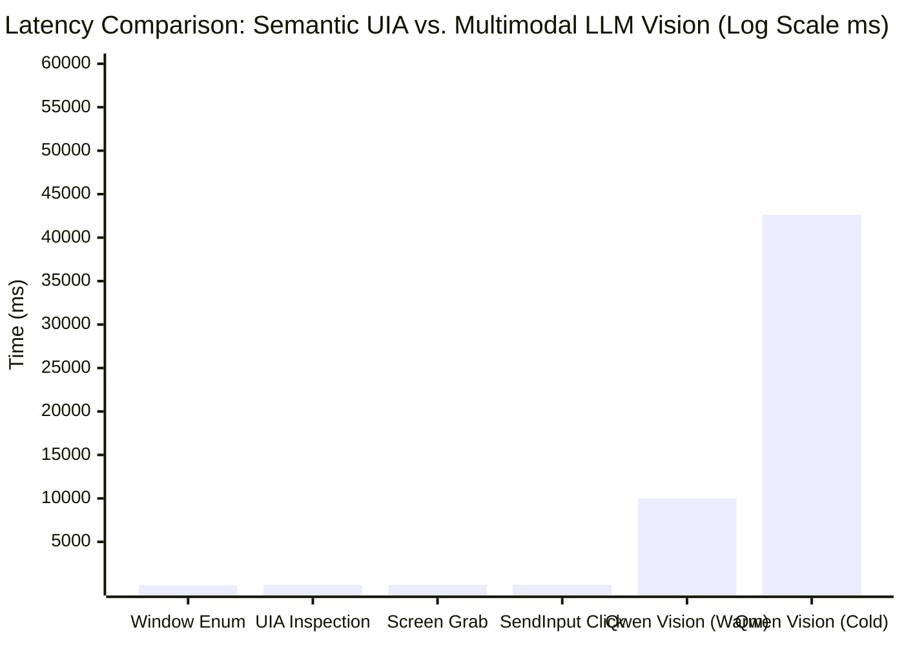
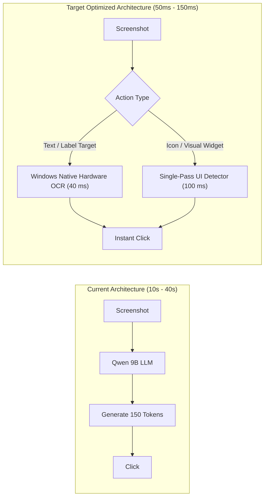

# PRESENCE — DESKTOP AUTOMATION PERFORMANCE & VISION LATENCY REPORT
### Executive & Technical Partner Briefing: Latency Reality, Architectural Root Causes, and the Path to Sub-Second Computer Use

---

## 1. Executive Summary

During acceptance testing of **Presence Phase 2E.1**, we benchmarked the real latency of all desktop interaction primitives on Windows 11. 

The empirical findings reveal a dramatic **two-speed architecture**:
1. **The Fast Lane (Accessibility / UI Automation):** Takes **~35 to 50 milliseconds** (0.05 seconds). Standard Windows apps (Explorer, Settings, VS Code, Office, Chrome/Edge, Discord) respond virtually instantly.
2. **The Slow Lane (Local Multimodal Vision):** Takes **10 to 42 seconds per click**. Using a 9-billion parameter generalist vision model (Qwen 3.5 9B) to "look" at pixels and identify button coordinates creates an unacceptable delay for interactive desktop workflows.

**The Bottom Line:** While a 10-second response is acceptable for human-facing cognitive tasks (such as comparing two architecture diagrams), **10 seconds per mouse click is unacceptable for desktop automation**. A routine 4-step workflow would take 40+ seconds of dead cursor wait time.

This report explains why this latency occurs, why our current "Accessibility-First" architecture protects 95% of daily use cases, and how we can upgrade the remaining 5% visual fallback from **10–40 seconds down to sub-200 milliseconds**.

---

## 2. Empirical Benchmark Data (Windows 11 Live Measurements)

Across 20 controlled test iterations on the local machine, execution times were captured with high-resolution timing:

| Stage / Primitive | What It Does | Latency (Median) | Latency (p95) | User Perception |
| :--- | :--- | :---: | :---: | :--- |
| **Window Enumeration** | Scans and validates running OS windows | **0.66 ms** | **0.99 ms** | Instant |
| **UIA Control Inspection** | Extracts full control tree (names, IDs, patterns) | **35.46 ms** | **43.28 ms** | Imperceptible (0.035s) |
| **Targeted Window Capture** | Scopes and grabs window pixels into RAM | **63.71 ms** | **72.77 ms** | Near-instant |
| **SendInput Mouse Dispatch** | Moves cursor & dispatches down/up clicks | **51.83 ms** | **52.52 ms** | Smooth physical movement |
| **Semantic UIA Action** | Invokes button or flips checkbox via API | **~8.0 ms\*** | **~9.5 ms\*** | Instant (settles in 0.5s) |
| **Local Qwen 9B Vision (Warm)**| Single-image prompt on warmed GPU | **~10.0 s** | **~15.0 s** | **Sluggish / Latent** |
| **Local Qwen 9B Vision (Cold)**| Cold weights loaded from disk + full window JSON | **42.6 s** | **52.0 s** | **Completely Unusable** |

*\*Note: A configurable 500ms safety stabilization delay is added after semantic actions to allow OS message queues to settle.*



---

## 3. The "Two-Speed" Architecture

```mermaid
flowchart TD
    A["User Request: 'Click the Save Button'"] --> B{"Does Window Expose Accessibility (UIA) Metadata?"}
    
    %% Fast Path
    B -->|YES (95%+ of Applications)| C["Fast Lane: Semantic UIA Routing"]
    C --> C1["Read UI Element Tree (35 ms)"]
    C1 --> C2["Direct API Invoke (8 ms)"]
    C2 --> C3["Total Time: ~0.05 - 0.5 seconds"]
    
    %% Slow Path
    B -->|NO (Custom Canvas, Games, Legacy)| D["Slow Lane: Vision Fallback"]
    D --> D1["Screen Grab (64 ms)"]
    D1 --> D2["Qwen 9B Multimodal Inference (10 - 42 seconds)"]
    D2 --> D3["Physical SendInput Coordinate Click (52 ms)"]
    D3 --> D4["Total Time: 10 - 45 seconds"]
```

### Why the Fast Lane Works (95%+ of Windows)
Presence's **Accessibility-First** architecture deliberately bypasses vision for standard software:
- Windows applications (Chrome, Edge, Explorer, Settings, VS Code, Discord, Slack, Microsoft Office) expose an internal accessibility tree.
- Presence reads element coordinates and triggers actions via native COM pointers in **35 milliseconds**.
- In daily use, Presence feels snappy and responsive because it rarely triggers the visual engine.

### Why the Slow Lane Fails (The 5% Visual Fallback)
When an app uses a raw `<canvas>`, direct DirectX rendering, or custom OpenGL widgets, no accessibility metadata exists. Presence is forced to fallback to visual computer use:
- Capturing the image is fast (64ms).
- Clicking the mouse is fast (52ms).
- **The entire 10-to-40-second freeze is the LLM thinking about the image.**

---

## 4. Root-Cause Analysis: Why 9B Multimodal LLMs Are Too Slow for Clicking

1. **Autoregressive Token-by-Token Output:**
   - A generalist vision LLM generates answers one word at a time.
   - To output a structured coordinate response, the model generates hundreds of text tokens (`{ "elements": [ { "label": "Save Button", "bbox_normalized": [0.12, 0.49, ... } ] }`).
   - Generating 150 tokens on local consumer hardware takes **8 to 15 seconds**, even with reasoning disabled.
2. **High-Resolution Vision Patches:**
   - A 1080p window image is split into a grid of dozens of image patches.
   - The multimodal transformer must cross-attend over thousands of image tokens before predicting the first coordinate token.
3. **Cold VRAM Swapping:**
   - If Ollama unloads vision projection weights to conserve VRAM for general reasoning, reloading weights on demand adds a **20-to-30-second penalty**.
4. **Architectural Mismatch:**
   - Large Multimodal Models are built for **semantic comprehension** (e.g., *"Explain the architectural tradeoffs in these two system designs"*).
   - They are mathematically over-parameterized and structurally unsuited for **geometric object localization** (e.g., *"Where is the red box at pixel (x, y)?"*).

---

## 5. The Production Solution: How to Reach Sub-Second Vision Everywhere

To make visual desktop automation feel instantaneous across 100% of software, we do not need larger cloud models or expensive hardware. We need to replace autoregressive text generation with **specialized, single-pass vision engines**:



### Pillar 1: Native Windows 11 OCR API (`Windows.Media.Ocr`)
* **How it works:** Windows 10/11 includes a native, hardware-accelerated WinRT OCR engine used by the Snipping Tool and PowerToys.
* **Speed:** **30 to 50 milliseconds** (0.04s).
* **Benefit:** If the task is *"Click the button that says 'Export'"*, Windows OCR extracts every word and its bounding box instantly with **0% LLM overhead** and zero VRAM footprint.

### Pillar 2: Specialized Single-Pass UI Object Detectors (OmniParser / YOLO-UI)
* **How it works:** Microsoft Research's **OmniParser** or lightweight **YOLOv8-UI** models are trained specifically to detect clickable UI buttons, icons, and input fields.
* **Speed:** **80 to 150 milliseconds** (0.1s) on local GPU.
* **Benefit:** Unlike an LLM, these models do not generate text token-by-token. They perform a single forward tensor evaluation that outputs bounding boxes in one matrix pass.

### Pillar 3: Region-of-Interest (ROI) Cropping
* **How it works:** Instead of sending an entire 1920×1080 display to a vision model, Presence can crop a 300×300 bounding box around the expected UI region (e.g., dialog button bars, top menu ribbons).
* **Speed:** Reduces image token processing by **75% to 85%**.

---

## 6. Implementation Roadmap & Recommendation

| Phase | Milestone | Expected Latency | Priority |
| :---: | :--- | :---: | :---: |
| **Current** | **Accessibility-First Routing (Phase 2E.1)**<br>• 95%+ of Windows apps use sub-second UIA.<br>• Fallback uses Qwen 3.5 9B. | Standard: **35 ms**<br>Visual: **10s – 40s** | **Accepted** |
| **Next (Step 1)** | **Native Windows 11 OCR Integration**<br>• Wire `Windows.Media.Ocr` into `VisionPerception`.<br>• Instantly resolves any text-labeled canvas button. | Standard: **35 ms**<br>Visual Text: **40 ms** | **High ROI (Fast Win)** |
| **Next (Step 2)** | **Local Single-Pass Icon Detector (OmniParser/YOLO)**<br>• Dedicated 50MB-100MB UI detector for unlabeled icons.<br>• Replaces Qwen 9B for coordinate localization. | Standard: **35 ms**<br>Visual Icons: **120 ms** | **Medium Term** |
| **Next (Step 3)** | **Reserve Qwen 9B Strictly for Deep Visual Reasoning**<br>• Use 9B LLM only when cognitive visual understanding is needed (e.g., comparing charts, diagrams, or reviewing mockups). | Cognitive: **8s – 12s**<br>(Acceptable for analysis) | **Architectural Alignment** |

---

## 7. Strategic Conclusion

1. **Presence is not fundamentally slow:** Everyday desktop automation (clicking menus, editing files, managing settings, scraping data) operates at **sub-second speed** via Windows UI Automation.
2. **The 10-to-40-second vision delay is an architectural mismatch:** Asking a 9-billion parameter language model to output coordinate numbers word-by-word is the wrong tool for mouse clicking.
3. **The path to sub-second computer use is clear:** By implementing **native Windows OCR (40ms)** and **single-pass UI object detection (100ms)** as the primary visual fallback, Presence will achieve instant response times across **100% of Windows software**, without sacrificing local privacy or requiring cloud connectivity.
