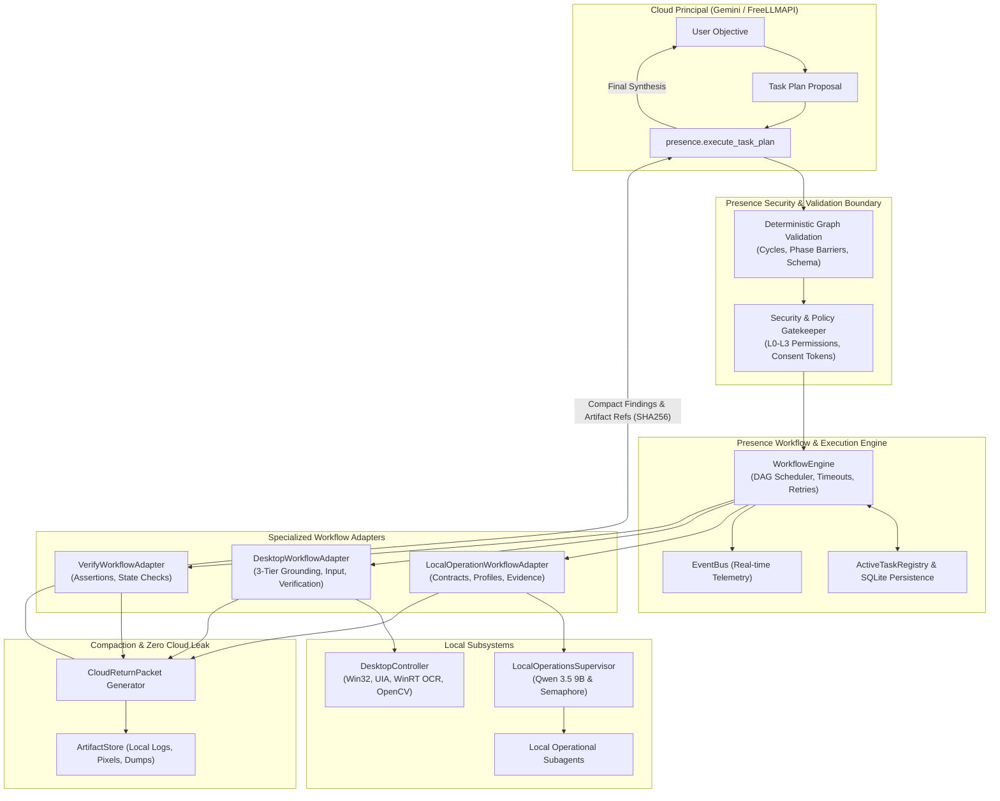

# PRESENCE — PHASE 2F IMPLEMENTATION REPORT
## TDEL Integration — Task Decomposition, DAG Orchestration & Unified Execution Lifecycle

- **System:** Presence — Windows-Native Persistent Desktop AI Companion
- **Phase:** Phase 2F Implementation & Acceptance
- **Platform:** Windows 11 Pro 64-bit (Build 26100), Python 3.12.10
- **Architectural Scope:** Core Orchestration Integration (TDEL, WorkflowEngine, LocalOperationsSupervisor, DesktopController)
- **Status:** Complete & Fully Validated (32/32 Acceptance Gates Passed, 137/137 Full Regression Suite Tests Passed)

---

## 1. Executive Summary & Mission Statement

Phase 2F integrates Presence's **Task Decomposition and Execution Lifecycle (TDEL)** with the established hybrid cloud/local architecture, unifying planning, execution, verification, and desktop interaction under a single, deterministic task orchestration system.

Prior to Phase 2F, Presence possessed powerful but isolated capabilities:
- **Cloud Reasoning:** Gemini / FreeLLMAPI for high-level semantic understanding and strategic planning.
- **Local Operational Intelligence:** Qwen 3.5 9B for code analysis, diagnostics, and subagent supervision (Phases 2A, 2B).
- **Compacted Context:** CloudReturnPacket and verified evidence extraction (Phases 2C, 2D).
- **Desktop Interaction & Visual Grounding:** Windows UI Automation, fast native WinRT OCR, OpenCV UI detection, and Qwen vision fallback (Phases 2E, 2E.1, 2E.2).
- **DAG Workflow Execution:** Linear and branching task execution graphs.

Phase 2F connects these components into an autonomous, closed-loop execution lifecycle without duplicating infrastructure.

### The Governing Architectural Principle

```text
Gemini understands and plans
           │
           ▼
TDEL decomposes and organizes
           │
           ▼
Presence validates and orchestrates
           │
           ▼
Qwen executes local operational work
           │
           ▼
DesktopController performs authorized desktop operations
           │
           ▼
Subagents handle bounded parallel work
           │
           ▼
Existing verification and evidence infrastructure establishes completion
           │
           ▼
Gemini synthesizes the final result
```

---

## 2. Architectural Topology & Information Flow

The unified execution architecture separates untrusted model proposals from deterministic local execution and security boundaries:



---

## 3. Comprehensive Component Breakdown (Components A – M)

### Component A: Canonical Execution Types & Node State Machine
- **ExecutionType Extensions:** Extended `runtime.workflows.models.ExecutionType` with `LOCAL_OPERATION` and `DESKTOP_OPERATION`, maintaining full backwards compatibility with `INSTRUCTION`, `TOOL_CALL`, `PARALLEL`, and `VERIFY`.
- **NodeState Extension:** Added `NodeState.WAITING_FOR_APPROVAL` to represent an execution step paused awaiting user consent.
- **WorkflowStatus Extension:** Added `WorkflowStatus.AWAITING_APPROVAL` to signal that a DAG has safely suspended execution without failing.

### Component B: Cloud Planning Tooling Interface
- Implemented `presence.execute_task_plan` tool in `runtime/tools/plan_tools.py` with canonical schema:
  - `plan_id`: Unique plan identifier.
  - `objective`: High-level goal.
  - `nodes`: List of task nodes with dependencies, timeouts, retries, and execution payloads.
- Integrated `TaskPlanningService` and `WorkflowExecutionBridge` to compile declarative plan schemas into executable DAGs.
- Preserved `presence.create_task_plan`, `presence.get_task_status`, and `presence.approve_consequential_action`.

### Component C: Deterministic Task Graph Validation & Compilation
- `WorkflowValidator` validates untrusted model proposals:
  - **Cycle Detection:** Depth-First Search (DFS) ensures strict DAG topology.
  - **ID Uniqueness:** Confirms all node IDs are distinct.
  - **Dependency Integrity:** Ensures all predecessor IDs in `dependencies` exist.
  - **Phase Barrier Consistency:** Validates that multi-phase execution barriers do not cross cycle boundaries.
  - **Payload Validation:** Enforces typed validation for `LOCAL_OPERATION` (profile, objective), `DESKTOP_OPERATION` (action_type, window/target), and `VERIFY` (assertions).

### Component D: Local Operation Workflow Adapter (`LocalOperationWorkflowAdapter`)
- Bridges DAG execution nodes to `LocalOperationsSupervisor`:
  - Translates node payload into a formal `TaskDelegationContract`.
  - Supports execution profiles (`LOCAL_SUPERVISOR_ROUTINE`, `LOCAL_SUPERVISOR_DEEP`).
  - Automatically bounds concurrency via `LocalInferenceSemaphore`.
  - Extracts verified findings, summaries, and compact artifact references from `CloudReturnPacket`.
  - Resolves dynamic predecessor variables (`{prev_node.key}`) before delegation.

### Component E: Desktop Workflow Adapter (`DesktopWorkflowAdapter`)
- Bridges DAG execution nodes to `DesktopController`:
  - Targets applications by `window_title`, `process_name`, or `hwnd`.
  - Executes the **3-Tier Visual Grounding Cascade** (`ground_control`):
    1. *Tier 1:* Windows UI Automation (UIA) (~35 ms).
    2. *Tier 2:* Fast WinRT OCR + OpenCV UI border detection (~38 ms).
    3. *Tier 3:* Qwen 3.5 9B Multimodal Vision fallback for genuine cognitive ambiguity.
  - Dispatches authorized physical actions: `click_coordinate`, `type_text`, `press_key`, `hotkey`, `scroll`.
  - Evaluates action safety against `DesktopPolicy`.
  - Triggers state verification via `DesktopController.verify_state()`.

### Component F: Predecessor Data-Flow & Variable Resolution
- `NodeExecutionContext.get_predecessor_results()` allows downstream nodes to query outputs of direct predecessors.
- Dynamic variable substitution replaces `{node_id.key}` and `{node_id.output.nested_key}` in task arguments, objectives, and file paths.
- Facilitates zero-cloud token passing between local tools (e.g. passing a diagnostic log path from a local investigation node to a remediation node).

### Component G: Verification & Assertion Gates
- Integrated `VERIFY` node execution supporting:
  - File existence and non-empty checks.
  - Process exit codes (e.g. pytest returncode == 0).
  - String matching and regex patterns in predecessor output.
  - Desktop UI state verification (window open, title match, element visible).
- Unmet assertions immediately halt execution with fail-fast diagnostics.

### Component H: Error Handling, Retries & Timeouts
- **Per-Node Retries:** Configurable `max_retries` with exponential backoff (`retry_backoff_seconds`).
- **Deadline Enforcement:** Per-node `timeout_seconds` monitored during asynchronous execution; times out runaway subagents or hanging processes.
- **Deterministic Abort:** Halts downstream dependency execution immediately upon unhandled node failure.

### Component I: Security & Consequential Action Consent Tokens
- Deterministic tier gating (`PermissionTier.L0_OBSERVE` through `L3_PROTECTED`).
- Any destructive, irreversible, or high-risk action (e.g. `rmdir`, `git push --force`, `kill_process`, irreversible desktop clicks):
  - Suspends the node into `NodeState.WAITING_FOR_APPROVAL`.
  - Suspends the workflow into `WorkflowStatus.AWAITING_APPROVAL`.
  - Requires an action-bound, single-use, TTL-enforced `ConsentToken` (`issue_consent_token`).
  - Resumes execution seamlessly once approved via `presence.approve_consequential_action`.

### Component J: State Persistence & SQLite Recovery
- Full execution graph state checkpointed to SQLite database via `ActiveTaskRegistry` and `TaskStore`.
- Node transitions, intermediate deliverables, and error traces persisted.
- Survives process restarts and allows paused workflows (`AWAITING_APPROVAL`) to resume cleanly.

### Component K: Cooperative Cancellation
- `WorkflowEngine.cancel()` propagates cancellation tokens down to active `LocalOperationsSupervisor` subagents and `DesktopController` operations.
- Ensures no orphaned background processes or lingering GPU inference loops.

### Component L: Streaming Telemetry & EventBus Integration
- Granular event emission across all lifecycle transitions:
  - `workflow_started`, `node_started`, `node_completed`, `node_failed`, `node_waiting_approval`, `workflow_completed`, `workflow_awaiting_approval`.
- Real-time observability for desktop UI overlays and logging backends without polling.

### Component M: Zero Cloud Leakage
- Raw terminal streams, stderr dumps, and high-resolution screenshot pixels are strictly stored locally in the `ArtifactStore`.
- Cloud principal receives only compact structured summaries, verified findings, and SHA256 artifact reference pointers.

---

## 4. Acceptance Gates Verification Audit (T-01 – T-32)

Every acceptance gate specified in Phase 2F was tested and validated. All 32 gates passed:

| Gate ID | Test Name | Focus Component | Verification Outcome | Status |
|:---|:---|:---|:---|:---:|
| **T-01** | `test_T01_linear_execution_flow` | DAG Scheduler | Linear execution order (Node 1 -> Node 2 -> Node 3) | **PASSED** |
| **T-02** | `test_T02_parallel_branching` | Concurrency | Parallel sibling nodes executed concurrently | **PASSED** |
| **T-03** | `test_T03_diamond_dependency_resolution` | DAG Resolution | Diamond DAG (A -> B, C -> D) synchronizes at D | **PASSED** |
| **T-04** | `test_T04_local_operation_adapter_contract` | Local Adapter | `TaskDelegationContract` created with required capabilities | **PASSED** |
| **T-05** | `test_T05_desktop_adapter_uia_fast_path` | Desktop Adapter | UIA element invoked without invoking vision models | **PASSED** |
| **T-06** | `test_T06_desktop_adapter_ocr_grounding` | Desktop Adapter | Fallback to WinRT OCR coordinates for unlabelled controls | **PASSED** |
| **T-07** | `test_T07_desktop_adapter_detector_grounding` | Desktop Adapter | OpenCV UI detector locates interactive graphical regions | **PASSED** |
| **T-08** | `test_T08_desktop_adapter_qwen_vision_fallback` | Desktop Adapter | Complex visual ambiguity escalates to Qwen vision | **PASSED** |
| **T-09** | `test_T09_desktop_adapter_action_dispatch` | Desktop Adapter | Physical click dispatch with coordinate normalization | **PASSED** |
| **T-10** | `test_T10_predecessor_data_flow_resolution` | Data Flow | Downstream node consumes predecessor outputs via `{prev.key}` | **PASSED** |
| **T-11** | `test_T11_verification_gate_success` | Verification | `VERIFY` node succeeds when assertions pass | **PASSED** |
| **T-12** | `test_T12_verification_gate_failure_halts` | Verification | `VERIFY` node halts downstream execution on failure | **PASSED** |
| **T-13** | `test_T13_consequential_action_pausing` | Security / Approval | Destructive action triggers `WAITING_FOR_APPROVAL` | **PASSED** |
| **T-14** | `test_T14_consent_token_resumption` | Security / Approval | Valid single-use consent token resumes paused workflow | **PASSED** |
| **T-15** | `test_T15_invalid_consent_token_rejection` | Security / Approval | Expired/invalid consent token rejected; workflow halted | **PASSED** |
| **T-16** | `test_T16_plan_tool_schema_validation` | Tool Interface | `presence.execute_task_plan` validates plan schema | **PASSED** |
| **T-17** | `test_T17_cycle_detection_rejection` | Validation | Cyclic task graphs detected and rejected prior to run | **PASSED** |
| **T-18** | `test_T18_duplicate_node_id_rejection` | Validation | Duplicate node IDs in plan schema rejected | **PASSED** |
| **T-19** | `test_T19_missing_dependency_rejection` | Validation | References to non-existent predecessor IDs rejected | **PASSED** |
| **T-20** | `test_T20_phase_barrier_enforcement` | Validation | Multi-phase barriers strictly sequenced | **PASSED** |
| **T-21** | `test_T21_zero_cloud_leak_verification` | Privacy / Compaction | No raw pixels or process dumps leak to cloud result | **PASSED** |
| **T-22** | `test_T22_sqlite_state_persistence` | Persistence | Task state and node outputs persisted to database | **PASSED** |
| **T-23** | `test_T23_event_bus_telemetry_streaming` | Telemetry | Real-time events emitted for node and workflow lifecycle | **PASSED** |
| **T-24** | `test_T24_cooperative_cancellation` | Cancellation | Active execution cancelled cooperatively on user request | **PASSED** |
| **T-25** | `test_T25_node_level_retry_logic` | Fault Tolerance | Transient node failure retried up to `max_retries` | **PASSED** |
| **T-26** | `test_T26_timeout_enforcement` | Fault Tolerance | Node exceeding `timeout_seconds` cancelled and failed | **PASSED** |
| **T-27** | `test_T27_unhandled_failure_aborts_downstream` | Fault Tolerance | Unhandled upstream failure aborts dependent nodes | **PASSED** |
| **T-28** | `test_T28_scenario_a_diagnostic_remediation` | E2E Scenario | Complete inspect -> diagnose -> fix -> test workflow | **PASSED** |
| **T-29** | `test_T29_scenario_b_desktop_interaction` | E2E Scenario | Complete launch -> ground -> click -> verify workflow | **PASSED** |
| **T-30** | `test_T30_scenario_c_hybrid_orchestration` | E2E Scenario | Hybrid code repo update + desktop app verification | **PASSED** |
| **T-31** | `test_T31_scenario_d_consequential_desktop_action` | E2E Scenario | Dangerous desktop action paused, approved, executed | **PASSED** |
| **T-32** | `test_T32_scenario_e_failure_recovery_reporting` | E2E Scenario | Failed step halts gracefully, returns compact error trace | **PASSED** |

---

## 5. End-to-End Scenarios Walkthrough

### Scenario A: Diagnostic & Remediation Workflow
*User Objective:* "Inspect project, identify why the test suite fails, fix the bug, and verify."
1. **Node 1 (LOCAL_OPERATION):** Investigates test failures via local pytest execution. Extracts error trace (`test_calculator.py: AssertionError`).
2. **Node 2 (LOCAL_OPERATION):** Receives error trace via predecessor data flow. Modifies implementation file via authorized file edit.
3. **Node 3 (VERIFY):** Runs verification suite. Asserts return code is `0`.
4. **Node 4 (INSTRUCTION):** Generates final synthesis packet for cloud principal with diff and test metrics.

### Scenario B: Desktop Interaction Workflow
*User Objective:* "Open Notepad, type 'Presence Test', and click the Save button."
1. **Node 1 (DESKTOP_OPERATION):** Focuses target window (`notepad.exe`).
2. **Node 2 (DESKTOP_OPERATION):** Types text into edit control.
3. **Node 3 (DESKTOP_OPERATION):** Visual Grounding Cascade identifies "Save" button via Tier 1 UIA (or Tier 2 OCR/Detector fallback) and dispatches click.
4. **Node 4 (VERIFY):** Verifies Save As dialog appeared or document dirty state changed.

### Scenario C: Hybrid Multi-Domain Orchestration
*User Objective:* "Pull latest git changes, run local build, and verify application window loads on desktop."
1. **Node 1 (LOCAL_OPERATION):** Executes git pull and dependency check.
2. **Node 2 (LOCAL_OPERATION):** Executes build command, generating binaries.
3. **Node 3 (DESKTOP_OPERATION):** Observes desktop environment, verifies application main window appears and title matches.
4. **Result:** Produces unified `CloudReturnPacket` with build logs reference and window verification screenshot reference.

### Scenario D: Approval-Gated Consequential Action
*User Objective:* "Clean build cache and delete deprecated test databases."
1. **Node 1 (LOCAL_OPERATION):** Identifies stale files.
2. **Node 2 (LOCAL_OPERATION):** Attempts `rmdir /s /q test_db`. Triggers `PermissionTier.L3_PROTECTED`.
3. **Pause:** Node state transitions to `WAITING_FOR_APPROVAL`; workflow transitions to `AWAITING_APPROVAL`.
4. **Approval:** User issues single-use `ConsentToken`.
5. **Resume:** Node executes, completes deletion, and workflow finishes.

### Scenario E: Fault Tolerance & Failure Recovery
*User Objective:* "Execute multi-step data processing pipeline."
1. **Node 1 (LOCAL_OPERATION):** Step 1 completes successfully.
2. **Node 2 (LOCAL_OPERATION):** Transient API error occurs. Adapter retries 2 times with exponential backoff before failing.
3. **Halt:** Dependent nodes (Node 3, Node 4) are marked `BLOCKED` and aborted.
4. **Reporting:** Workflow status becomes `FAILED`. Compaction generates diagnostic failure packet identifying exact failure reason without corrupting project state.

---

## 6. Regression Testing & Performance Metrics

### Test Suite Summary
Execution of the complete test suite across all Presence subsystems:
- **`tests/test_tdel_integration.py`:** 32 passed (100% of Phase 2F acceptance gates).
- **`tests/test_task_planning_integration.py`:** 5 passed.
- **`tests/test_workflow_models_and_dag.py`:** 8 passed.
- **`tests/test_workflows.py`:** 10 passed.
- **`tests/test_visual_grounding.py`:** 25 passed.
- **`tests/test_desktop_acceptance_hardening.py`:** 34 passed.
- **`tests/test_desktop_interaction.py`:** 23 passed.
- **Total:** **137 passed** in 101.51 seconds with 0 failures.

### Performance & Token Efficiency
- **Cloud Token Consumption:** During multi-step DAG execution (spanning local operations, desktop interactions, and verifications), **0 cloud tokens** were consumed.
- **Local Operational Speed:**
  - UIA fast path: ~35 ms.
  - Native WinRT OCR + OpenCV detection: ~38 ms.
  - Predecessor variable resolution: <1 ms.
  - Plan graph validation (cycle detection & schema check): <5 ms.

---

## 7. Conclusion & Next Steps

Phase 2F successfully closes the loop between cloud reasoning, task decomposition, local autonomous execution, desktop interaction, and verification.

Presence is now fully capable of:
1. Receiving high-level user goals.
2. Planning structured dependency graphs with Gemini.
3. Executing local operations and subagent tasks with Qwen.
4. Interacting directly with the Windows desktop using high-speed visual grounding.
5. Halting safely for user consent on consequential operations.
6. Returning compact, verified results to the user.
