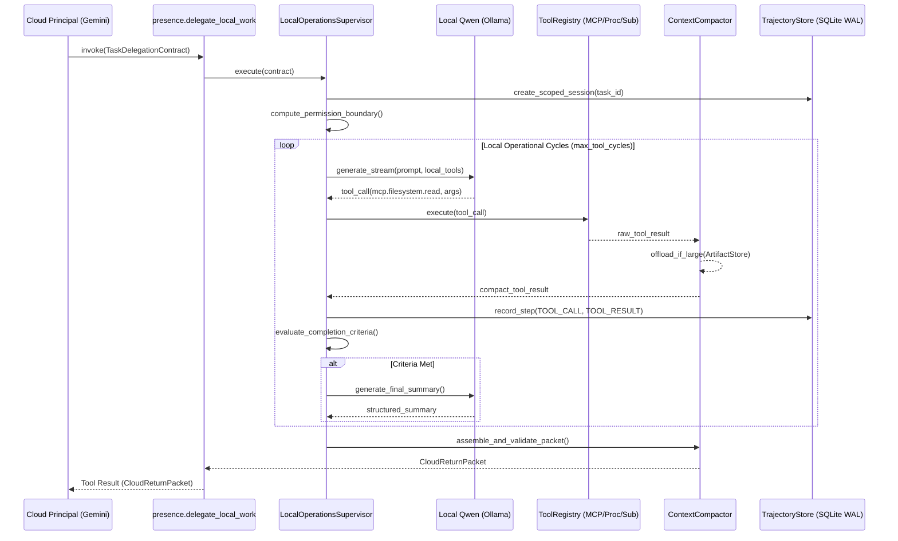
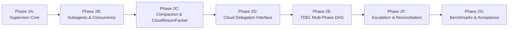

# PRESENCE — PHASE 2 ARCHITECTURAL SPECIFICATION
## Cloud Principal Intelligence + Local Operations Supervisor & Context Compaction

**Project:** Presence — Windows-native persistent AI desktop companion  
**Runtime:** Python 3.12.10 (x64)  
**Operating System:** Windows 11  
**Architecture Target:** Phase 2 Hierarchical Intelligence Architecture & Context Compaction  
**Principal Intelligence:** Cloud Model (Gemini 1.5 Pro / FreeLLMAPI)  
**Operations Supervisor:** Local Model (Qwen 3.5 9B via Ollama)  
**Deterministic Foundation:** Phases 0–5 & TDEL (SQLite WAL, WorkflowEngine, PermissionBoundary, ProcessManager, MCPSupervisor, SubagentManager, ContextAssembler, ArtifactStore)  
**Document Status:** Architectural Design & Engineering Specification  

---

# 1. UNDERSTANDING OF THE INTENDED ARCHITECTURE

### The Core Paradigm Shift
The objective of Phase 2 is **NOT** a flat request router that randomly flips between local and cloud models based on keyword patterns or prompt length.

The objective is to establish a **Hierarchical Intelligence Architecture**:
- **The Cloud Model is the Principal Intelligence:** It owns the user relationship, conceptual reasoning, high-level intent, strategic decomposition, critical evaluation, and final deliverable synthesis. It determines **WHAT** must be accomplished.
- **The Local Model is the Operations Supervisor:** It operates under delegated authority as an autonomous executor. It coordinates MCP tools, manages operational subagents, executes CLI/PowerShell commands, interprets intermediate outputs, compacts operational context, and gathers verified evidence. It manages **HOW** the operational work gets accomplished.
- **Presence Deterministic Runtime is the Enforcer:** Permissions, process trees, resource ceilings, SQLite persistence, and state recovery remain strictly deterministic and cannot be bypassed or weakened by either model.

```
+-----------------------------------------------------------------------------+
|                               PRINCIPAL ROLE                                |
|  Cloud Model (Gemini / FreeLLMAPI)                                          |
|  - High-level intent comprehension & strategic planning                     |
|  - Architecture & design decisions                                          |
|  - Structured operational delegation via Task Delegation Contract           |
|  - Evaluation of verified evidence returned in CloudReturnPacket            |
|  - Synthesis of final user response                                         |
+-----------------------------------------------------------------------------+
                                      |
                     [Task Delegation Contract]
                                      v
+-----------------------------------------------------------------------------+
|                            OPERATIONAL SUPERVISOR                           |
|  Local Model (Qwen 3.5 9B via Ollama)                                       |
|  - Receives delegated objective, constraints, and allowed capabilities      |
|  - Drives multi-turn tool-call loop independently ($0 cloud token cost)    |
|  - Selects, invokes, and evaluates registered MCP tools                     |
|  - Spawns and supervises local operational subagents                         |
|  - Compacts intermediate tool and subagent outputs via ArtifactStore        |
|  - Assembles verified CloudReturnPacket (or structured escalation package)  |
+-----------------------------------------------------------------------------+
                                      |
                         [CloudReturnPacket]
                                      v
+-----------------------------------------------------------------------------+
|                            FINAL REASONING & OUTPUT                         |
|  Cloud Model delivers synthesized, verified answer to User                  |
+-----------------------------------------------------------------------------+
```

### Why the Traditional Cloud-Heavy ReAct Loop Fails
In conventional agent architectures, every step in an operational task (inspecting a file, reading a log, calling an MCP tool, running a test, asking a subagent) requires a full round-trip to the cloud LLM. For an investigation requiring 8 MCP calls, 3 subagents, and 12 tool-interpretation steps:
1. **Excessive Latency:** 20+ sequential cloud HTTP requests with network round-trips.
2. **Token Bloat:** Each subsequent turn resends accumulated tool outputs and conversation history, rapidly exhausting context windows and budget.
3. **Fragile Upstream Dependency:** Any transient 429/502 error during intermediate tool interpretation aborts the entire user turn.
4. **Context Pollution:** Raw file contents, command stderr streams, and bulky MCP schemas overwhelm the cloud model's attention, degrading reasoning quality.

### The Hierarchical Solution
By isolating the operational loop and compacting context locally:
- Cloud inference is reduced to **two high-value calls** for routine operational tasks:
  1. *Turn Inception:* Understand request $\rightarrow$ delegate operational objective.
  2. *Turn Completion:* Receive verified `CloudReturnPacket` $\rightarrow$ synthesize final user answer.
- Zero intermediate tool outputs, file contents, or MCP exchanges ever leave the local machine.
- Cloud API consumption, rate-limit exposure, and token expenditure drop by $85\% - 95\%$ while preserving cloud-level reasoning for the final answer.

---

# 2. ARCHITECTURAL COMPONENT DIAGRAM

```mermaid
flowchart TD
    User([User]) <--> ChatView[TUI ChatView / Presence App]
    ChatView <--> Session[Main AgentSession]

    subgraph CloudPrincipal ["Cloud Principal Intelligence (Gemini / FreeLLMAPI)"]
        Session <--> CloudExec[AgentExecutor (Cloud Mode)]
        CloudExec --- CloudTools["Restricted Tool Catalog\n• presence.delegate_local_work\n• presence.manage_plan (L0)\n(No raw MCP or CLI tools)"]
    end

    CloudExec -- "1. TaskDelegationContract" --> DelegationTool["presence.delegate_local_work"]

    subgraph LocalSupervisorSubsystem ["Local Operations Supervisor (Qwen 3.5 9B via Ollama)"]
        DelegationTool --> Supervisor["LocalOperationsSupervisor"]
        Supervisor <--> SupExec["Supervisor AgentExecutor\n(Local Routine Mode, think=False)"]
        
        SupExec <--> SupRegistry["Full Operational Tool Catalog\n• Filesystem MCP\n• Code-Search MCP\n• ProcessManager Tools\n• Subagent Tools"]

        subgraph CompactionLayer ["Local Context Compactor & Aggregator"]
            ToolCompactor["ToolOutputCompactor\n(Threshold > 2KB -> ArtifactStore)"]
            SubCompactor["SubagentResultCompactor\n(Deduplication & Contradiction)"]
            PacketAssembler["CloudReturnPacket Assembler\n(Truthfulness & Validation Engine)"]
        end

        subgraph LocalExecutionEngines ["Deterministic Execution Engines"]
            SupRegistry <--> MCPSup["MCPSupervisor\n(External MCP Servers)"]
            SupRegistry <--> ProcMgr["ProcessManager\n(Win32 Job Objects)"]
            SupRegistry <--> SubMgr["SubagentManager\n(Local Ephemeral Workers)"]
        end

        SubMgr <--> Subagents["Operational Subagents A, B, C\n(Local Qwen, Inh. Permissions)"]
    end

    Supervisor -- "2. CloudReturnPacket\n(Validated Evidence Package)" --> DelegationTool
    DelegationTool -- "Compact Tool Result" --> CloudExec

    subgraph DeterministicFoundations ["Authoritative Deterministic State & Security"]
        PermBound["PermissionBoundary\n(Non-bypassable Authorization)"]
        TaskReg["ActiveTaskRegistry\n(Task Lifecycle & Status)"]
        TrajStore["TrajectoryStore\n(SQLite WAL DBs)"]
        ArtStore["ArtifactStore\n(Filesystem Payloads)"]
        WFEngine["WorkflowEngine / TDEL\n(Multi-Phase DAGs)"]
    end

    Supervisor -.-> PermBound
    Supervisor -.-> TaskReg
    Supervisor -.-> TrajStore
    CompactionLayer <--> ArtStore
    Supervisor -.-> WFEngine
```

---

# 3. END-TO-END REQUEST LIFECYCLE

Presence supports three explicit operational patterns:

### Pattern A: Ordinary Conversational Request
*Example: "Explain how Windows Job Objects provide memory limits."*
1. **User Request:** User submits request via TUI.
2. **Intent Evaluation:** `ComplexityClassifier` identifies request as `SIMPLE` / `DISCUSSION_ONLY`.
3. **Direct Cloud Response:** Cloud model receives request without delegation tools or overhead.
4. **Output:** Cloud model generates explanation directly. 0 local supervisor invocations.

```
User ---> Main Session ---> Cloud Principal ---> User Answer
```

---

### Pattern B: Operational Delegation (Single-Phase Objective)
*Example: "Inspect the repository, identify the cause of failing tests, and tell me how to fix them."*

```
Step 1: Cloud Reception
   User Input: "Inspect the repository, identify the cause of failing tests..."
   Cloud Principal receives input + ambient workspace context.
   Cloud Tool Declarations contain: `presence.delegate_local_work` (and L0 introspection).

Step 2: Task Contract Construction
   Cloud model reasons: "This requires deep repository inspection, MCP searching, and test execution."
   Cloud model invokes: `presence.delegate_local_work(contract={...})`.

Step 3: Local Supervisor Activation
   `LocalOperationsSupervisor` receives contract:
   - Validates contract schema.
   - Computes effective permission boundary: `ParentBoundary ∩ Contract.constraints`.
   - Registers task in `ActiveTaskRegistry`.
   - Initializes dedicated scoped trajectory in SQLite.

Step 4: Local Operational Loop & Compaction (Multiple Cycles, $0 Cloud Cost)
   Cycle 4.1: Qwen requests `mcp.filesystem.list_directory` -> Tool executes locally.
              Output compacted locally; large trees stored in ArtifactStore.
   Cycle 4.2: Qwen analyzes output -> Requests `mcp.code_search.find_pattern(pattern="test_")`.
   Cycle 4.3: Qwen analyzes results -> Requests `process.run_command(cmd="pytest")`.
              Raw 45 KB test output offloaded to ArtifactStore; compact failure trace retained.
   Cycle 4.4: Qwen reads test failures -> Identifies mock inconsistency in `test_provider.py`.
   Cycle 4.5: Qwen verifies findings against completion criteria.

Step 5: CloudReturnPacket Assembly & Validation
   Compaction subsystem validates and packages:
   - Summary: "3 provider tests failed due to outdated mock fixtures."
   - Verified Findings: Exact files, line numbers, failing assertion traces.
   - Failures: Exit code 1, 3 failed tests, clean trace snippets.
   - Artifact References: `artifact://diag_pytest_run_4812.txt`.
   - Outcome: `COMPLETED`.

Step 6: Return to Cloud Principal
   `presence.delegate_local_work` returns structured `CloudReturnPacket`.
   Cloud model receives this single compact tool result (~800 tokens).

Step 7: Final Synthesis
   Cloud model synthesizes the final architectural response explaining the root cause and recommending the exact fix.
   Cloud responds to User.
```

---

### Pattern C: Complex Multi-Phase TDEL Task
*Example: "Investigate architecture race conditions, propose refactoring plan, execute approved edits, run test suite, and generate technical deliverable."*
1. **Cloud Decomposes via TDEL:** Cloud generates multi-phase `TaskPlan`:
   - *Phase 1 (Operational):* Codebase audit for lock contention $\rightarrow$ `DELEGATE_LOCAL`.
   - *Phase 2 (Reasoning):* Refactoring architecture design $\rightarrow$ `CLOUD_REASONING`.
   - *Phase 3 (Operational):* Apply edits & run regressions $\rightarrow$ `DELEGATE_LOCAL`.
   - *Phase 4 (Reasoning):* Final deliverable synthesis $\rightarrow$ `CLOUD_REASONING`.
2. **Phase Boundaries:** WorkflowEngine enforces dependencies. Local Supervisor executes operational phases and returns verified `CloudReturnPacket` at phase transitions.
3. **Human Approval Gates:** High-tier mutations in Phase 3 trigger existing `ApprovalRequest` gates through TUI before execution.

---

# 4. CLOUD-TO-LOCAL DELEGATION CONTRACT SPECIFICATION

Communication between models must be deterministic, typed, and structured. Conversational ambiguity is prohibited.

### 4.1 Input Schema: `TaskDelegationContract`
```python
from enum import Enum
from typing import List, Dict, Any, Optional
from pydantic import BaseModel, Field

class ExecutionProfile(str, Enum):
    LOCAL_SUPERVISOR_ROUTINE = "local_supervisor_routine"  # Qwen 3.5 9B (think=False)
    LOCAL_SUPERVISOR_DEEP = "local_supervisor_deep"        # Qwen 3.5 9B (think=True)

class ExpectedDeliverableType(str, Enum):
    DIAGNOSTIC_REPORT = "diagnostic_report"
    EVIDENCE_PACKAGE = "evidence_package"
    FILE_AUDIT = "file_audit"
    TEST_VERIFICATION = "test_verification"
    CUSTOM = "custom"

class DelegationConstraints(BaseModel):
    read_only: bool = Field(True, description="Strictly forbid L1/L2/L3 state modifications")
    source_modification_allowed: bool = Field(False, description="Whether code file edits are permitted")
    require_verified_evidence: bool = Field(True, description="Claims must be backed by actual tool outputs")
    max_tool_cycles: int = Field(15, ge=1, le=50, description="Max local iterations before forced termination")
    timeout_seconds: float = Field(180.0, ge=10.0, le=600.0, description="Overall wall-clock timeout")
    max_subagents: int = Field(2, ge=0, le=4, description="Maximum concurrent subagents permitted")
    context_budget_tokens: int = Field(2000, ge=500, le=8000, description="Target token budget for CloudReturnPacket")

class TaskDelegationContract(BaseModel):
    task_id: str = Field(..., description="Unique deterministic task identifier")
    parent_conversation_id: str = Field(..., description="Main cloud conversation ID")
    objective: str = Field(..., description="Clear operational objective to achieve")
    context_summary: str = Field(..., description="Concise background context needed for the task")
    execution_profile: ExecutionProfile = Field(ExecutionProfile.LOCAL_SUPERVISOR_ROUTINE)
    constraints: DelegationConstraints = Field(default_factory=DelegationConstraints)
    allowed_capabilities: List[str] = Field(
        ...,
        description="Allowed capability categories: ['mcp.filesystem', 'mcp.code_search', 'process_execution', 'subagents']"
    )
    expected_deliverable: Dict[str, Any] = Field(
        ...,
        description="Expected structure: {'type': 'diagnostic_report', 'required_fields': ['findings', 'evidence']}"
    )
    completion_criteria: List[str] = Field(
        ...,
        description="Deterministic criteria: ['tests_executed', 'failing_trace_captured']"
    )
    escalation_policy: Optional[str] = Field(
        "escalate_on_missing_tool_or_contradiction",
        description="Behavior when local execution cannot proceed"
    )
```

---

# 5. LOCAL SUPERVISOR'S OPERATIONAL LOOP

The `LocalOperationsSupervisor` runs an autonomous, bounded execution loop. It reuses Presence's existing `AgentExecutor` and `TrajectoryStore` components, ensuring zero duplicated execution logic.



### Operational Loop Algorithm:
1. **Contract Ingestion:** Parse and validate `TaskDelegationContract`. Create isolated child session with metadata `parent_conversation_id`, `nesting_depth=1`.
2. **Dynamic Capability Gating:** Filter `ToolRegistry` to include ONLY tools authorized by `contract.allowed_capabilities`. Forbid `presence.delegate_local_work` to eliminate recursion hazards.
3. **Effective Permission Enforcement:** Wrap `PermissionBoundary` with `ScopedPermissionBoundary`. If `contract.constraints.read_only == True`, clamp ceiling to `PermissionTier.L0_OBSERVE`.
4. **Execution Iteration:** Drive turn via `AgentExecutor` using `OllamaModelProvider(model_id="qwen3.5:9b", mode="routine", think=False)`. Tool outputs are processed through `ToolOutputCompactor` before recording in SQLite.
5. **Deterministic Verification Gate:** Cross-check against `contract.completion_criteria`. If criteria require test execution and no test tool was invoked, reject early completion and prompt supervisor to execute required verification.
6. **Package Assembly & Validation:** Build `CloudReturnPacket`, validate schema and evidence integrity, and return.

---

# 6. MCP AND SUBAGENT OWNERSHIP

### 6.1 Tool Exposure Architecture
A foundational rule of this architecture is: **The cloud model must not receive raw MCP tool definitions.**

```
+-------------------------------------------------------------+
|                      MAIN CLOUD SESSION                     |
|  Exposed Tools:                                             |
|  - presence.delegate_local_work                             |
|  - presence.manage_plan (L0 read-only status)               |
|  (No filesystem, no code-search, no subprocess, no git)     |
+-------------------------------------------------------------+
                               │
                               │ TaskDelegationContract
                               ▼
+-------------------------------------------------------------+
|                 LOCAL SUPERVISOR SESSION                    |
|  Exposed Tools:                                             |
|  - mcp.filesystem.*                                         |
|  - mcp.code_search.*                                        |
|  - process.run_command, process.kill_process                |
|  - subagents.spawn_subagent, subagents.get_result           |
|  (Never exposed: presence.delegate_local_work)              |
+-------------------------------------------------------------+
```

### 6.2 Subagent Supervision under Qwen
When a delegated task requires parallel investigation (e.g. searching 3 disjoint modules), Qwen acts as the parent supervisor:
1. Qwen invokes `subagents.spawn_subagent(role="investigator", prompt="...")`.
2. Existing `SubagentManager` creates the child session.
3. The child session's model provider defaults to `OllamaModelProvider` (local Qwen).
4. Child session inherits permissions from the supervisor session.
5. Subagent results return strictly to Qwen's conversation context.
6. Qwen evaluates child findings, identifies contradictions, and synthesizes them into its own deliverable.

### 6.3 Local Hardware Concurrency & Semaphore Guard
Running multiple simultaneous 9B LLM inference streams on local hardware risks severe CUDA Out-Of-Memory (OOM) errors or extreme token-generation thrashing.
- **Deterministic Work is Concurrent:** Filesystem MCP, search tools, compiler processes, and test runs execute concurrently across worker threads and processes.
- **LLM Inference is Serialized / Bounded:** A shared `LocalInferenceSemaphore(max_concurrent=1)` (configurable to 2 for multi-GPU setups) guards calls to `OllamaModelProvider.generate_stream()`.
- Subagents queue cooperatively for inference turns while running their deterministic tools in parallel.

---

# 7. PERMISSION AND CONTEXT BOUNDARIES

### 7.1 Non-Bypassable Permission Model
The permission boundary enforces a strict intersection:

$$\text{Effective Permission} = \text{Parent Session Tier} \cap \text{Contract Constraints} \cap \text{Allowed Capabilities}$$

| Operation Tier | Cloud Model Authority | Local Supervisor Authority | Operational Subagent Authority |
| :--- | :---: | :---: | :---: |
| **L0 (Observe)** | Full (can inspect state) | Full (reads files, searches, checks status) | Full (scoped to delegated task) |
| **L1 (Reversible Temp)** | Allowed with notice | Allowed if `read_only=False` | Allowed only if parent permits |
| **L2 (Reversible Mutation)**| Requires approval/notice | Forbidden unless explicitly authorized in plan | Strictly Forbidden |
| **L3 (Permanent / High Risk)**| User Approval Gate Required | **Forbidden** | **Forbidden** |

- **Security Invariant:** Under no circumstances can Qwen grant itself elevated permissions, override `read_only=True`, or execute high-risk operations.
- If an operation requires `L2` or `L3` actions, the supervisor terminates the cycle and reports `ESCALATION_REQUIRED`.

### 7.2 Context Boundaries & Trajectory Hygiene
- **Zero Full-Trajectory Dumps:** The cloud conversation history is never dumped into Qwen. Qwen receives only `objective`, `context_summary`, and target paths.
- **Zero Intermediate Log Pollution:** Raw subprocess outputs, 500-line stack traces, and 10,000-line search dumps are written to `ArtifactStore`. The cloud model receives only compact `VerifiedFinding` snippets and artifact links.
- **Prompt Injection Defense:** External tool outputs and file contents ingested by Qwen are tagged as untrusted data (`data_role="untrusted_evidence"`) and never interpreted as system-level prompt overrides.

---

# 8. ESCALATION AND RESULT RECONCILIATION

When the local supervisor encounters blockers, it must not loop endlessly, hallucinate progress, or blindly retry destructive actions.

### 8.1 Escalation Triggers
1. **Unavailable Capability:** Contract requires a tool not present in `ToolRegistry` or an offline MCP server.
2. **Contradictory Evidence:** Subagents return conflicting findings that cannot be resolved locally.
3. **Budget Exhaustion:** `max_tool_cycles` reached without satisfying completion criteria.
4. **Architectural Ambiguity:** Objective requires a high-level trade-off decision that belongs to the principal cloud model.
5. **Authorization Required:** A discovered remediation requires `L2` or `L3` file modifications.

### 8.2 Escalation Package Schema
```python
class EscalationReason(str, Enum):
    CAPABILITY_UNAVAILABLE = "CAPABILITY_UNAVAILABLE"
    CONTRADICTORY_EVIDENCE = "CONTRADICTORY_EVIDENCE"
    BUDGET_EXHAUSTED = "BUDGET_EXHAUSTED"
    AUTHORIZATION_REQUIRED = "AUTHORIZATION_REQUIRED"
    COMPLEX_REASONING_REQUIRED = "COMPLEX_REASONING_REQUIRED"

class EscalationPackage(BaseModel):
    task_id: str
    reason: EscalationReason
    description: str
    completed_steps: List[str]
    partial_evidence: List[Dict[str, Any]]
    attempted_remedies: List[str]
    unresolved_blocker: str
    required_cloud_decision: str
    suggested_options: List[str]
```

### 8.3 Cloud Decision Loop
Upon receiving an `ESCALATION_REQUIRED` result:
- The cloud model evaluates `required_cloud_decision`.
- If the blocker is missing context, Cloud provides guidance and re-delegates.
- If user approval is needed, Cloud presents the findings and requests user confirmation via TUI.
- If the problem requires strategic refactoring, Cloud takes over reasoning and formulates an architectural proposal.

---

# 9. LOCAL CONTEXT COMPACTION & CLOUD TOKEN OPTIMIZATION

### 9.1 The Compaction Mandate
The Local Operations Supervisor (Qwen 3.5 9B) is explicitly responsible for compacting operational context before transmitting findings back to the Cloud Principal Model.
Transmitting raw MCP tool dumps, verbose command stdout, or uncurated subagent step logs to the Cloud Principal is strictly prohibited.

The compaction subsystem enforces five architectural guarantees:
1. **Zero Quadratic Prompt Growth:** Intermediate tool chatter is compacted locally so each subsequent turn does not resend cumulative history.
2. **Deterministic-First Extraction:** Truncation, filtering, and structured signal extraction run deterministically before invoking LLM summarization.
3. **Artifact-Backed Lossless Traceability:** Full raw payloads are preserved in `ArtifactStore` with SHA-256 hashes; only compact envelopes and `artifact://` URIs return to context.
4. **Evidence Truthfulness:** Compaction must never hallucinate findings, convert hypotheses into facts, suppress failures, or drop source citations.
5. **Typed Handoff via `CloudReturnPacket`:** A formal, validated Pydantic model is the sole data structure delivered to the Cloud Principal.

---

### 9.2 Intermediate Tool Output Compaction Pipeline

```
Raw Tool Output (MCP / Subprocess / File Read)
                    │
                    ▼
          [Size Threshold Check]
         > 2 KB (~500 tokens)?
         ├── Yes ──> Write to ArtifactStore ──> Return artifact_id & preview envelope
         └── No  ──> Keep inline
                    │
                    ▼
     [Deterministic Signal Extraction]
  - Extract exit codes & process status
  - Extract error messages & stack trace head/tail
  - Extract failing test names & assertion messages
  - Extract file paths, line numbers & diff blocks
  - Filter redundant schemas, repeated headers & boilerplate
                    │
                    ▼
     [Need Semantic Interpretation?]
  - Messy unstructured logs or multi-file discrepancies?
         ├── Yes ──> Local Qwen Routine Summarization (think=False, factual only)
         └── No  ──> Use Deterministic Compact Envelope
                    │
                    ▼
    Bounded Context Entry for Active Trajectory
```

#### Deterministic vs Semantic Compaction Rules:
- **Filesystem & Directory Listings:** If $>15$ files, retain only matching/relevant file paths and count; offload full tree to `ArtifactStore`.
- **Process & Test Runner Outputs (`pytest`, CLI):** Extract exit code, duration, passed/failed counts, and failing failure blocks. Omit passing test dots and environment headers.
- **Code Search (`grep`, AST):** Extract file path, line numbers, and matching 3-line snippets. Discard full file buffers.
- **Semantic Summarization Invariant:** When Qwen summarizes logs, the prompt enforces: *"Extract ONLY factual errors and events. Do NOT speculate or omit error codes. Cite exact line numbers."*

---

### 9.3 Subagent Result Compaction

Operational subagents execute in their own isolated SQLite trajectories. Their raw step transcripts and tool iterations are **never** forwarded to the Cloud Principal.

```
Subagent A (Trajectory A) ──┐
Subagent B (Trajectory B) ──┼──> SubagentResultCompactor (Local Qwen) ──> Consolidated Summary
Subagent C (Trajectory C) ──┘           │                                 + De-duplicated Findings
                                        ▼                                 + Contradiction Flags
                              [Deduplication Engine]                     + Merged Artifacts
                              [Contradiction Detector]
```

1. **Receipt Ingestion:** Qwen collects child `SubagentSummaryReceipt` objects from `SubagentManager`.
2. **Deduplication:** Merges identical findings discovered across overlapping subagent search scopes.
3. **Contradiction Detection:** If Subagent A concludes *"No locks acquired in `manager.py:45`"*, but Subagent B concludes *"Lock acquired at `manager.py:45` in thread worker"*, the compactor flags this as a `CONTRADICTION` with both claims highlighted.
4. **Artifact Consolidation:** Child artifact references are cataloged into the unified evidence package.

---

### 9.4 Cloud Handoff Specification: `CloudReturnPacket`

The `CloudReturnPacket` is the authoritative deliverable schema returned by `presence.delegate_local_work`.

```python
from enum import Enum
from typing import List, Dict, Any, Optional
from pydantic import BaseModel, Field

class DelegationOutcome(str, Enum):
    COMPLETED = "COMPLETED"
    PARTIALLY_COMPLETED = "PARTIALLY_COMPLETED"
    FAILED = "FAILED"
    BLOCKED = "BLOCKED"
    ESCALATION_REQUIRED = "ESCALATION_REQUIRED"
    CANCELLED = "CANCELLED"
    OUTCOME_UNKNOWN = "OUTCOME_UNKNOWN"

class FindingType(str, Enum):
    VERIFIED_FACT = "VERIFIED_FACT"        # Backed by direct tool output / test result
    OBSERVED_ANOMALY = "OBSERVED_ANOMALY"  # Unexpected state or warning
    HYPOTHESIS = "HYPOTHESIS"              # Inferred causal relationship (not yet proven)
    CONTRADICTION = "CONTRADICTION"        # Conflicting evidence between sources

class VerifiedFinding(BaseModel):
    finding_id: str = Field(..., description="Unique finding ID: e.g. 'F01'")
    finding_type: FindingType
    statement: str = Field(..., description="Factual description of finding")
    source_file: Optional[str] = Field(None, description="Workspace path")
    line_numbers: Optional[List[int]] = Field(None, description="Exact line references")
    evidence_ref: str = Field(..., description="Key linking to supporting_evidence")
    confidence: float = Field(1.0, ge=0.0, le=1.0)

class SupportingEvidenceItem(BaseModel):
    evidence_id: str
    source_type: str = Field(..., description="'file_read', 'process_output', 'mcp_tool', 'subagent'")
    source_name: str = Field(..., description="e.g. 'pytest', 'mcp.filesystem.read', 'sub_48a'")
    snippet: str = Field(..., max_length=600, description="Exact factual excerpt (max 600 chars)")
    artifact_id: Optional[str] = Field(None, description="ArtifactStore pointer for full raw content")
    sha256_hash: Optional[str] = Field(None, description="Integrity hash of the artifact")

class FailureDetail(BaseModel):
    component: str
    error_code: Optional[str] = None
    failing_items: List[str] = Field(default_factory=list, description="e.g. failing test names")
    error_message: str
    stack_trace_excerpt: Optional[str] = None
    artifact_id: Optional[str] = None

class SubagentSummaryReceipt(BaseModel):
    subagent_id: str
    role: str
    outcome: str
    summary: str
    artifact_ids: List[str] = Field(default_factory=list)

class CompactionMetrics(BaseModel):
    raw_payload_bytes: int
    compacted_packet_bytes: int
    compaction_ratio_percent: float
    estimated_cloud_tokens_saved: int
    local_inference_turns_used: int

class CloudReturnPacket(BaseModel):
    task_id: str
    original_objective: str
    execution_outcome: DelegationOutcome
    summary: str = Field(..., description="High-level executive summary (1-3 paragraphs)")
    verified_findings: List[VerifiedFinding] = Field(default_factory=list)
    supporting_evidence: List[SupportingEvidenceItem] = Field(default_factory=list)
    errors_and_failures: List[FailureDetail] = Field(default_factory=list)
    subagent_summaries: List[SubagentSummaryReceipt] = Field(default_factory=list)
    artifact_references: List[Dict[str, Any]] = Field(default_factory=list)
    unresolved_questions: List[str] = Field(default_factory=list)
    contradictions_detected: List[Dict[str, Any]] = Field(default_factory=list)
    escalation_requirements: Optional[Dict[str, Any]] = None
    metrics: CompactionMetrics
```

#### Validation Before Cloud Handoff:
Before `presence.delegate_local_work` completes, the `CloudReturnPacket` undergoes programmatic validation:
1. Every `VerifiedFinding` must link to a valid `SupportingEvidenceItem`.
2. Every `artifact_id` must exist in `ArtifactStore`.
3. If test commands or CLI tasks exited with non-zero codes, `errors_and_failures` **must not** be empty.
4. Total packet size must not exceed the target context budget.

---

### 9.5 Evidence Integrity & Anti-Hallucination Guarantees

To ensure compaction never compromises diagnostic accuracy:

| Integrity Invariant | Architectural Enforcement Mechanism |
| :--- | :--- |
| **No Invented Findings** | Validator verifies that every finding cites a concrete `evidence_id`. Unbacked assertions are rejected. |
| **No Hypothesis Escalation** | Inferred conclusions are strictly tagged `HYPOTHESIS`. Only direct tool outputs are tagged `VERIFIED_FACT`. |
| **No Suppressed Failures** | Non-zero exit codes, test failures, and tool errors automatically populate `errors_and_failures`. They cannot be filtered out. |
| **Full Traceability** | The complete uncompacted text is persisted in `ArtifactStore`. Cloud model can read raw chunks via `read_artifact`. |
| **Prompt Injection Defense** | All evidence strings are sanitized and wrapped in data envelopes `<evidence_payload source="...">...</evidence_payload>` so tool text cannot manipulate the Cloud Principal. |

---

### 9.6 Cloud Continuation Context Optimization

When the Cloud Principal resumes after delegation, its `ContextAssembler` builds a clean, compact prompt:

```
[System Prompt]: You are Presence Principal Intelligence...
[User]: "Inspect the repository, identify failing tests, and tell me how to fix them."
[Assistant Tool Call]: presence.delegate_local_work({"objective": "Inspect failing tests..."})
[Tool Result]: <CloudReturnPacket JSON (~800 tokens)>
```

- **Excluded from Cloud Context:**
  - 14 intermediate tool calls and responses.
  - 85 KB of raw pytest output and terminal escape codes.
  - 3 subagent independent message histories.
  - Full contents of inspected source files.
- **Estimated Savings:** For an average diagnostic turn, cloud input tokens are reduced from **~32,000 tokens** to **~1,200 tokens** ($>96\%$ reduction).

---

### 9.7 Adaptive Token Budgeting Algorithm

The supervisor adapts the size and density of the `CloudReturnPacket` based on the receiving cloud model's capacity and task priority:

$$\text{Target Packet Budget} = \min\left(\text{MaxBudget}_{\text{Model}}, \; \text{BaseBudget} \times \text{ComplexityMultiplier}\right)$$

| Cloud Provider / Model | Context Window | Target Packet Budget | Compaction Mode |
| :--- | :---: | :---: | :--- |
| **FreeLLMAPI (Auto / Flash)** | 8K – 32K | **1,000 – 1,500 tokens** | Aggressive (Strict previews, heavy artifact offloading) |
| **Gemini 1.5 Flash** | 128K | **2,000 – 3,000 tokens** | Balanced (Full snippets, line blocks, error details) |
| **Gemini 1.5 Pro** | 1M+ | **4,000 – 8,000 tokens** | Deep (Rich diffs, multi-file code excerpts included) |

#### Priority-Based Truncation Queue:
If the packet exceeds its budget, compaction sheds fields in reverse priority order:
1. *Priority 1 (Never Dropped):* `errors_and_failures`, `unresolved_questions`, `contradictions_detected`.
2. *Priority 2 (High Value):* `verified_findings` with exact line citations.
3. *Priority 3 (Summarizable):* `supporting_evidence` snippets trimmed from 600 chars to 200 chars + artifact pointer.
4. *Priority 4 (Sheddable):* Narrative `summary` tightened; subagent process receipts compacted to one-line bullets.

---

### 9.8 Compaction Benchmarks & Verification Methodology

A compaction result is deemed valid **only** if the Cloud Principal can correctly solve the original problem without accessing raw tool logs.

#### Evaluation Metrics:
1. **Compaction Ratio ($R$):**
   $$R = 1 - \frac{\text{Tokens}(\text{CloudReturnPacket})}{\text{Tokens}(\text{Raw Operational Stream})}$$
   *Target: $R \ge 85\%$ for routine tasks; $R \ge 92\%$ for log-heavy tasks.*
2. **Evidence Preservation Rate ($P_{\text{ev}}$):**
   $$P_{\text{ev}} = \frac{|\text{Verified Facts Retained in Packet}|}{|\text{Ground Truth Facts in Raw Logs}|} = 100\%$$
3. **Distortion / Hallucination Rate ($H$):**
   $$H = \frac{|\text{Spurious Facts in Packet}|}{|\text{Total Facts in Packet}|} = 0\%$$
4. **Downstream Cloud Diagnostic Accuracy:**
   The cloud model is prompted: *"Based on the evidence packet, identify the exact file, line number, and root cause of the failure."*
   *Passing Threshold: 100% correct file and root cause identification across benchmark suite.*

---

# 10. INTEGRATION POINTS IN EXISTING CODEBASE

The implementation reuses Presence's battle-tested infrastructure with minimal surgical adaptations:

```
Existing Component          Current Role                     Phase 2 Adaptation
------------------------------------------------------------------------------------------------------------------
runtime/session.py          AgentSession & Factory           Configure main session with restricted toolset
                                                             (delegate_local_work only). Supervisor creates
                                                             scoped child sessions via factory.

runtime/agent_executor.py   ReAct Execution Engine           Reuse as-is. Executes both Cloud turn and Local
                                                             Supervisor turn identically.

runtime/reconstruction.py   ContextAssembler                 Extend compact_intermediate_tool_output() to leverage
                                                             ArtifactStore pointers; assemble clean Cloud continuation.

runtime/artifacts/store.py  ArtifactStore                    Preserve raw tool payloads (>2 KB) with SHA-256 sidecars;
                                                             provide secure chunked reading for Cloud Principal.

runtime/tools/registry.py   Tool Catalog & Validation        Add namespace gating so MCP tools are selectively
                                                             registered to supervisor, not to cloud.

runtime/subagents/manager.py Ephemeral Subagent Manager      Allow Local Supervisor to act as parent_conversation_id.
                                                             Pin subagent default model to local Qwen.

runtime/mcp/supervisor.py   External MCP Server Manager      Register tools into Supervisor's ToolRegistry.
                                                             Zero changes to process tree or containment.

runtime/providers/coordinator.py MultiProviderCoordinator    Underlying dispatch engine. Used for intentional
                                                             delegation (request_config.provider="ollama") as well
                                                             as emergency cloud failover.

runtime/task_planning/      TDEL Plan Models & Bridge        Introduce DELEGATE_LOCAL node execution type in
                                                             WorkflowExecutionBridge.

runtime/permissions.py      PermissionBoundary               Introduce ScopedPermissionBoundary enforcing contract
                                                             concurrency & read-only clamping.
```

---

# 11. PHASE-GATED IMPLEMENTATION PLAN



### Phase 2A: Local Operations Supervisor Core
- Implement `LocalOperationsSupervisor` service.
- Define `TaskDelegationContract` models.
- Implement isolated execution loop driving local Qwen (`think=False`).
- Implement `ScopedPermissionBoundary` enforcing read-only constraints.
- *Gate:* Unit test verifying supervisor completes multi-turn file inspection locally with $0 cloud tokens.

### Phase 2B: Local Subagent Supervision & Concurrency Guard
- Implement `LocalInferenceSemaphore` to serialize local LLM calls while allowing parallel tool execution.
- Wire `SubagentManager` so supervisor sessions can spawn local child subagents.
- Ensure subagent results roll up to supervisor, not parent cloud session.
- *Gate:* Test spawning 2 subagents investigating disjoint files, aggregating findings into one supervisor package.

### Phase 2C: Local Context Compaction & CloudReturnPacket
- Implement `ToolOutputCompactor` offloading results $>2\text{ KB}$ to `ArtifactStore`.
- Implement `SubagentResultCompactor` for deduplication and contradiction detection.
- Implement `CloudReturnPacket` model, programmatic validation, and anti-hallucination verification.
- Implement adaptive token budgeting engine.
- *Gate:* Test compacting 50 KB raw test log into <800 token verified `CloudReturnPacket` with 100% error fidelity.

### Phase 2D: Cloud Delegation Interface
- Implement `presence.delegate_local_work` tool definition in `runtime/tools/delegation_tools.py`.
- Update `AgentSessionFactory` to filter raw MCP tools from main cloud session when delegation is enabled.
- Verify cloud model generates valid delegation contract and processes returned `CloudReturnPacket`.
- *Gate:* End-to-end turn where Gemini delegates diagnostic task, receives evidence, and delivers final answer.

### Phase 2E: TDEL Integration & Workflow Delegation Nodes
- Add `DELEGATE_LOCAL` node execution profile in `runtime/task_planning/models.py`.
- Update `WorkflowExecutionBridge` to dispatch `DELEGATE_LOCAL` nodes through `LocalOperationsSupervisor`.
- Ensure Markdown task ledger and SQLite WAL record operational subtask progress.
- *Gate:* Multi-phase TDEL plan with Phase 1 Local Inspection $\rightarrow$ Phase 2 Cloud Review $\rightarrow$ Phase 3 Local Verification.

### Phase 2F: Structured Escalation & Evidence Reconciliation
- Implement `EscalationPackage` generation on tool errors, budget exhaustion, or contradictions.
- Wire cloud model prompt to handle escalations constructively without infinite retry loops.
- *Gate:* Fault-injection test where supervisor hits missing tool, escalates cleanly, and cloud handles gracefully.

### Phase 2G: Benchmarks & Comparative Acceptance
- Benchmark existing cloud-heavy ReAct execution against hierarchical execution on identical diagnostic tasks.
- Measure: Cloud API requests, cloud token consumption, local inference calls, latency, memory/VRAM footprint, compaction ratio, evidence preservation rate.
- Document definitive efficiency improvements.

---

# 12. PRIMARY ACCEPTANCE TEST SCENARIO

### Acceptance Test Case: Subagent Messaging Race Condition Audit
- **User Prompt:** *"Inspect the Presence project, investigate whether the subagent messaging architecture has any race conditions, and report your findings."*
- **Execution Validation:**
  1. **Cloud Request 1:** Gemini receives prompt. Emits **exactly 1 tool call**: `presence.delegate_local_work`.
  2. **Supervisor Reception:** Qwen receives contract (`objective="Investigate subagent messaging race conditions"`).
  3. **Local MCP & Search Activity:** Qwen calls `mcp.code_search` to find `EventBus.publish` and `threading.Lock` in `runtime/subagents/manager.py`. Qwen reads relevant line ranges. Raw file texts offloaded to `ArtifactStore`. 0 cloud calls made.
  4. **Local Subagent Delegation:** Qwen spawns 2 local operational subagents:
     - Subagent 1: Inspects `SubagentManager._lock` usage and status transitions.
     - Subagent 2: Inspects `ActiveTaskRegistry` registration timing.
  5. **Compaction & Evidence Aggregation:** Qwen deduplicates subagent receipts, checks for contradictions, and constructs `CloudReturnPacket`.
  6. **Evidence Delivery:** Supervisor returns validated `CloudReturnPacket` (~850 tokens, $97\%$ compaction ratio).
  7. **Cloud Request 2:** Gemini receives packet and writes a comprehensive, authoritative diagnostic report citing exact files and lines.
- **Pass Criteria:**
  - Total Cloud Inference Requests: **Exactly 2** (1 delegation + 1 synthesis).
  - Intermediate Tool Calls sent to Cloud: **0**.
  - Local Qwen Cycles: Successfully managed locally.
  - Final Findings: Supported by factual line-numbered evidence with $100\%$ ground-truth accuracy.

---

# 13. OUTSTANDING ARCHITECTURAL DECISIONS

1. **Local Model Thinking Mode Selection:**
   - *Recommendation:* Routine operations should default to `mode="routine"` (`think=False`) for maximum throughput and minimal token latency. For deep diagnostic analysis (e.g. static bug detection), contract can set `execution_profile="local_supervisor_deep"` to activate Qwen's thinking mode (`think=True`).
2. **Synchronous Wait vs Background Threshold:**
   - *Recommendation:* If local supervisor completes within 15 seconds, return synchronously to cloud model within the same turn. If the operational task takes longer, background it cleanly, update TUI task progress, and deliver results via event notification.
3. **TUI Live Progress Visibility:**
   - *Recommendation:* While the cloud model waits for the evidence package, the TUI `TasksView` should stream Qwen's active operational steps and tool completions in real-time so the user has full transparency into local activity.

---

# 14. SUMMARY DESIGN PRINCIPLE

> **The cloud model decides WHAT needs to be accomplished.**  
> **The local model manages HOW the delegated operational work gets accomplished.**  
> **Qwen performs the operational work and compacts the evidence; Gemini receives only what is necessary to make the next high-level decision.**  
> **Presence's deterministic infrastructure enforces execution, permissions, persistence, and safety.**
