# PRESENCE — TASK ORCHESTRATION, CONCURRENCY & MULTI-AGENT EXECUTION
## Phase 0: Repository Audit & Architectural Reconnaissance Report

**Target System:** Presence — Windows-Native Persistent AI Companion  
**Environment:** Python 3.12.10 (x64), Windows 11 Enterprise, Textual TUI  
**Authoritative Core:** `PresenceRuntime`, `EventBus`, `TaskRegistry`, `PermissionBoundary`, `ArtifactStore`, `TrajectoryStore`  
**Date:** November 19, 2026  
**Status:** COMPLETE (Phase 0 Gate Accepted)

---

## 1. Executive Summary

This audit establishes the empirical codebase reality of **Presence** prior to initiating the multi-phase task orchestration, concurrency, and multi-agent execution upgrade. Every subsystem referenced in the Master Engineering Specification was inspected directly on disk and in execution.

The core finding is that **Presence already contains robust foundational security and containment primitives** (e.g., Windows Job Object process trees, strict FTS5 indexing, SQLite WAL trajectory stores, and cryptographic permission boundaries), but its agent execution loop (`AgentExecutor`) and tool invocation model are currently **strictly synchronous and sequential**. Shell operations block the Textual event loop or background worker thread, `ActiveTaskRegistry` is purely in-memory, tool calls emitted in a single turn are executed one-by-one in serial, and child subagent conversation linkage is defined in the database schema but disconnected in the runtime wiring.

By systematically unlocking asynchronous process management, persistent task accounting, parallel tool dispatch, ephemeral subagents, deterministic workflow DAGs, and a native blackboard swarm, Presence will achieve execution parity with state-of-the-art agent runtimes without violating its strict architectural guarantees: **single runtime, single event bus, single task registry, single permission boundary, and fail-closed security.**

---

## 2. Answers to the 12 Architectural Questions

Each finding below has been verified by direct code inspection and unit execution.

| # | Master Question | Answer | Authoritative Source & Code Evidence |
|---|-----------------|:------:|--------------------------------------|
| **1** | Does `TaskRegistry` support persistent task state? | **NO** | `runtime/observability/task_registry.py` lines 20–35. `ActiveTaskRegistry` stores tasks in an ephemeral in-memory dictionary `_active_tasks: Dict[str, TaskNode]` and completed tasks in a bounded `collections.deque(maxlen=500)`. Task state is completely lost upon runtime exit, crash, or reload. |
| **2** | Does it distinguish agent tasks from OS subprocess tasks? | **NO** | `runtime/observability/models.py` lines 12–23. `TaskType` enum defines: `RUNTIME`, `CONVERSATION`, `TURN`, `MODEL_INFERENCE`, `TOOL_EXECUTION`, `MCP_REQUEST`, `SEARCH_REQUEST`, `PAGE_FETCH`. It lacks types for `SUBPROCESS`, `SUBAGENT`, `WORKFLOW_PHASE`, and `WORKFLOW_STEP`. |
| **3** | Can `EventBus` safely receive events originating from worker threads? | **PARTIALLY** | `runtime/events.py` lines 42–68. `EventBus.publish()` acquires a thread `RLock` to sequence events and snapshot subscribers, making publication thread-safe. However, subscribers are invoked **synchronously on the caller's thread**. When background workers publish events that touch the Textual UI DOM, thread violations occur unless explicitly dispatched through Textual's event loop via `call_from_thread`. |
| **4** | Does `AgentSession` support asynchronous execution and cancellation? | **PARTIALLY** | `runtime/agent_executor.py` lines 122–140 and `runtime/session.py`. `AgentExecutor.execute_turn()` is implemented as a synchronous Python generator (`Iterator[AgentExecutionEvent]`), dispatched inside a background worker thread (`app.run_worker(..., thread=True)`). Cancellation is supported via `CancellationToken.cancel()`, which is polled between stream chunks and tool calls. It is not native `async/await`. |
| **5** | Does `AgentSessionFactory` support isolated child conversations? | **YES (Incomplete API)** | `runtime/session.py`. `AgentSessionFactory.create_session()` accepts `conversation_id`, creating an isolated `TrajectoryStore` SQLite database (`<conversation_id>.db`). However, the factory method does not expose parameters for `parent_conversation_id` or `nesting_depth`. |
| **6** | Is parent-child conversation linkage already persisted? | **YES (Schema) / NO (Wiring)** | `runtime/summaries.py` lines 48–60. The `conversation_summaries` table schema defines `parent_conversation_id TEXT` and `nesting_depth INTEGER DEFAULT 0`. `GlobalSummaryManager.list_subagents()` is implemented. However, `AgentSessionFactory` never populates these columns, and no agent tools exist to launch or monitor subagents. |
| **7** | Can the Windows Job Object implementation supervise entire process trees? | **YES** | `runtime/platform_win32.py` lines 380–510. `Win32JobObject` and `launch_contained_process` configure `JOB_OBJECT_LIMIT_KILL_ON_JOB_CLOSE`, spawn suspended (`CREATE_SUSPENDED`), assign to job object, verify membership via `IsProcessInJob`, and resume the thread. **Critical Gap:** `runtime/mcp/servers/shell_server.py` does *not* use this; it calls raw, uncontained `subprocess.run()`. |
| **8** | Can existing `ArtifactStore` store stdout/stderr without loading entire output into RAM? | **NO** | `runtime/artifacts/store.py` lines 35–65. `store_text_artifact()` requires `content_str: str` fully in memory, creating OOM hazards when commands produce multi-megabyte streams. A streaming file-descriptor append mechanism (`store_stream_artifact`) is required. |
| **9** | Can `ToolRegistry` describe whether a tool is read-only, idempotent or side-effecting? | **PARTIALLY** | `runtime/tools/registry.py` lines 24–45. `ToolDefinition` tracks `authority_tier: PermissionTier` (L0_OBSERVE, L1_QUERY, L2_MUTATE, L3_PROTECTED). However, it lacks explicit boolean flags: `read_only: bool`, `idempotent: bool`, and `concurrency_group: Optional[str]`. |
| **10** | Can `AgentExecutor` process multiple tool calls returned in one model response? | **YES (Strictly Sequential)** | `runtime/agent_executor.py` lines 353–415. The executor processes `for tc in extracted_tool_calls:` in a synchronous loop. Even when the model yields 5 independent read-only tool calls, they execute serially. |
| **11** | Can the TUI react to task changes without polling? | **NO** | `runtime/tui/views/tasks_view.py` lines 50–90. `TasksView` loads task data only on mount or when the user manually clicks "Refresh Tasks". It does not subscribe to `EventBus` task lifecycle events. |
| **12** | Can the runtime recover safely after an interrupted task? | **NO (Tasks) / YES (Lifecycle)** | `runtime/persistence.py`. Heartbeats detect unclean runtime shutdown on restart. However, running tasks in `ActiveTaskRegistry` vanish without tombstone records, and subprocesses spawned by `shell_server.py` outside Job Objects remain orphaned in Windows. |

---

## 3. Subsystem Reconnaissance & Gap Analysis

```mermaid
flowchart TD
    subgraph Current Architecture
        A[User Input] --> B[AgentSession / Worker Thread]
        B --> C[AgentExecutor]
        C --> D[Provider Stream]
        D --> E{Tool Calls?}
        E -- Serial Loop --> F[ToolRegistry.execute]
        F --> G[Shell Server: subprocess.run BLOCKING]
        F --> H[Search Tools / MCP Tools]
        E -- Text Response --> I[Commit Step to TrajectoryStore]
    end

    subgraph Proposed Task Architecture
        J[AgentExecutor] --> K[Parallel Tool Dispatcher]
        K --> L[L0/L1 Concurrency Pool]
        K --> M[L2/L3 Serial Execution Boundary]
        L --> N[ProcessManager: Win32JobObject Containment]
        N --> O[Bounded Wait <= 5000ms]
        O -- Under Limit --> P[Return Synchronous Result]
        O -- Over Limit --> Q[Yield TASK_BACKGROUNDED Receipt]
        Q --> R[TaskRegistry Persistent SQLite State]
        R --> S[EventBus Reactive Bridge]
        S --> T[Resume Agent / TUI Live Update]
    end
```



### 3.1 Agent Execution & Concurrency
- **File:** `runtime/agent_executor.py`
- **Current State:** Single-threaded iteration loop. Emits `TOOL_REQUESTED`, commits `TOOL_CALL`, synchronously calls `self.tool_registry.execute()`, commits `TOOL_RESULT`, and re-invokes model with updated history.
- **Required Modifications:**
  1. Inspect tool calls returned in the chunk.
  2. Partition tool calls into independent concurrent batches (read-only/L0/L1) and dependent serial barriers (L2/L3).
  3. Dispatch independent calls via `concurrent.futures.ThreadPoolExecutor(max_workers=5)`.
  4. Collect results, commit atomic trajectory steps, and pass consolidated context to the next iteration.

### 3.2 Shell Server & Subprocess Execution
- **File:** `runtime/mcp/servers/shell_server.py`
- **Current State:**
  ```python
  res = subprocess.run(cmd, shell=True, capture_output=True, text=True, timeout=120)
  ```
  Synchronously blocks the calling thread for up to 2 minutes. Does not attach to Windows Job Objects. If Presence is closed or killed, child processes (e.g. `npm install`, `cargo build`, `python`) become orphaned zombies.
- **Required Modifications:**
  Replace `subprocess.run()` with `ProcessManager.run_command(command, wait_ms=5000, is_daemon=False, cwd=None)`.
  - Spawns process inside `Win32JobObject` with `JOB_OBJECT_LIMIT_KILL_ON_JOB_CLOSE`.
  - Reads stdout/stderr via background daemon threads streaming directly to `stdout.log` and `stderr.log` in `.system_generated/tasks/<task_id>/`.
  - Blocks for up to `wait_ms`. If finished, returns output. If still running, returns background task receipt.

### 3.3 Task Registry & Persistence
- **Files:** `runtime/observability/task_registry.py`, `runtime/observability/models.py`
- **Current State:** Ephemeral dictionary. Lost on restart.
- **Required Modifications:**
  1. Add persistent `tasks` table to `runtime/persistence.py` SQLite database:
     `task_id`, `task_type`, `display_name`, `state`, `created_at`, `started_at`, `completed_at`, `parent_task_id`, `conversation_id`, `exit_code`, `error_message`, `artifact_ref`, `metadata_json`.
  2. Implement dual-layer registry: fast in-memory active cache backed by atomic SQLite writes.
  3. On runtime startup, perform recovery reconciliation: any tasks left in `RUNNING` or `STARTING` state from an unclean shutdown are marked `INTERRUPTED`.

### 3.4 Windows Job Object Containment
- **File:** `runtime/platform_win32.py`
- **Current State:** Mature `Win32JobObject` class and `launch_contained_process` function already implemented with `CREATE_SUSPENDED`, `AssignProcessToJobObject`, handle whitelisting, and `ResumeThread`.
- **Reusability:** 100% reusable. Must be adopted by the new `ProcessManager` for all command executions.

### 3.5 Artifact Store & Streaming Logs
- **File:** `runtime/artifacts/store.py`
- **Current State:** Stores strings in memory.
- **Required Modifications:**
  Add `create_stream_writer(task_id, stream_name)` returning an appendable file handle or thread-safe stream writer that flushes to disk and produces an `ArtifactMeta` record without buffering in RAM.

---

## 4. Potential Race Conditions & Concurrency Hazards

1. **Subprocess Pipe Deadlock:**
   If a child process outputs more data than the Windows OS pipe buffer size (typically 4 KB–64 KB) while the parent is waiting synchronously, the child blocks on `write()` and the parent blocks on `wait()`, causing a permanent deadlock.
   *Mitigation:* Never use synchronous pipe reads. Use dedicated worker threads or non-blocking async readers that continuously drain stdout and stderr into disk artifacts.

2. **Job Object Creation Race:**
   If a process is created running and immediately spawns grandchildren before being assigned to the Job Object, those grandchildren escape containment.
   *Mitigation:* Always spawn with `CREATE_SUSPENDED`, assign to Job Object, verify with `IsProcessInJob`, and only then call `ResumeThread`. This is already guaranteed by `platform_win32.launch_contained_process`.

3. **EventBus UI Callback Cross-Thread Violation:**
   A background task finishing in a thread pool calls `event_bus.publish(TaskCompletedEvent)`. If a Textual widget callback attempts to manipulate the DOM directly from that worker thread, Textual raises an exception.
   *Mitigation:* Implement an `AsyncEventBridge` or wrap TUI event handlers with `app.call_from_thread()`.

4. **Trajectory SQLite Database Locked:**
   Multiple concurrent tool threads writing steps or reading artifacts simultaneously can encounter `sqlite3.OperationalError: database is locked`.
   *Mitigation:* Keep TrajectoryStore in WAL mode (`PRAGMA journal_mode=WAL`), set `PRAGMA busy_timeout=5000`, and gate database write operations behind a process-wide mutex per conversation ID.

---

## 5. Security & Permission Boundary Verification

1. **Strict Permission Enforcement:**
   All commands executed by `ProcessManager` must pass through `PermissionBoundary.check_permission()` before process spawning. Commands categorized as L2 (Mutate) or L3 (Protected) require explicit policy clearance.
2. **Handle Inheritance Whitelist:**
   Spawning child processes must not leak open file handles (especially open SQLite database handles or IPC pipes). `launch_contained_process` in `platform_win32.py` already implements strict `STARTUPINFOEXW` handle inheritance whitelists.
3. **SSRF and Network Quarantine:**
   Child processes do not inherit arbitrary network proxy bypasses. Environment variables passed to child processes are scrubbed of API keys (e.g. `GEMINI_API_KEY`, `FREELLMAPI_API_KEY`) to prevent untrusted scripts from exfiltrating credentials.

---

## 6. Master Phased Implementation Roadmap


### Phase 1: Asynchronous Process Manager (CRITICAL)
- **Files:** `runtime/process_manager/models.py`, `runtime/process_manager/output_collector.py`, `runtime/process_manager/manager.py`, `runtime/mcp/servers/shell_server.py`.
- **Target:** Bounded wait execution (`wait_ms=5000`), non-blocking stream collectors to disk, `Win32JobObject` containment, and execution receipts.

### Phase 2: Task Management & Reactive Event Wakeup
- **Files:** `runtime/observability/task_registry.py`, `runtime/persistence.py`, `runtime/tools/task_tools.py`.
- **Target:** SQLite-persisted tasks, `presence.manage_task` tool (`list`, `status`, `kill`), and reactive resume triggers.

### Phase 3: Parallel Tool Execution
- **Files:** `runtime/agent_executor.py`, `runtime/tools/registry.py`.
- **Target:** Tool concurrency metadata (`read_only`, `concurrency_group`), parallel thread pool dispatch for independent calls, sequential barriers for side-effecting calls.

### Phase 4: Ephemeral Subagents
- **Files:** `runtime/subagents/manager.py`, `runtime/tools/subagent_tools.py`, `runtime/session.py`.
- **Target:** `invoke_subagent`, `send_message`, `manage_subagents`, isolated child conversations with linked hierarchy in SQLite.

### Phase 5: Deterministic Workflows
- **Files:** `runtime/workflows/engine.py`, `runtime/tools/workflow_tools.py`.
- **Target:** DAG execution engine (`run_workflow`), phase barriers, parallel branch fan-out, artifact pipeline chaining.

### Phase 6: Swarm Board
- **Files:** `runtime/swarm/board.py`, `runtime/tools/swarm_tools.py`.
- **Target:** Shared message board, agent roster, asynchronous worker dispatch, and task coordination.

### Phase 7: Observability, Stress Testing & Hardening
- **Files:** `runtime/tui/views/tasks_view.py`, `tests/test_process_manager.py`, `tests/test_concurrency.py`.
- **Target:** Reactive TUI task tree updates, 50-command stress benchmark, zero-leak verification.

---

**Phase 0 Acceptance Status:** ACCEPTED. Architectural reconnaissance complete, all 12 questions definitively answered, and dependency graph verified. Proceeding directly to Phase 1.
