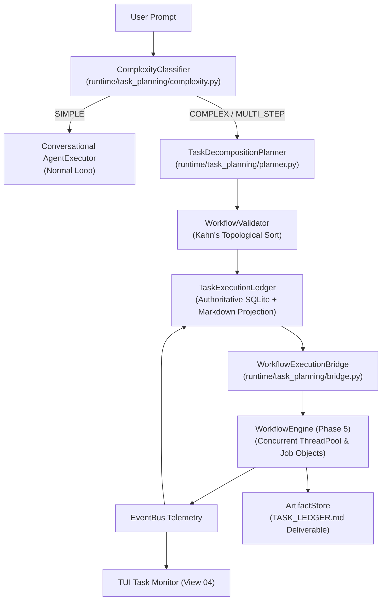

# PRESENCE — TASK DECOMPOSITION & EXECUTION LEDGER (TDEL)
## Phase 0: Architectural Audit & Integration Blueprint

**Project:** Presence — Windows-Native Persistent AI Desktop Companion  
**Runtime:** Python 3.12 x64  
**Operating System:** Windows 11 Enterprise  
**Deliverable:** `PRESENCE_TDEL_ARCHITECTURE_AUDIT.md`  
**Phase:** 0 — Architectural Audit  

---

## 1. Executive Summary & Objective

The objective of this audit is to inspect the completed Phase 0–5 runtime infrastructure of Presence and design the **Task Decomposition & Execution Ledger (TDEL)** layer.

Currently, Presence possesses:
- Phase 1: Supervised subprocess execution under Windows Job Objects (`ProcessManager`).
- Phase 2: Hierarchical task monitoring & SQLite WAL state persistence (`ActiveTaskRegistry`, `PersistenceManager`).
- Phase 3: Governed tool execution, rate limiting, and web traffic controls (`ToolRegistry`, `PermissionBoundary`, `SearchGovernor`).
- Phase 4: Ephemeral isolated subagent spawning (`SubagentManager`).
- Phase 5: Deterministic DAG execution with parallel branch scheduling (`WorkflowEngine`, `WorkflowScheduler`, `WorkflowValidator`).

**The Missing Capability:** Presence lacks an intelligent front-end planning layer that analyzes compound user requests, classifies their complexity, breaks them into verified micro-tasks, projects them into a human-readable task ledger (`TASK_LEDGER.md`), and coordinates their execution through the Phase 5 engine without conversational LLM overhead.

---

## 2. Answers to the 12 Architectural Questions

### 1. Can `WorkflowDefinition` represent user intent, task descriptions, and completion criteria?
**Yes.** `WorkflowDefinition` contains `workflow_id`, `name`, `description`, `metadata`, and a collection of `WorkflowNode` objects. Each node has `node_id`, `name` (display title), `execution_type`, `payload` (configuration), `depends_on`, and `dependency_condition`.  
To explicitly support verifiable completion criteria, we will extend `WorkflowNode` and its plan representation with a typed `completion_criteria` field (e.g. `{"type": "ARTIFACT_EXISTS" | "EXIT_CODE_ZERO" | "NON_EMPTY" | "JSON_FIELD"}`), which maps directly into `VERIFY` adapters or adapter post-conditions.

### 2. Can each workflow node have a readable user-facing title?
**Yes.** The `WorkflowNode.name` field is explicitly designed as a user-facing human-readable string (e.g., `"Step 1: Inventory installed applications"`).

### 3. Does `WorkflowEngine` emit sufficient events to update a task ledger?
**Yes.** `WorkflowEngine` publishes strongly-typed events to `EventBus`:
- `WORKFLOW_STARTED`: run initialization.
- `WORKFLOW_NODE_STARTED`: node dispatched to thread worker.
- `WORKFLOW_NODE_COMPLETED`: node execution succeeded and verified.
- `WORKFLOW_NODE_FAILED`: node execution failed.
- `WORKFLOW_COMPLETED`: terminal success of the graph.
- `WORKFLOW_FAILED`: terminal failure of the graph.
In addition, `ActiveTaskRegistry` publishes `TASK_STARTED`, `TASK_COMPLETED`, and `TASK_FAILED`. The new TDEL ledger can subscribe to these events to update ledger entries deterministically without polling or model calls.

### 4. Can workflow node states be queried without invoking an LLM?
**Yes.** 100% deterministically. States are queried via `engine.get_run(run_id)`, `persistence.get_workflow_run(run_id)`, or `task_registry.get_task(task_id)` in local memory and SQLite. Zero LLM tokens are consumed to inspect task status.

### 5. Can existing workflow persistence represent plan versions?
**Partially.** The `workflows` table records a specific execution run (`run_id`, `workflow_id`, `status`, `definition_json`). However, plans can be revised *before* or *during* execution.  
To cleanly support plan versions, we will introduce a lightweight `task_plans` table in `PersistenceManager` (`plan_id`, `workflow_id`, `conversation_id`, `title`, `plan_version`, `definition_hash`, `status`, `created_at`, `updated_at`). This avoids mutating completed node history and guarantees full provenance.

### 6. Can `TaskRegistry` represent the relationship between a task plan and its workflow?
**Yes.** `TaskNode` in `ActiveTaskRegistry` has `parent_task_id` and `task_type` (`WORKFLOW`, `WORKFLOW_PHASE`, `WORKFLOW_STEP`). The root task plan is registered as a root `TaskType.WORKFLOW`, and each decomposed step is linked as a child `WORKFLOW_STEP`.

### 7. Does the TUI already support displaying hierarchical tasks?
**Yes.** `TasksView` (`runtime/tui/views/tasks_view.py`) renders an interactive tree widget (`#tasks-tree`) using `task_registry.get_active_roots()` and recursively displays child nodes with duration telemetry, status styling, and cancellation buttons.

### 8. Can `ArtifactStore` create and update user-readable Markdown artifacts?
**Yes.** `ArtifactStore.store_text_artifact` stores versioned text artifacts with SHA-256 checksums, line counts, and metadata. We can generate `TASK_LEDGER.md` projections and refresh them atomically as execution advances.

### 9. Can the current chat session distinguish simple conversational requests from complex execution requests?
**Not currently.** In the existing flow, `AgentExecutor` passes all incoming messages straight into `model_provider.generate_turn()`.  
We will implement `ComplexityClassifier` in `runtime/task_planning/complexity.py`. It uses fast deterministic heuristics (e.g. multi-step indicators, action verbs, compound clauses, audit targets) to immediately route `SIMPLE` queries (chat, simple tool lookup) through the normal conversational path, and `COMPLEX` / `MULTI_STEP` / `RESEARCH_HEAVY` queries into the decomposition planner.

### 10. Can a workflow plan be revised safely before execution?
**Yes.** Before `engine.execute_workflow()` is called, the plan exists as an uncommitted `TaskPlan` data structure. It can be modified, re-ordered, or revised, incrementing `plan_version`, and re-validated via `WorkflowValidator` with zero risk to runtime state.

### 11. How are user approvals represented?
**Through the 4-tier `PermissionBoundary` and `AuthorityLevel`.** If a node requires an L3 protected action (e.g. process termination, file deletion), its status in the ledger is set to `AWAITING_APPROVAL`. The plan prompts the user for consent, producing a cryptographic single-use consent token before execution proceeds.

### 12. Can completed workflow nodes remain completed after recovery?
**Yes.** Completed nodes have state `COMPLETED` and output references persisted in `workflow_nodes` table in SQLite. When an interrupted workflow resumes, the scheduler evaluates existing completed node checkpoints and avoids re-executing them, advancing directly to remaining `PENDING` / `READY` tasks.

---

## 3. Reusable Infrastructure & Integration Map



---

## 4. Component Design: Task Decomposition & Execution Ledger

### 4.1 Module Layout
```text
runtime/task_planning/
    __init__.py          # Module exports
    models.py            # TaskPlan, TaskPlanNode, PlanStatus, ComplexityCategory
    complexity.py        # ComplexityClassifier (Deterministic heuristics + fast eval)
    planner.py           # TaskDecompositionPlanner (Generates structured DAG plans)
    ledger.py            # TaskExecutionLedger (Authoritative SQLite state & event sync)
    projection.py        # Markdown projection generator (TASK_LEDGER.md renderer)
    bridge.py            # WorkflowExecutionBridge (Connects TaskPlan to WorkflowEngine)
    service.py           # TaskPlanningService (Façade coordinating classification, planning, execution)
```

### 4.2 SQLite Database Tables (`task_plans`)
```sql
CREATE TABLE IF NOT EXISTS task_plans (
    plan_id TEXT PRIMARY KEY,
    workflow_id TEXT NOT NULL,
    conversation_id TEXT NOT NULL,
    title TEXT NOT NULL,
    goal TEXT NOT NULL,
    complexity TEXT NOT NULL,
    plan_version INTEGER NOT NULL DEFAULT 1,
    definition_hash TEXT NOT NULL,
    status TEXT NOT NULL,
    created_at REAL NOT NULL,
    updated_at REAL NOT NULL,
    completed_at REAL,
    ledger_artifact_id TEXT,
    metadata_json TEXT
);
CREATE INDEX IF NOT EXISTS idx_plans_conv ON task_plans(conversation_id);
CREATE INDEX IF NOT EXISTS idx_plans_status ON task_plans(status);
```

### 4.3 Human-Readable Markdown Projection (`TASK_LEDGER.md`)
Rendered deterministically from SQLite:
```markdown
# Task Ledger: System Audit & MCP Discovery
**Plan ID:** `plan_48a9b2` | **Status:** `IN_PROGRESS` | **Version:** 1  
**Goal:** Audit installed desktop applications and identify compatible MCP servers.

## Execution Progress (2/5 Completed)
- [x] **Step 1: Inventory installed desktop applications** (0.34s)
  - *Type:* `PROCESS` | *Artifact:* `art_inv_819a`
- [x] **Step 2: Identify target integration candidates** (0.12s)
  - *Type:* `TOOL` | *Targets:* Chrome, Blender, DaVinci, Discord
- [/] **Step 3: Discover Blender MCP repositories** (Running...)
  - *Type:* `TOOL` | *Depends on:* Step 2
- [ ] **Step 4: Discover DaVinci & Chrome MCP tools** (Pending)
  - *Type:* `TOOL` | *Depends on:* Step 2
- [ ] **Step 5: Synthesize integration recommendations** (Pending)
  - *Type:* `AGGREGATE` | *Depends on:* Steps 3, 4
```

---

## 5. Execution Phasing Plan

| Phase | Deliverable | Objective |
| :--- | :--- | :--- |
| **Phase 0** | Architecture Audit | Complete verification of existing components and integration plan. |
| **Phase 1** | Planner & Classifier | Complexity classification (`SIMPLE` vs `COMPLEX`) and structured plan generation. |
| **Phase 2** | Persistent Task Ledger | SQLite `task_plans` storage, ACID transaction updates, and event synchronizer. |
| **Phase 3** | Workflow Bridge | Converting `TaskPlan` into `WorkflowDefinition` and dispatching via `WorkflowEngine`. |
| **Phase 4** | Markdown Projection & TUI | Rendering `TASK_LEDGER.md` artifacts and hooking live updates into TUI. |
| **Phase 5** | Interruption Recovery | Reconciling plans on restart; preserving completed nodes without rerunning. |
| **Phase 6** | Plan Management Tools | Implementing `presence.manage_plan` (pause, resume, retry, inspect, revise). |
| **Phase 7** | Testing & Benchmarks | Full test suite, token efficiency benchmarks, and regression verification. |

---
*Phase 0 Audit is complete. Ready to proceed to Phase 1.*
