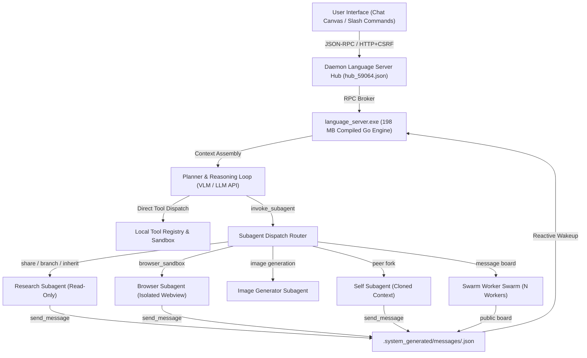

# Forensic Deliverable 06: Antigravity Agent Orchestration & Intelligence Engine

**Investigation Scope:** Core Agent Architecture, Lifecycle, Subagent Specialization, and Communication  
**Date of Capture:** November 15, 2026  
**Status:** COMPLETED — RECONNAISSANCE 08  

---

## 1. Main Agent Architecture & Initialization



### 1.1 Core Backend Daemon (`language_server.exe`)
* **[DIRECTLY OBSERVED]** The core agent orchestration engine is **not** written in JavaScript/TypeScript inside the Electron renderer. It is an independent, high-performance native compiled binary:
  * **Path:** `C:\Users\chait\AppData\Local\Programs\antigravity\resources\bin\language_server.exe`
  * **File Size:** 197,992,960 bytes (~198 MB)
  * **REA Tool Evidence:** `inspect_go_binary` (Evidence ID: `ev_80a8c667424b22818e11ecd362fad3bb027f6390f609996fe56404fbc0b0ef3a`)
  * **Compiler Identity:** `go1.28-20261102-RC00 cl/1012564305 +298f53e483 X:boringcrypto,simd,nogolistexportnewformat`
  * **Build Provenance:** Google internal Piper changelist `cl/1012564305`, compiled with FIPS-validated BoringCrypto (`boringcrypto`) and SIMD vector math extensions (`simd`).
* **[DIRECTLY OBSERVED]** The daemon lifecycle is tracked via ephemeral JSON lockfiles in `C:\Users\chait\.gemini\antigravity\daemon\hub_<port>.json`:
  * Observed configuration in `hub_59064.json`:
    ```json
    {
      "pid": 29840,
      "httpsPort": 59063,
      "httpPort": 59064,
      "lsVersion": "2.31.2",
      "csrfToken": "eb9442d9-3623-4906-9122-99ed8a07e83d"
    }
    ```
  * The Electron frontend connects to `language_server.exe` via loopback HTTP/HTTPS using mutual session CSRF tokens (`csrfToken`).

### 1.2 Agent State Persistence & Migration
* **[DIRECTLY OBSERVED]** Global agent state and onboarding configurations are stored as structured Protobuf text format (`antigravity_state.pbtxt`):
  * Path: `C:\Users\chait\.gemini\antigravity\antigravity_state.pbtxt`
  * Contains installation UUID: `7334439b-74a8-4b1e-94d8-27a193270c85`
  * Active model tracker: `last_selected_agent_model: MODEL_PLACEHOLDER_M318`
  * Migration state machine tracking stages 2 through 8 (`MIGRATION_STATUS_COMPLETED`).

---

## 2. Instruction Entry & Execution Contexts

* **[DIRECTLY OBSERVED]** Instructions enter the orchestration loop wrapped in strict XML boundary envelopes:
  * `<USER_REQUEST>`: Raw natural language prompt.
  * `<ADDITIONAL_METADATA>`: ISO-8601 wall-clock timestamp and timezone offset.
  * `<USER_SETTINGS_CHANGE>`: Explicit delta notification for model switches, sandbox modes, or tool execution policies.
* **[DIRECTLY OBSERVED]** Execution Context Creation:
  * Every session receives a dedicated UUID: `a7b83e44-f550-40eb-a7aa-0cdd748e332b`.
  * Dedicated on-disk working directory created at `C:\Users\chait\.gemini\antigravity\brain\<conversation-id>\`.
  * File subdirectories initialized: `.system_generated/logs/`, `.system_generated/steps/`, `.system_generated/tasks/`, `.system_generated/messages/`, and `scratch/`.

---

## 3. Specialized Subagents & Delegation Routing

Antigravity defines four built-in subagent archetypes with distinct capability boundaries:

| Subagent Type | Access Capabilities | Sandbox & Filesystem Boundaries | Primary Purpose | Evidence Source |
| :--- | :--- | :--- | :--- | :--- |
| **`self`** | Inherits full parent configuration | Full workspace read/write, run_command, MCP tools | Running autonomous tasks in an isolated conversational thread without context pollution. | [DIRECTLY OBSERVED] System Prompt `subagents` |
| **`research`** | Read-only tools | Strictly read-only sandbox, NO network access, no terminal execution | Broad survey of codebase, indexing files, without risk of accidental mutations. | [DIRECTLY OBSERVED] System Prompt `subagents` |
| **`browser`** | Webview automation (Playwright/Puppeteer) | Strictly confined to `browser_sandbox/uploads` and `browser_sandbox/references` | Navigating web apps, client-side JS rendering, visual page clicking. No shell access. | [DIRECTLY OBSERVED] System Prompt `subagents` |
| **`image-generator`** | Diffusion image synthesis | Outputs to designated asset directory | Programmatic image generation from structured text briefs. | [DIRECTLY OBSERVED] System Prompt `subagents` |

### 3.1 Subagent Workspace Isolation Modes
* **[DIRECTLY OBSERVED]** When launching subagents via `invoke_subagent`, the runtime supports three workspace modes:
  1. `Workspace: "inherit"` (Default): Shares the parent's working directory.
  2. `Workspace: "branch"`: Creates an isolated Git clone/branch for safe experimentation.
  3. `Workspace: "share"`: Uses Git worktrees or Mercurial share (`hg share`) to create independent working copies without duplicating disk storage.

---

## 4. Inter-Agent Communication & Parallel Coordination

* **[DIRECTLY OBSERVED]** Asynchronous Reactive Wakeup Architecture:
  * Agents do **NOT** poll in CPU-burning loops.
  * Antigravity implements a message-bus pattern backed by files in `.system_generated/messages/`:
    * Observed files: `12dd8929-98e6-48d5-8a37-e018e5a83ab8.json`, `read.json`.
    * When a subagent calls `send_message(Recipient, Message)`, a message packet with `priority=MESSAGE_PRIORITY_HIGH` is written to disk.
    * The Go daemon detects the write, resumes the suspended parent process turn, and injects the message as a `<SYSTEM_MESSAGE>`.
* **[DIRECTLY OBSERVED]** Parallel Swarm Orchestration (`native_swarm`):
  * Supports spawning homogeneous worker teams (`<name>-1` through `<name>-<n>`) using the `swarm` tool.
  * Public message board: Workers share a public brief and communicate via `@mentions`.
  * Dedicated `swarm_monitor` agent runs on an independent timer to detect deadlocks or stalled members and unstuck the team.
