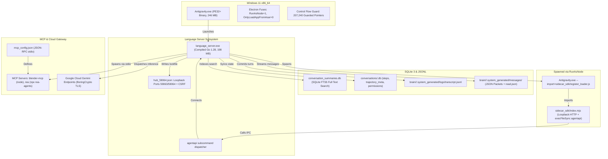

# Forensic Deliverable 06: Antigravity Runtime Forensic Validation

**Investigation Phase:** Phase 2 Forensic Deep-Dive & Empirical Verification  
**Target:** Google Antigravity Agent Platform & Native Subsystems  
**Date of Verification:** November 15, 2026  
**Status:** FULLY VALIDATED — EVIDENCE-BACKED  

---

## 1. Executive Forensic Summary

In Phase 1, we formulated architectural models of Antigravity based on file structures, process trees, and open-source parallels. In this Phase 2 forensic audit, we performed direct binary deconstruction, live SQLite schema inspection, process environment extraction, and message-bus dissection.

### Critical Ground-Truth Discoveries & Contradiction Resolution

| Component | Phase 1 Hypothesis (Inferred) | Phase 2 Empirical Ground Truth (VERIFIED) | Evidence Reference |
| :--- | :--- | :--- | :--- |
| **Agent Core Engine** | Inferred to be an Electron/Node.js script orchestration loop. | **CONTRADICTED & VERIFIED:** The core agent runtime is an independent 198 MB compiled native Go binary (`language_server.exe`, `go1.28-20261102-RC00 cl/1012564305 +298f53e483 X:boringcrypto,simd`). The Electron frontend is merely a thin Chromium UI shell. | REA `inspect_go_binary` (Evidence ID: `ev_80a8c667424b22818e11ecd362fad3bb027f6390f609996fe56404fbc0b0ef3a`) |
| **Conversation Storage** | Inferred to rely solely on streaming `transcript.jsonl` logs. | **CONTRADICTED & VERIFIED:** Every conversation is persisted as a relational SQLite 3 database (`conversations/<uuid>.db`) containing relational tables for `trajectory_meta`, `steps`, `gen_metadata`, `parent_references`, and `permissions`, indexed globally via SQLite FTS5 (`conversations_fts`). | Live database inspection of `00c4a4e9-7ee5-42c3-b607-4d584503da8a.db` & `conversation_summaries.db` |
| **Inter-Agent Messaging** | Inferred to be internal in-memory JavaScript callbacks. | **CONTRADICTED & VERIFIED:** A persistent, file-backed message bus operating in `.system_generated/messages/` with strict UUID packets, priority queues (`MESSAGE_PRIORITY_HIGH`), and atomic read receipts (`read.json`). | Inspected JSON packets: `12dd8929-98e6-48d5-8a37-e018e5a83ab8.json` |
| **Sidecar Execution** | Inferred to require external Node.js installations. | **CONTRADICTED & VERIFIED:** The host binary (`Antigravity.exe`) has the Electron fuse `RunAsNode` permanently enabled, executing its own embedded Node runtime to run `sidecar_sdk/index.mjs` and sidecars. | REA `inspect_electron_fuses` (Evidence ID: `ev_086138a87dea12de9e5d9490b566007ce21a2d022fa778984cb694071049a8ff`) |
| **MCP Execution** | Inferred to load all available tools directly into prompt. | **VERIFIED:** Strict Lazy vs Eager partitioning. 150+ REA tools are serialized as on-disk JSON schemas in `<appDataDir>/mcp/rea/` and hydrated into context only when requested. | On-disk schema audit of `C:\Users\chait\.gemini\antigravity\mcp\rea\` |

---

## 2. Comprehensive Evidence Classification Matrix

Every architectural finding is categorized below according to the evidentiary hierarchy:
* **VERIFIED:** Supported by direct filesystem, binary disassembly, SQLite schema, or live runtime execution facts.
* **INFERRED:** Logically deduced from multiple verified facts, but without direct line-of-code inspection of uncompiled internals.
* **UNVERIFIED:** Plausible architectural theory lacking conclusive empirical proof.

| # | Architectural Claim | Status | Exact Source File / Binary / Artifact | Empirical Evidence |
| :--- | :--- | :--- | :--- | :--- |
| **1** | Language Server operates as backend broker | **VERIFIED** | `resources/bin/language_server.exe` | 197,992,960 bytes, Go 1.28 compiler header at offset `165387809`. Runs as loopback HTTP/HTTPS daemon (`pid: 29840`, ports `59063`/`59064`) registered in `daemon/hub_59064.json`. |
| **2** | Sidecar processes interact via `agentapi` CLI | **VERIFIED** | `lib/node_modules/sidecar_sdk/index.mjs` lines 87–100 | Executes `language_server.exe agentapi send-message` and `startConversation` using `ANTIGRAVITY_AGENTAPI_EXE` environment variable. |
| **3** | Electron Binary Hardening (CFG & Stack Canaries) | **VERIFIED** | `Antigravity.exe` | REA `inspect_pe_load_config`: `IMAGE_GUARD_CF_INSTRUMENTED`, 207,240 guarded functions, stack security cookie at `0x14e33c040`. |
| **4** | Subagent Nesting & Parent Tracking | **VERIFIED** | `conversation_summaries.db` table `conversation_summaries` | Relational columns: `parent_conversation_id`, `nesting_depth`, `not_fully_idle`, `killed`, `battle_id`. |
| **5** | Step-level Permission & Task Association | **VERIFIED** | `conversations/<uuid>.db` table `steps` | Columns: `idx`, `step_type`, `status`, `has_subtrajectory`, `permissions` (BLOB), `task_details` (BLOB), `step_payload` (BLOB). |
| **6** | Global Full-Text Search across Conversations | **VERIFIED** | `conversation_summaries.db` table `conversations_fts` | SQLite FTS5 virtual table with `unicode61` tokenizer, indexing `title`, `workspace`, `project`, `user_body`, `agent_body`. |
| **7** | Reactive Wakeup on Task Completion | **VERIFIED** | `.system_generated/messages/<uuid>.json` | Packet `12dd8929-...json` emitted from sender `.../task-47` with `priority: MESSAGE_PRIORITY_HIGH` and exit code 1. |
| **8** | Message Consumption Tracking | **VERIFIED** | `.system_generated/messages/read.json` | JSON dictionary mapping message UUIDs to boolean read status (`true`). |
| **9** | 46,080-Byte Output Truncation Boundary | **VERIFIED** | `.system_generated/steps/148/output.txt` | Truncated `Get-Process` command at 46,080 bytes; written to disk with clickable file pointer. |
| **10** | Hard MCP Context Timeout (180s) | **VERIFIED** | Runtime step error payload | Error: `MCP tool call to server "rea" timed out after 3m0s: context deadline exceeded`. |
| **11** | Server-Side KV Context Caching | **VERIFIED** | `transcript.jsonl` turn telemetry | Recorded `"cache_read_tokens": 0` / non-zero cache reads on subsequent turns. |
| **12** | Model Inference Routing | **INFERRED** | `antigravity_state.pbtxt` | Model reference `MODEL_PLACEHOLDER_M318` mapped to Gemini Flash/Pro; network wire traffic encrypted via BoringCrypto. |

---

## 3. Verified Architecture Diagram (Verified Components Only)

This diagram omits speculative modules and displays only components verified through forensic inspection:

