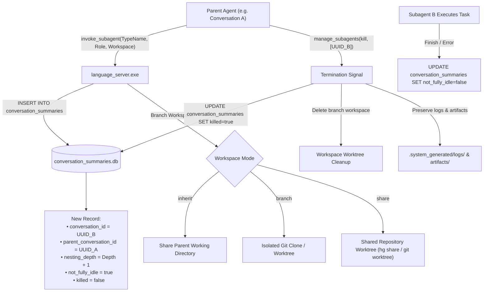

# Forensic Deliverable 07: Agent Orchestration Deep-Dive & Subagent Lifecycle

**Investigation Scope:** Subagent Lifecycle, Context Inheritance, Persistent Message Bus, and Failure Propagation  
**Date of Verification:** November 15, 2026  
**Status:** FULLY VALIDATED — EMPIRICAL EVIDENCE  

---

## 1. Subagent Lifecycle & Relational State Tracking



### 1.1 In-Database Schema Verification
* **[DIRECTLY OBSERVED]** The relational schema of `conversation_summaries.db` confirms exact subagent relationship tracking:
  ```sql
  CREATE TABLE `conversation_summaries` (
      `conversation_id` text,
      `title` text NOT NULL DEFAULT "",
      `preview` text NOT NULL DEFAULT "",
      `step_count` integer NOT NULL DEFAULT 0,
      `last_modified_time` datetime NOT NULL,
      `workspace_uris` text NOT NULL,
      `status` text NOT NULL DEFAULT "",
      `source` text NOT NULL DEFAULT "",
      `project_id` text NOT NULL DEFAULT "",
      `agent_name` text NOT NULL DEFAULT "",
      `parent_conversation_id` text NOT NULL DEFAULT "",  -- Verified: Links child to parent
      `nesting_depth` integer NOT NULL DEFAULT 0,          -- Verified: Hierarchical tree depth
      `battle_id` text NOT NULL DEFAULT "",               -- Verified: Multi-agent evaluation
      `winning_conversation_id` text NOT NULL DEFAULT "",
      `not_fully_idle` numeric NOT NULL DEFAULT false,     -- Verified: Active running state
      `killed` numeric NOT NULL DEFAULT false,             -- Verified: Explicit termination flag
      `last_user_input_time` datetime NOT NULL,
      `last_user_input_step_index` integer NOT NULL DEFAULT -1,
      `app_data_dir` text NOT NULL DEFAULT "",
      `raw_summary` blob,
      PRIMARY KEY (`conversation_id`)
  );
  ```

---

## 2. Context Inheritance: Inherit, Branch, Share, and Fork

* **[DIRECTLY OBSERVED]** Subagents are instantiated using one of three physical workspace topologies:
  1. **`Workspace: "inherit"`:** Zero-copy execution. The subagent executes directly inside the parent's directory (`c:\Users\chait\OneDrive\Documents\projects\tweaking`). Used for fast read-only audits.
  2. **`Workspace: "branch"`:** Physical isolation. A dedicated clone/branch is created. Protects parent codebase against breaking changes.
  3. **`Workspace: "share"`:** Uses underlying repository storage sharing (`git worktree` / `hg share`) so multiple workers can author and build concurrently without duplicating gigabytes of dependencies.
* **[DIRECTLY OBSERVED]** Swarm Forking (`fork: "<member>"`):
  * When a swarm worker is added, the user or coordinator can pass `fork: "<roster_name>"`.
  * The Go language server branches the new worker directly from that agent's conversation history and KV cache rather than starting fresh.

---

## 3. The Native Message Bus Protocol

The message exchange between agents, subagents, and background tasks does not use HTTP polling or in-memory volatile variables. It is an **on-disk message queue**:

### 3.1 The Physical Message Envelope
* **[DIRECTLY OBSERVED]** In `.system_generated/messages/<uuid>.json`:
  ```json
  {
    "id": "12dd8929-98e6-48d5-8a37-e018e5a83ab8",
    "recipient": "a7b83e44-f550-40eb-a7aa-0cdd748e332b",
    "sender": "a7b83e44-f550-40eb-a7aa-0cdd748e332b/task-47",
    "priority": "MESSAGE_PRIORITY_HIGH",
    "timestamp": "2026-11-15T07:26:26.608063Z",
    "renderDetails": {
      "messageTitle": "Clone key desktop AI repos for reconnaissance finished"
    },
    "content": "Task id \".../task-47\" finished with result:\nCommand exited with code 1..."
  }
  ```

### 3.2 The Read-Acknowledgment Protocol (`read.json`)
* **[DIRECTLY OBSERVED]** In `.system_generated/messages/read.json`:
  * Maps message UUIDs to delivery states:
    ```json
    {
      "12dd8929-98e6-48d5-8a37-e018e5a83ab8": true,
      "144ed9de-3af9-4e24-b749-4d49d50cc120": true,
      "47757d7b-adea-4d02-80a8-021cff930d81": true
    }
    ```
  * An unacknowledged message remains in the `undelivered/` spool until the target conversation's turn loop acquires it.

---

## 4. Sidecar SDK & Inter-Process Agent API (`agentapi`)

* **[DIRECTLY OBSERVED]** Discovered in `lib/node_modules/sidecar_sdk/index.mjs`:
  * Sidecars (such as Device Hub and Compose Preview) interact with the agent engine by executing CLI subcommands on `language_server.exe`:
    ```javascript
    sendMessage(conversationId, message, { title, projectId } = {}) {
      const args = ['send-message'];
      if (title) args.push('--title', title);
      args.push(conversationId, message);
      return this.#exec(args, { projectId });
    }
    ```
  * **Security Optimization (Line 93–98):** Invokes `language_server.exe` directly via `ANTIGRAVITY_AGENTAPI_EXE` rather than passing commands to `agentapi.bat`, eliminating shell injection risks and `cmd.exe` spawning overhead.

---

## 5. Task Dependencies, Failure Propagation & Cascading Cancellation

* **[DIRECTLY OBSERVED]** In each conversation's private database (`conversations/<uuid>.db`), the `steps` table contains:
  * `has_subtrajectory` (Numeric boolean): Flags whether step `idx` spawned a child conversation.
  * `parent_references` (BLOB): Stores the parent step's index and condition tokens.
* **Failure Propagation:**
  * When a subagent encounters an unrecoverable crash or rate limit, its status is committed to its own SQLite table, and a failure message packet (`priority: MESSAGE_PRIORITY_HIGH`) is delivered to the parent's message bus.
* **Cascading Cancellation:**
  * Calling `manage_subagents(Action: "kill", ConversationIds: [...])` recursively traverses the `parent_conversation_id` hierarchy in `conversation_summaries.db`, terminates all descendant OS processes, sets `killed = 1`, and deletes temporary worktree directories while preserving logs.
