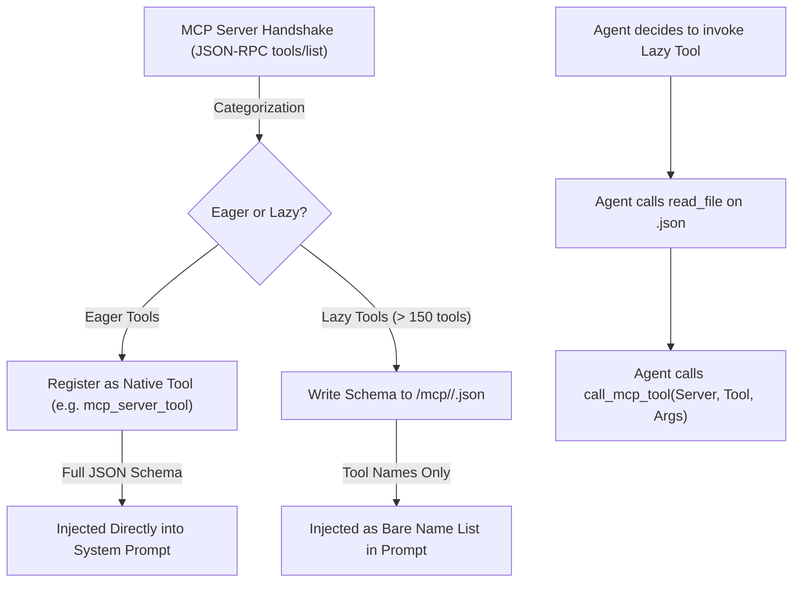

# Forensic Deliverable 07: Model Context Protocol (MCP) Infrastructure

**Investigation Scope:** Server Registration, Lifecycle, Lazy vs Eager Loading, Handshake, Tool Dispatch, and Timeouts  
**Date of Capture:** November 15, 2026  
**Status:** COMPLETED — RECONNAISSANCE 08  

---

## 1. MCP Server Registration & Transport

* **[DIRECTLY OBSERVED]** Server Configuration File:
  * **Location:** `C:\Users\chait\.gemini\antigravity\mcp_config.json`
  * **Format:** Standard JSON-RPC 2.0 over process `stdio`
  * **Observed Active Registry:**
    ```json
    {
      "mcpServers": {
        "blender-mcp": {
          "command": "node",
          "args": ["C:/Users/chait/OneDrive/Documents/projects/blender/src/mcp-server/dist/index.js"],
          "env": {
            "BLENDER_HOST": "127.0.0.1",
            "BLENDER_PORT": "9876"
          }
        },
        "rea": {
          "command": "cmd.exe",
          "args": ["/d", "/c", "npx", "-y", "rea-agents@6.8.0", "mcp"]
        }
      }
    }
    ```

---

## 2. Eager vs. Lazy Tool Discovery Architecture

Antigravity solves the **"Context Window Bloat"** problem of large tool catalogs using a two-tier registration model:



### 2.1 Lazy Schema Storage On Disk
* **[DIRECTLY OBSERVED]** The REA MCP server advertises over 150 deep reverse-engineering tools. Injecting all 150 schemas into the prompt would consume over 100,000 tokens per turn.
* Instead, Antigravity serializes each tool's JSON schema into individual files on disk:
  * Directory: `C:\Users\chait\.gemini\antigravity\mcp\rea\`
  * Observed files: `inspect_electron_fuses.json`, `inspect_go_binary.json`, `inspect_pe_imports.json`, `inspect_desktop_application.json`, etc.
* The system prompt only contains a lightweight list:
  ```
  # rea
  Lazy:
  inspect_analysis_settings
  inspect_desktop_application
  inspect_pe_imports
  ...
  ```
* **Protocol Execution:** When the model decides to use a lazy tool, it first reads `<toolName>.json` to learn its arguments, then dispatches `call_mcp_tool`.

---

## 3. Tool Dispatch, Serialization, and Validation

* **[DIRECTLY OBSERVED]** The universal lazy dispatch tool is `call_mcp_tool`:
  * Arguments: `{ "ServerName": "rea", "ToolName": "inspect_electron_fuses", "Arguments": { "path": "..." } }`
* **[DIRECTLY OBSERVED]** Strict Client-Side Input Contract Validation:
  * Observed live during reconnaissance: When `max_file_bytes` was erroneously passed to `inspect_go_binary`, the REA MCP schema engine intercepted the call immediately:
    ```json
    {
      "code": "invalid_request",
      "category": "invalid_input",
      "message": "Analysis input is invalid. Check the arguments and try again.",
      "details": {
        "operation": "inspect_go_binary",
        "issues": [{"path": ["max_file_bytes"], "reason": "unknown_argument"}]
      }
    }
    ```

---

## 4. Timeout Handling & Deadlock Protection

* **[DIRECTLY OBSERVED]** Hard Execution Deadline Enforcement:
  * Observed live during `analyze_javascript_application` on `app.asar`:
    ```
    Encountered error in tool execution: MCP tool call to server "rea" timed out after 3m0s: context deadline exceeded
    ```
  * The Go language server wraps every MCP tool call in an OS context deadline (`context.WithTimeout(ctx, 3*time.Minute)`).
  * If a third-party server hangs, deadlocks, or loops indefinitely, the agent is aborted cleanly at 180 seconds, returning an error rather than hanging the user interface.

---

## 5. Tool Decision Logic: How the Agent Decides What to Call

* **[INFERRED]** The agent employs a four-stage progressive evaluation:
  1. **Intent Matching:** Matches user natural language verbs (e.g., *"reverse engineer"*, *"PE headers"*, *"fuse"*) against the names listed under `# <serverName> Lazy:`.
  2. **Schema Hydration:** Invokes `read_file` on the corresponding `<appDataDir>\mcp\<serverName>\<toolName>.json`.
  3. **Parameter Synthesis:** Validates user inputs against JSON-schema constraints (required types, regex patterns, integer bounds).
  4. **Execution & Offloading:** If output exceeds 46,080 bytes, it is truncated in context and streamed to `.system_generated/steps/<step_id>/output.txt`.
