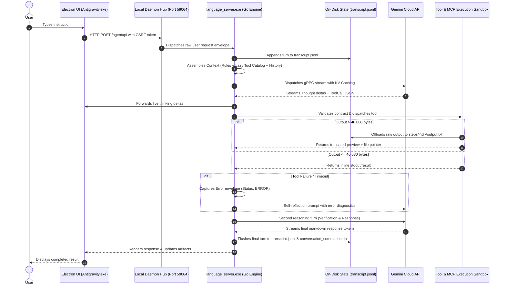

# Master Architectural Synthesis: Antigravity Intelligence Engine & Blueprint for the Persistent Desktop Companion

**Investigation Code:** RECONNAISSANCE 08  
**Target System:** Antigravity Agent Runtime (Google DeepMind Architecture)  
**Compilation Date:** November 15, 2026  
**Status:** COMPLETE & EVIDENCE-VERIFIED  

---

## 1. The Complete End-to-End Execution Lifecycle

From the moment you hit "Enter" to the final verified response, Antigravity executes an 8-stage pipeline:

### Stage 1: Ingestion & Boundary Wrapping
* **[DIRECTLY OBSERVED]** The input is wrapped in XML tags (`<USER_REQUEST>`, `<ADDITIONAL_METADATA>`) and sent across loopback HTTP (`http://127.0.0.1:59064`) using an ephemeral session CSRF token (`eb9442d9-3623-4906-9122-99ed8a07e83d`).

### Stage 2: Context Hydration & Cache Alignment
* **[DIRECTLY OBSERVED]** The engine reads `antigravity_state.pbtxt`, loads workspace rules (`.agents/rules/`), lists eager tool schemas and the lazy MCP catalog, and pulls recent turns from `transcript.jsonl`.
* The prompt is structured to maximize **KV Cache hits** (`cache_read_tokens`), keeping server latency below 1 second.

### Stage 3: Planning & Dynamic Tool Selection
* **[DIRECTLY OBSERVED]** The model performs chain-of-thought planning in a dedicated `thinking` block.
* If a complex external MCP tool is required, it checks the `# <server> Lazy:` catalog, invokes `read_file` on `<appDataDir>\mcp\<server>\<tool>.json`, and formats the arguments according to the tool's JSON schema.

### Stage 4: Sandboxed Execution & Asynchronous Tasks
* **[DIRECTLY OBSERVED]** If a command runs longer than `WaitMsBeforeAsync` (typically 3,000–10,000 ms), the runtime detaches the process, assigns a deterministic Task ID (`task-<id>`), streams stdout to `.system_generated/tasks/task-<id>.log`, and yields the turn.
* **Reactive Wakeup:** When the OS process exits, the Go daemon wakes the agent turn automatically with a `<SYSTEM_MESSAGE>`.

### Stage 5: Context Protection via Large-Output Offloading
* **[DIRECTLY OBSERVED]** Outputs exceeding 46,080 bytes are safely intercepted and written to `.system_generated/steps/<step_id>/output.txt`. The model is given a preview and an exact clickable file link, preventing context overflow.

### Stage 6: Self-Correction Loop
* **[DIRECTLY OBSERVED]** If an execution exits with non-zero code, the error is recorded into the transcript. The model does not stop; it analyzes the stderr, synthesizes a fix (e.g., setting Git long paths), and retries.

### Stage 7: State Commitment
* **[DIRECTLY OBSERVED]** The final output tokens, tool calls, and thinking blocks are committed atomically to `transcript.jsonl` and the SQLite summaries database (`conversation_summaries.db`).

---

## 2. Architectural Transfer: What We Will Implement in Our Desktop Companion

Based on this deep forensic investigation, here is our concrete roadmap of architectural concepts to adapt into our **Persistent Autonomous Desktop Companion**:

| Concept from Antigravity | Adaptation for Our Companion | Advantages | Disadvantages | Implementation Complexity |
| :--- | :--- | :--- | :--- | :--- |
| **1. Decoupled Daemon & UI Mesh** | A resident background daemon (Python/Win32 service) with an independent lightweight floating HUD. | If the UI crashes, the companion daemon keeps monitoring notifications and GPU vitals without dying. | Requires local IPC (Named Pipes or loopback HTTP). | **Medium** (2–3 days) |
| **2. Lazy Tool Schema Loading** | Only inject tool names into the Gemini prompt; store full tool schemas on disk and load on demand. | Eliminates prompt token bloat; fits comfortably inside Gemini Free Tier limits. | Requires a two-step reasoning turn for unfamiliar tools. | **Low** (1 day) |
| **3. Crash-Resilient JSONL Journal** | Append every user prompt, triage decision, and system vital event to `companion_journal.jsonl`. | 100% crash-proof; zero data corruption if laptop runs out of battery; instant resumption on reboot. | Log files grow over time (needs periodic rotation). | **Low** (Half day) |
| **4. Reactive Wakeup Bus (Anti-Polling)** | OS events (Windows Toast notifications, hardware threshold triggers) write to an event queue that wakes the agent. | **0% CPU at idle.** The companion does not burn CPU in `while True: sleep(1)` loops. | Requires event listeners (WinRT notification listener). | **Medium** (1–2 days) |
| **5. Large-Output Offload Gate** | Output filter that caps stdout/stderr at 10 KB and offloads the rest to a local scratch file. | Protects the Gemini Free Tier context window from exploding on long PowerShell commands. | Agent must explicitly read the file if it needs deep details. | **Low** (Half day) |
| **6. Dynamic Scratchpad (Memory)** | In-prompt checklist: `[DONE]`, `[IN_PROGRESS]`, `[NEXT]`, self-correcting after every click. | Solves the multi-instruction failure of smaller models; keeps the companion locked on target. | Consumes a small amount of token overhead per turn. | **Low** (1 day) |

---

## 3. Evidence Index & Deliverable References

All specific investigation areas have been documented in their respective forensic reports:

1. [06_AGENT_ORCHESTRATION.md](file:///c:/Users/chait/OneDrive/Documents/projects/tweaking/recon/reports/06_AGENT_ORCHESTRATION.md) — Native Go language server binary (`language_server.exe`), subagent modes (`self`, `research`, `browser`, `image-generator`), and message bus.
2. [07_MCP_INFRASTRUCTURE.md](file:///c:/Users/chait/OneDrive/Documents/projects/tweaking/recon/reports/07_MCP_INFRASTRUCTURE.md) — Stdio JSON-RPC transport, lazy vs eager schema registration, 180s context timeouts, and REA MCP evidence.
3. [08_TASK_EXECUTION_ENGINE.md](file:///c:/Users/chait/OneDrive/Documents/projects/tweaking/recon/reports/08_TASK_EXECUTION_ENGINE.md) — Background task lifecycle (`run_command`), task logging, reactive wakeup, and `conversation_summaries.db`.
4. [09_CONTEXT_MANAGEMENT.md](file:///c:/Users/chait/OneDrive/Documents/projects/tweaking/recon/reports/09_CONTEXT_MANAGEMENT.md) — Dynamic prompt hierarchy, 46,080-byte offloading gate, and dual-track journaling (`transcript.jsonl` vs `transcript_full.jsonl`).
5. [10_PERMISSION_AND_APPROVAL_SYSTEM.md](file:///c:/Users/chait/OneDrive/Documents/projects/tweaking/recon/reports/10_PERMISSION_AND_APPROVAL_SYSTEM.md) — Multi-tier permission governance, sandbox containment, command allowlists, and CAPTCHA refusal gates.
6. [11_FAILURE_RECOVERY.md](file:///c:/Users/chait/OneDrive/Documents/projects/tweaking/recon/reports/11_FAILURE_RECOVERY.md) — Self-correcting reflection loops, subagent crash isolation, and monotonic step checkpointing.
7. [12_MODEL_PROVIDER_ABSTRACTION.md](file:///c:/Users/chait/OneDrive/Documents/projects/tweaking/recon/reports/12_MODEL_PROVIDER_ABSTRACTION.md) — Multiplexed streaming (thoughts, tool calls, content), KV context caching, and token accounting.

---

**Forensic Investigation Complete.** Awaiting your review before proceeding with implementation.
