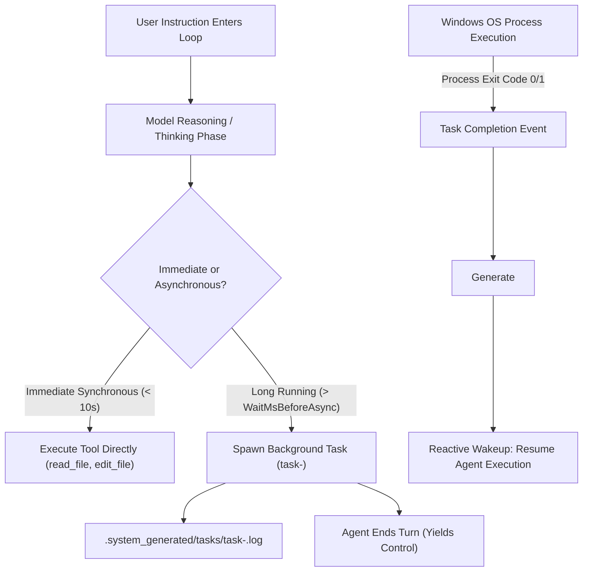

# Forensic Deliverable 08: Task Planning & Execution Engine

**Investigation Scope:** Natural Language Processing, Task Decomposition, Background Tasks, Reactive Wakeup, and State Retention  
**Date of Capture:** November 15, 2026  
**Status:** COMPLETED — RECONNAISSANCE 08  

---

## 1. Instruction Processing & Task Decomposition



* **[DIRECTLY OBSERVED]** The agent decomposes complex tasks into discrete tool-call turns. In each turn, the model outputs:
  1. `thinking`: Structured chain-of-thought analysis hidden from the final user response.
  2. `tool_calls`: An array of one or more tool calls dispatched simultaneously or sequentially.
  3. `content`: User-facing markdown communication or artifact updates.

---

## 2. Background Task Management & Asynchronous Execution

Antigravity features a native background task scheduler integrated with the operating system:

### 2.1 The `run_command` Async Contract
* **[DIRECTLY OBSERVED]** `run_command` accepts three critical parameters:
  * `CommandLine`: PowerShell/Shell command to execute.
  * `WaitMsBeforeAsync`: Milliseconds to block before automatically backgrounding (typically 3,000–10,000 ms).
  * `IsDaemon`: Boolean flag for permanent daemons (dev servers, tunnels).
* If a command does not finish within `WaitMsBeforeAsync`, the runtime intercepts it, assigns a deterministic Task ID (`<conversation_id>/task-<id>`), and detaches it into a background thread.

### 2.2 Forensic Evidence from Live Execution
* Observed during our reconnaissance:
  ```
  Tool is running as a background task with task id: a7b83e44-f550-40eb-a7aa-0cdd748e332b/task-47
  Task logs are available at: file:///C:/Users/chait/.gemini/antigravity/brain/a7b83e44-f550-40eb-a7aa-0cdd748e332b/.system_generated/tasks/task-47.log
  ```
* **[DIRECTLY OBSERVED]** The log file on disk (`.system_generated/tasks/task-47.log`) streams live stdout/stderr.
* **[DIRECTLY OBSERVED]** The runtime provides `manage_task` to inspect live progress:
  * `Action: "status"`: Retrieves exit code and trailing log lines.
  * `Action: "send_input"`: Passes stdin to an interactive CLI.
  * `Action: "kill"`: Terminates the background process tree.

---

## 3. The Reactive Wakeup Protocol (Zero-Polling)

* **[DIRECTLY OBSERVED]** Anti-Polling Architecture:
  * Agents are explicitly forbidden from running `sleep` loops or polling status in a spinlock.
  * When a background process finishes, the Go daemon captures the exit code and injects an automated high-priority system wake-up message:
    ```xml
    <SYSTEM_MESSAGE>
    [Message] timestamp=2026-11-15T07:26:26Z sender=a7b83e44-f550-40eb-a7aa-0cdd748e332b/task-47 priority=MESSAGE_PRIORITY_HIGH content=Task id "a7b83e44-f550-40eb-a7aa-0cdd748e332b/task-47" finished with result:
    Command exited with code 0.
    </SYSTEM_MESSAGE>
    ```
  * This wakes the agent from sleep instantaneously without wasting CPU cycles.

---

## 4. Long-Running State Retention & Session Recovery

* **[DIRECTLY OBSERVED]** State across long-running tasks is anchored in three persistent stores:
  1. **Conversation Summaries Database (`conversation_summaries.db`):**
     * File path: `C:\Users\chait\.gemini\antigravity\conversation_summaries.db`
     * File size: 18,833,408 bytes (~18.8 MB)
     * Format: SQLite 3 with Write-Ahead Logging (`conversation_summaries.db-wal`, `conversation_summaries.db-shm`).
     * Indexes conversation summaries, project memberships, and active execution markers.
  2. **The Artifact Store (`brain/<conversation-id>/`):**
     * Persists structured deliverables and architectural documentation that remain accessible even if the sliding context window compacts or truncates.
  3. **Scratchpad Directory (`brain/<conversation-id>/scratch/`):**
     * Permanent scratchpad storage for intermediate scripts, data files, and logs.
