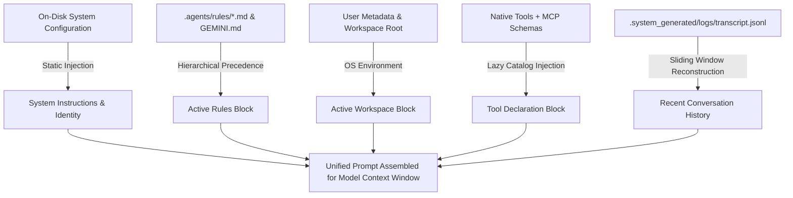

# Forensic Deliverable 09: Context Management & History Retention

**Investigation Scope:** Context Construction, Output Offloading, Truncation Protocols, and Session Continuity  
**Date of Capture:** November 15, 2026  
**Status:** COMPLETED — RECONNAISSANCE 08  

---

## 1. Context Assembly & Dynamic Prompt Construction



* **[DIRECTLY OBSERVED]** The prompt received by the model is assembled hierarchically:
  1. `<identity>`: Base agent persona and mission boundaries.
  2. `<artifacts>`: Specifications on markdown artifact persistence and KaTeX formatting.
  3. `<conversation_transcript>`: Location pointers to `transcript.jsonl` and `transcript_full.jsonl`.
  4. `<guidelines>`: Strict safety rules (permission bypass refusal, CAPTCHA non-solving policy).
  5. `<communication_style>`: Tone, brevity, and markdown guidelines.
  6. `<slash_commands>`: User-invokable UI shortcut triggers.
  7. `<messaging>`: Reactive wakeup rules and inter-agent communication channels.
  8. `<mcp_servers>`: Eager tools list and lazy tool catalog.
  9. `<subagents>`: Built-in subagent archetypes (`self`, `research`, `browser`, `image-generator`).
  10. `<skills>`: Progressive disclosure catalog of active skills (`agy-customizations`, `reverse-engineer-anything`, etc.).
  11. `<user_information>`: Windows OS version, active workspace root, AppData path, and Conversation ID.
  12. Conversation History: Reconstructed turns from `transcript.jsonl`.

---

## 2. Large-Output Offloading & Truncation Safety Bounds

To prevent tool outputs from exhausting the model's context window, Antigravity implements a strict **46,080-Byte Offload Gate**:

### 2.1 Tool Output Truncation
* **[DIRECTLY OBSERVED]** Live evidence captured during `Get-Process` and PE Import dumps:
  ```
  The tool's output was truncated due to being too long. You can find the full output in a file at file:///C:/Users/chait/.gemini/antigravity/brain/a7b83e44-f550-40eb-a7aa-0cdd748e332b/.system_generated/steps/148/output.txt.
  
  Here is a preview with the middle of the output truncated:
  Command exited with code 0.
  ...
  <truncated 7890 of 17782 bytes from the middle of the output>
  ```
* **Protocol:**
  1. If a command's stdout/stderr exceeds 46,080 bytes (or 800 lines in `read_file`), the full raw payload is written to `.system_generated/steps/<step_id>/output.txt`.
  2. The model receives only a sanitized preview (head + tail) with an exact file pointer.
  3. If the model needs specific bytes, it can call `read_file` with `ByteOffset`, `StartLine`, and `EndLine`.

---

## 3. Two-Tier Conversation Transcript Journaling

* **[DIRECTLY OBSERVED]** Under `.system_generated/logs/`, Antigravity maintains two parallel JSONL streams:
  1. **`transcript.jsonl` (Compact Stream):**
     * Contains truncated text fields and pointers.
     * Contains a `truncated_fields` array (e.g. `["content"]`, `["thinking"]`).
     * Fast to parse into memory on turn resumption.
  2. **`transcript_full.jsonl` (Unabridged Stream):**
     * Contains the complete, raw, unedited content, tool outputs, and deep chain-of-thought blocks.
     * Never truncated.
     * Used for auditing, historical training, and forensic replay.

---

## 4. Context Summarization & Compaction

* **[DIRECTLY OBSERVED]** Disk-Level Summarization:
  * In addition to in-memory compaction (invoked via `/compact`), Antigravity maintains continuous Protobuf summaries in `C:\Users\chait\.gemini\antigravity\agyhub_summaries_proto.pb` (110,992 bytes).
  * This guarantees that when switching between workspaces or reopening projects weeks later, the agent loads a high-density summary of past decisions without having to re-read gigabytes of raw logs.
