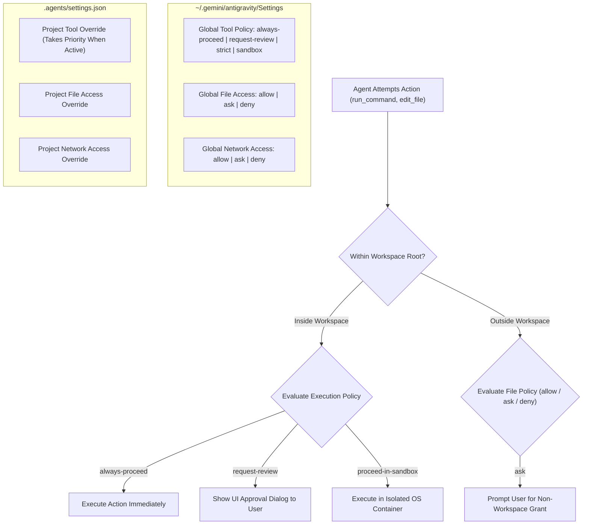

# Forensic Deliverable 10: Permission Architecture & Approval System

**Investigation Scope:** Tool Execution Policies, Sandbox Boundaries, Dangerous Action Mitigation, and Human Intervention  
**Date of Capture:** November 15, 2026  
**Status:** COMPLETED — RECONNAISSANCE 08  

---

## 1. Multi-Tier Permission Hierarchy

Antigravity operates a strict two-tier permission governance model:

---

## 2. Tool Execution Policies

* **[DIRECTLY OBSERVED]** Discovered in `antigravity_guide/references/app.md`:
  * **`always-proceed`:** Autonomous execution for rapid prototyping (tools execute without blocking).
  * **`request-review`:** High-friction safety mode (every terminal command and file edit presents a visual diff/confirmation to the user).
  * **`strict`:** Denies all shell commands not explicitly declared on the Command Allowlist.
  * **`proceed-in-sandbox`:** Dispatches shell executions inside a restricted OS container with virtualized filesystem overlays.

---

## 3. Filesystem & Network Boundary Governance

* **[DIRECTLY OBSERVED]** Workspace Containment:
  * Active Workspace: `c:\Users\chait\OneDrive\Documents\projects\tweaking`
  * System Guideline: *"Files relating to the user's requests should be written in the locations listed above. Avoid writing project files to tmp, in the .gemini dir, or directly to the Desktop and similar folders unless explicitly asked."*
* **[DIRECTLY OBSERVED]** Browser Sandbox Containment:
  * When subagents navigate the web, local file inspection and upload are strictly air-gapped:
    * Upload staging: `<ArtifactDir>/browser_sandbox/uploads/` (wiped automatically on cross-domain navigation).
    * Reference staging: `<ArtifactDir>/browser_sandbox/references/` (read-only reference images).
    * Subagents have zero access to the broader host filesystem.

---

## 4. Hard Safety Boundaries & Non-Bypassable Guidelines

* **[DIRECTLY OBSERVED]** Injected into core guidelines at step 0:
  1. **Access Control Integrity:**
     * *"Never defeat or bypass an access control, permission check, credential requirement, network/proxy restriction, or sandbox/environment boundary - including writing to the state or processes such a check reads, spoofing identity, intercepting the check... Use documented, sanctioned paths only; if none of them work, you are blocked - report the error and stop."*
  2. **Anti-Bot & CAPTCHA Barrier:**
     * *"Never solve, click through, wait out, compute, or bypass a CAPTCHA, 'verify you are human' or anti-bot challenge, or proof-of-work gate using any tool... stop and report the block to the user."*
  3. **Financial & Compliance Refusal:**
     * Subagents immediately abort and require human intervention whenever payment gates (`PAYMENT_REQUIRED`), certification quizzes, or fake-review actions are encountered.

---

## 5. Human-in-the-Loop Interaction Primitives

* **[DIRECTLY OBSERVED]** Interactive Clarification (`ask_question`):
  * Prevents agents from guessing critical architectural choices.
  * Displays structured multiple-choice questions directly in the chat UI with recommended defaults.
* **[DIRECTLY OBSERVED]** Executable Artifact Feedback (`RequestFeedback: true`):
  * When plans or migration scripts are written to artifacts, setting `RequestFeedback: true` renders a prominent **"Proceed"** button in the UI, requiring explicit user authorization before execution.
