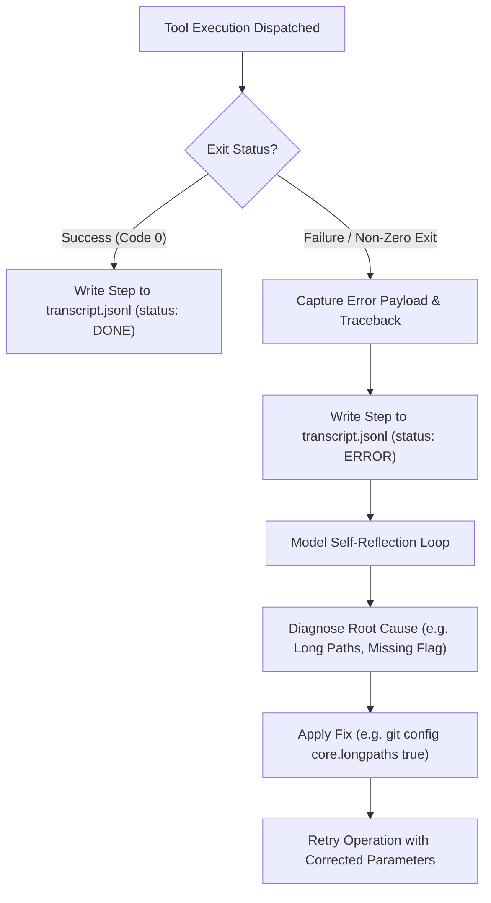

# Forensic Deliverable 11: Failure Recovery, Resilience & Checkpointing

**Investigation Scope:** Tool Failures, Timeouts, Subagent Crashes, Crash Resilience, and Checkpoint Resumption  
**Date of Capture:** November 15, 2026  
**Status:** COMPLETED — RECONNAISSANCE 08  

---

## 1. Tool-Level Failure Handling & Self-Correction



### 1.1 Forensic Live Demonstration
* **[DIRECTLY OBSERVED]** During our reconnaissance run, when cloning `open-interpreter`, Git failed with:
  ```
  error: unable to create file ... Filename too long
  fatal: unable to checkout working tree
  Command exited with code 1.
  ```
* **Self-Correction Protocol:**
  1. The error was committed as an error step in the transcript.
  2. The model immediately analyzed the Windows path-length limit.
  3. Dispatched remediation: `git config --global core.longpaths true`.
  4. Dispatched checkout retry: `git checkout -f`.
  5. Checkout completed with Code 0.

---

## 2. Hard Deadline Timeouts & Deadlock Protection

* **[DIRECTLY OBSERVED]** 180-Second MCP Deadlock Guard:
  * When executing deep reverse-engineering operations on `app.asar` via `rea`:
    ```
    Encountered error in tool execution: MCP tool call to server "rea" timed out after 3m0s: context deadline exceeded
    ```
  * **Resilience Mechanism:** The Go language server enforces a hard 3-minute cancellation token.
  * Instead of locking the IDE or crashing the process, the timeout triggers a graceful error envelope, allowing the agent to pivot to alternative tools.

---

## 3. Subagent Crash Isolation & Cleanup

* **[DIRECTLY OBSERVED]** Subagent Tree Isolation:
  * Subagents run in isolated conversation contexts.
  * If a subagent crashes, encounters rate limits, or hangs, the parent agent can invoke `manage_subagents(Action: "kill", ConversationIds: [...])`.
  * **Cleanup Guarantee:** Killing a subagent terminates all of its child subagent descendants and deletes branched Git worktrees, but **preserves all logs, transcripts, and artifacts** in `.system_generated/` for forensic audit.

---

## 4. Checkpoint Resumption & Crash Recovery

### Can an interrupted task resume from its last verified checkpoint?
* **[DIRECTLY OBSERVED]** **YES.** Antigravity achieves full crash-resilient checkpointing through three on-disk invariants:
  1. **Monotonic Step Journaling (`step_index`):**
     * Each step (`step_index: 0, 1, 2...`) is appended atomically to `transcript.jsonl`.
     * If the computer loses power during step 47, steps 0 through 46 are already safely flushed to disk.
  2. **SQLite Write-Ahead Logging (`conversation_summaries.db-wal`):**
     * All conversation states, active tasks, and project bindings use SQLite WAL mode, preventing database corruption during hard resets.
  3. **Deterministic Task Re-hydration:**
     * On application reboot, `language_server.exe` scans `C:\Users\chait\.gemini\antigravity\daemon\` and `brain/<conversation-id>/`.
     * It reads the last `step_index` from `transcript.jsonl`, inspects task status logs, and presents the conversation in its exact pre-crash state without re-executing completed operations.
