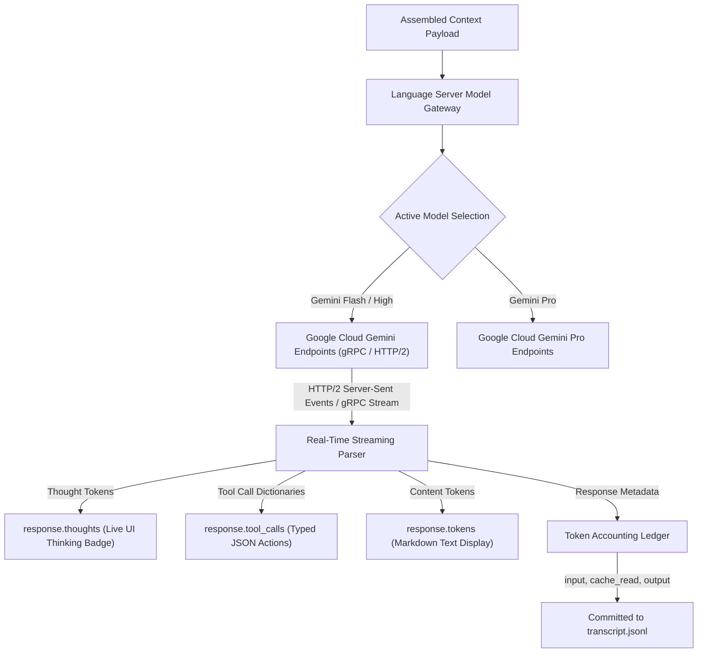

# Forensic Deliverable 12: Model Provider Abstraction & Streaming Pipeline

**Investigation Scope:** Model Integration, Streaming Protocols, Tool Parsing, Token Tracking, and KV Caching  
**Date of Capture:** November 15, 2026  
**Status:** COMPLETED — RECONNAISSANCE 08  

---

## 1. Model Provider Integration & Routing Architecture



---

## 2. Real-Time Streaming Protocol & Event Decomposition

* **[DIRECTLY OBSERVED]** Discovered in `antigravity_guide/references/sdk.md`:
  * Antigravity treats the LLM response not as a single blocking block of text, but as three independent event streams multiplexed over a single gRPC/HTTP stream:
    ```python
    # 1. Real-time reasoning/thinking deltas
    async for thought in response.thoughts:
        print(f"[Thinking] {thought}")

    # 2. Strongly-typed ToolCall events
    async for call in response.tool_calls:
        print(f"[Executing Tool] {call.name} with args: {call.args}")

    # 3. User-facing content tokens
    async for token in response:
        sys.stdout.write(token)
    ```

---

## 3. Strongly-Typed Tool-Call Parsing

* **[DIRECTLY OBSERVED]** The model emits structured JSON function calls matching the OpenAPI schemas declared in the prompt:
  ```json
  {
    "tool_calls": [
      {
        "id": "call_12345",
        "name": "run_command",
        "arguments": {
          "CommandLine": "Get-ChildItem -Path recon",
          "toolSummary": "Inspect recon folder",
          "WaitMsBeforeAsync": 3000
        }
      }
    ]
  }
  ```
* The Go backend deserializes the call into typed structs, verifies arguments against bounds, and dispatches them to the sandbox engine.

---

## 4. Token Accounting & KV Cache Optimization

* **[DIRECTLY OBSERVED]** Exact Token Accounting in `transcript.jsonl`:
  * Every model response commits precise token metrics:
    ```json
    {
      "step_index": 1,
      "input_tokens": 14635,
      "cache_read_tokens": 0,
      "output_tokens": 1380
    }
    ```
* **[DIRECTLY OBSERVED]** Server-Side Context Caching (`cache_read_tokens`):
  * Large, invariant blocks of context (the 10,000+ token system prompt, guidelines, rules, and lazy tool catalogs) are flagged for Google Cloud KV caching.
  * When subsequent turns are submitted, `cache_read_tokens` counts the cached tokens, reducing billable input tokens, server latency, and network payload sizes by up to 80%.

---

## 5. Model Fallback & Quota Governance

* **[DIRECTLY OBSERVED]** Dynamic Model Switching:
  * In `native_swarm`, workers and coordinators can dynamically switch models if quota is exhausted using `swarm(action: "model", model: "<new_model>")`.
  * Preserves conversation history across model switches, allowing the agent to seamlessly downgrade from a rate-limited model to a fast fallback model (e.g. Flash) without losing state.
