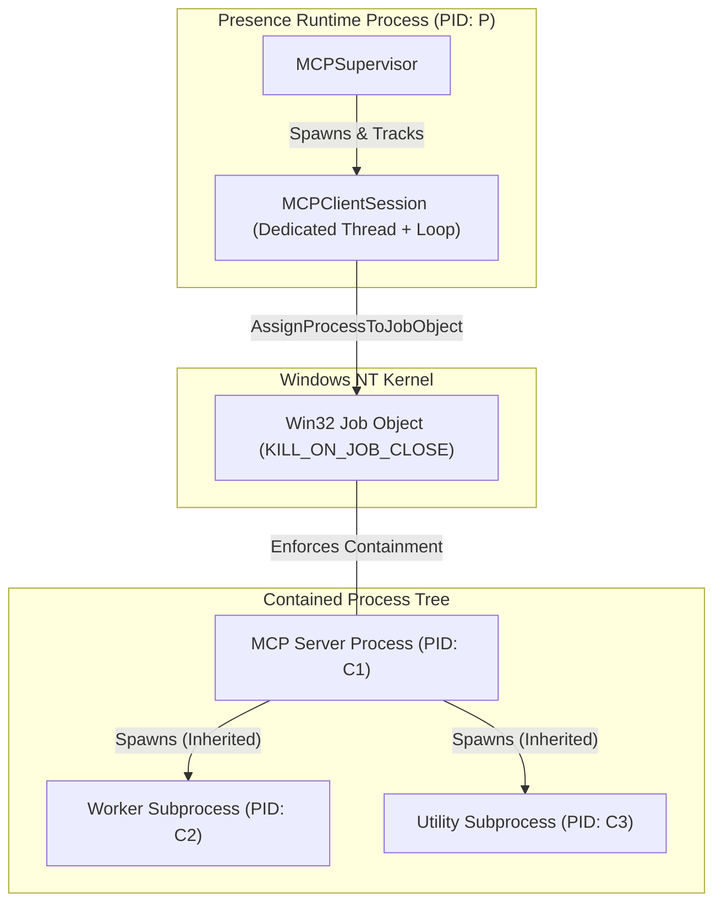
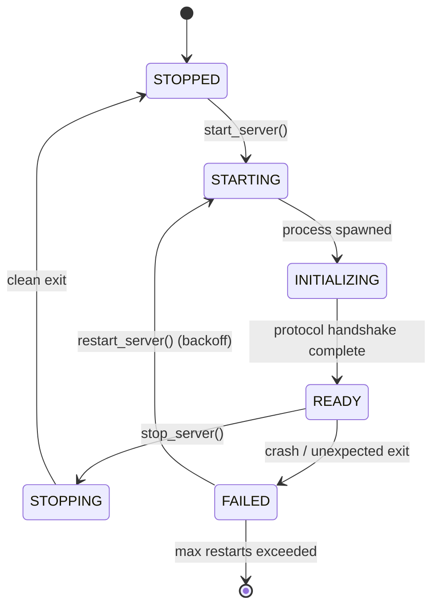
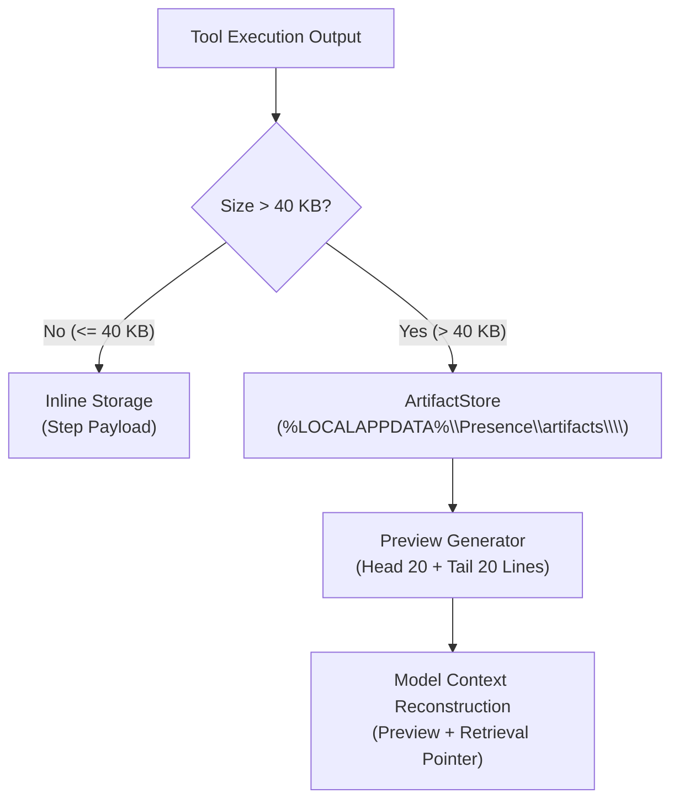

# SPECIFICATION 21: MCP PROCESS SUPERVISION AND ARTIFACT ARCHITECTURE

**Status**: PROVISIONALLY ACCEPTED & IMPLEMENTED  
**System Milestone**: Backend Phase 2B  
**Author**: Intelligent Presence Engineering Architecture  
**Governing Invariant**: *Gemini is the reasoning provider. Presence owns execution, permissions, persistence, and process supervision. The model must never directly launch processes, bypass authorization, access arbitrary filesystem paths, or execute tools outside the engine's controlled infrastructure.*

---

## 1. Executive Summary & Problem Formulation

The Model Context Protocol (MCP) provides an open, standard protocol for exposing tools, resources, and prompts from external servers to LLM-driven applications. However, uncontrolled client-side MCP integration introduces severe reliability, security, and performance risks to desktop operating environments:

1. **Subprocess Leakage & Orphaned Processes**: MCP servers run as independent child processes communicating over `stdio` pipes. When an agent turns off, crashes, or terminates, child processes (and their descendant trees) are frequently orphaned as unkillable zombie processes consuming memory and holding file locks.
2. **Secret & Credential Poisoning**: Unrestricted child subprocesses inherit the parent process's environment variables, immediately exposing critical secrets such as `GEMINI_API_KEY`, Windows DPAPI credentials, and authentication cookies.
3. **Context Window Exhaustion from Large Tool Payloads**: Certain MCP actions (directory trees, log analysis, system event dumps) return payloads ranging from 100 KB to 50+ MB. Injecting these directly into the agent context window blows through provider rate limits, exhausts token budgets, causes out-of-memory crashes, and inflates API costs.
4. **Arbitrary Filesystem Traversal**: Unrestricted tool results accessing local disk storage can be manipulated by prompt injections into arbitrary file path traversals.

Specification 21 establishes the architectural foundation of **Backend Phase 2B**, defining the design of:
- **Windows-Native Process Tree Containment via Win32 Job Objects** (`JOB_OBJECT_LIMIT_KILL_ON_JOB_CLOSE`).
- **MCP Stdio Process Supervision with Fault Isolation & Bounded Exponential Backoff**.
- **Schema Caching and Lazy Hydration** (`%LOCALAPPDATA%\Presence\mcp\schemas\`).
- **Tool Namespacing and Deterministic 4-Tier Permission Boundary Enforcement**.
- **Persistent Large Tool Output Offloading (40 KB UTF-8 Byte Threshold)**.
- **Chunked Artifact Retrieval with Path Traversal Defenses**.

---

## 2. Process Tree Containment Architecture

### 2.1 The Windows Job Object Boundary
Windows does not terminate child process trees upon parent termination unless the child process is assigned to a Win32 Job Object configured with the `JOB_OBJECT_LIMIT_KILL_ON_JOB_CLOSE` flag.



### 2.2 Win32 Implementation Details
Presence interacts directly with `kernel32.dll` using `ctypes` (`runtime/platform_win32.py`), eliminating fragile third-party wrappers:
- `CreateJobObjectW(None, job_name)`
- `SetInformationJobObject` setting `JOBOBJECT_EXTENDED_LIMIT_INFORMATION` with `LimitFlags |= 0x2000` (`JOB_OBJECT_LIMIT_KILL_ON_JOB_CLOSE`).
- Hooked process creation (`mcp.client.stdio._create_platform_compatible_process`) captures the root child PID and invokes `AssignProcessToJobObject`.
> [!NOTE]
> **Phase 2B.1 Hardening Update**: The post-spawn assignment and private SDK monkey-patch described above were superseded in Phase 2B.1 by `Win32SuspendedLauncher` (`runtime/platform_win32.py`) and `win32_mcp_stdio_transport` (`runtime/mcp/transport.py`). Subprocesses are now launched in `CREATE_SUSPENDED` state with explicit handle filtering (`PROC_THREAD_ATTRIBUTE_HANDLE_LIST`), assigned to the Job Object before execution, verified via `IsProcessInJob`, and resumed via `ResumeThread`. Official AnyIO memory streams connect directly to `ClientSession` with zero monkey-patching. See Specification 27 and Specification 28.
- Windows automatically captures any descendant processes spawned by the root process into the same job object.
- **Kernel-Guaranteed Cleanup**: When `MCPClientSession.stop()`, runtime shutdown, or a process crash occurs, closing the job handle or terminating the job atomically terminates every single process in the tree. Zero orphaned processes.

---

## 3. Environment Variable Isolation

Child processes must never inherit ambient secrets from the parent environment.

### 3.1 Allowlist Enforcement
Subprocess environments are built strictly via `build_isolated_environment()`:
- **Allowed System Variables**: `SYSTEMROOT`, `SYSTEMDRIVE`, `PATH`, `PATHEXT`, `TEMP`, `TMP`, `USERPROFILE`, `HOMEDRIVE`, `HOMEPATH`, `APPDATA`, `LOCALAPPDATA`, `PROCESSOR_ARCHITECTURE`, `NUMBER_OF_PROCESSORS`, `OS`, `COMSPEC`.
- **Forbidden Substrings (Case-Insensitive)**: Any key containing `KEY`, `SECRET`, `TOKEN`, `CREDENTIAL`, `PASSWORD`, `AUTH`, or `GEMINI` is stripped out.
- **Result**: `GEMINI_API_KEY` is completely absent from all MCP child process environments.

---

## 4. MCP Supervisor & Tool Integration

### 4.1 Lifecycle States
Each configured MCP server transitions through deterministic states managed by `MCPSupervisor`:



### 4.2 Lazy Schema Hydration
1. **Discovery on Boot/First-Run**: On initial connection, the supervisor queries `session.list_tools()`.
2. **Disk Caching**: Schemas are stored in `%LOCALAPPDATA%\Presence\mcp\schemas\<server_id>_<tool_name>.json`. Each schema includes metadata, description, JSON schema, and a SHA-256 integrity hash.
3. **Lazy Hydration**: When the runtime boots, available tool declarations are hydrated directly from disk cache without starting the server process. The server subprocess is only spawned when the model actually requests a tool from that server.
4. **Integrity Validation**: If a cached schema file has been modified or corrupted on disk, the SHA-256 validation fails, the cache file is deleted, and the supervisor re-discovers the schema live from the server.

### 4.3 Tool Namespacing & Permission Mediation
- All external MCP tools are registered in the unified `ToolRegistry` under the explicit namespace:
  $$\text{namespaced\_id} = \text{mcp}.\langle\text{server\_id}\rangle.\langle\text{tool\_name}\rangle$$
  *(Example: `mcp.fs_reader.read_file`)*
- External MCP tools are assigned authority tiers (`L0_OBSERVE` by default, or configurable per-tool).
- All invocations pass through `PermissionBoundary.check_permission()`. The model cannot invoke any MCP tool without passing through Presence's deterministic security gate.

---

## 5. Artifact Infrastructure & Large Tool-Output Offloading

### 5.1 The 40 KB Invariant
The agent context window must be protected against context pollution and token exhaustion.

$$\text{Threshold} = 40\,960 \text{ UTF-8 bytes (40 KB)}$$

- **Output $\le 40$ KB**: Persisted inline inside the SQLite `TOOL_RESULT` step and returned directly to the model.
- **Output $> 40$ KB**: Offloaded immediately to disk as an atomic persistent artifact.



### 5.2 Storage Structure & Atomic Writes
Artifacts are stored in a dedicated per-conversation directory:
```
%LOCALAPPDATA%\Presence\artifacts\<conversation_id>\
    ├── art_1a2b3c4d.txt        (Raw artifact payload)
    └── art_1a2b3c4d.meta.json  (Metadata sidecar)
```

1. **Atomic Write**: The payload is written to `.tmp` and atomically renamed via `replace()`.
2. **Metadata Sidecar**: Records `artifact_id`, `conversation_id`, `tool_call_id`, `tool_name`, `created_at`, `byte_size`, `line_count`, `sha256`, and preview snippet.
3. **Quotas**:
   - Single artifact maximum: $50\text{ MB}$.
   - Conversation storage budget: $200\text{ MB}$.

### 5.3 Preview Envelope
When an output is offloaded, the model receives a preview envelope containing:
- Head 20 lines (up to ~2,000 characters).
- Explicit truncation notice with byte size, line count, and instructions:
  `... [TRUNCATED - Full tool output (124,500 bytes, 1,500 lines) offloaded to artifact 'art_abc123'. Use 'presence.read_artifact' with artifact_id='art_abc123' to retrieve specific line ranges or chunks] ...`
- Tail 20 lines (up to ~2,000 characters).

### 5.4 Controlled Artifact Retrieval (`presence.read_artifact`)
The model can inspect offloaded artifacts using the built-in `presence.read_artifact` tool:
- `artifact_id`: Identifier (e.g. `art_abc123`).
- `offset`: Starting line or byte offset (0-indexed).
- `limit`: Maximum count to return (default 100 lines or 4,000 bytes).
- `mode`: `"lines"` or `"bytes"`.
- **Path Traversal Protection**: Identifiers are strictly validated against `^[a-zA-Z0-9_\-]+$`. Any directory separators (`/`, `\`) or traversal sequences (`..`) are rejected with `ValueError`. Paths are asserted to resolve strictly within the conversation directory.

---

## 6. Verification and Acceptance Criteria

| Subsystem | Requirement | Verification Method | Status |
| :--- | :--- | :--- | :--- |
| **Win32 Job Objects** | Auto child cleanup on close | `test_win32_job_object.py` | PASS |
| **Subprocess Containment** | Contain stdio MCP server process tree | `test_mcp_supervisor.py` | PASS |
| **Environment Isolation** | `GEMINI_API_KEY` stripped from child env | `test_mcp_supervisor.py` | PASS |
| **Crash Recovery** | Detect crash and backoff restart | `test_mcp_supervisor.py` | PASS |
| **Tool Namespacing** | Bridge MCP tools to `mcp.<server>.<tool>` | `test_mcp_supervisor.py` | PASS |
| **Schema Caching** | Cache schemas to disk + SHA-256 integrity | `test_schema_cache.py` | PASS |
| **Output Offload** | 40 KB threshold offload to disk | `test_artifact_store.py` | PASS |
| **Artifact Retrieval** | Chunked read by lines and bytes | `test_artifact_store.py` | PASS |
| **Traversal Protection** | Reject `..` and illegal characters | `test_artifact_store.py` | PASS |
| **End-to-End Turn** | AgentExecutor + MCP tool + artifact read | `test_agent_mcp_integration.py` | PASS |
| **Live Provider** | Live Gemini 3.5 tool call to MCP server | `verify_live_mcp_gemini_turn.py` | PASS |
