# SPECIFICATION 23: UPSTREAM MCP HOST SOURCE FORENSICS

**Status**: COMPLETED & VERIFIED  
**System Milestone**: Upstream Research & Architecture Audit  
**Author**: Intelligent Presence Engineering Architecture  
**Governing Invariant**: *If a reliable implementation already exists, inspect its architecture, understand its source code, and modify or integrate it instead of unnecessarily rebuilding it from scratch. Truth is established by source code and runtime behavior, not documentation.*

---

## 1. Executive Summary & Audit Methodology

This specification presents a rigorous, source-level forensic audit of mature open-source Model Context Protocol (MCP) host implementations, agent runtimes, and Windows-native process containment systems. 

The investigation was conducted by cloning upstream repositories into an isolated research environment (`presence-upstream-research/`), completely outside the production Presence source tree, pinning exact commit SHAs, auditing Cargo and Python manifests, inspecting call paths down to exact line ranges, and testing failure scenarios.

### 1.1 Candidate Repository Roster & Pinned Commits

| Candidate ID | Project / Repository | Pinned Commit SHA | Branch / Tag | Primary Language | License | Core Capability Audited |
| :--- | :--- | :--- | :--- | :--- | :--- | :--- |
| **Candidate A** | [aaif-goose/goose](https://github.com/aaif-goose/goose) | `0bf8b62407201ce11cac7da2582d25eb0fe620f5` | `main` | Rust | Apache-2.0 | MCP Extension Manager, Stdio/HTTP transports, process containment |
| **Candidate B** | [OpenAgentPlatform/dive-mcp-host](https://github.com/OpenAgentPlatform/dive-mcp-host) | `1e6c604c696541f3aa8a45ef8fbe31a29ca63e3a` | `main` | Python | MIT | Multi-transport MCP Host, ToolManager, OAuth, elicitation, lifecycle |
| **Candidate C1** | [modelcontextprotocol/python-sdk](https://github.com/modelcontextprotocol/python-sdk) | `77001c96f9507be0f4d009b83210a384a5e08bda` | `main` | Python | MIT | Official reference Python SDK, ClientSession, Stdio/SSE/Streamable HTTP, Win32 Job Object utilities |
| **Candidate C2** | [modelcontextprotocol/rust-sdk](https://github.com/modelcontextprotocol/rust-sdk) (`rmcp`) | `0e2396f73a88617141b31f645de6f1171ed5f993` | `main` | Rust | Apache-2.0 / MIT | Official Tier-1 Rust MCP SDK, type-safe schema definitions, async transport engine |
| **Candidate C3** | [watchexec/process-wrap](https://github.com/watchexec/process-wrap) | `2f4bc393d8bd03b4b1c81fee2e13ce82dd42906e` | `main` | Rust | Apache-2.0 / MIT | Dedicated Windows Job Object containment, suspended process launch, I/O completion ports |

---

## 2. Source-Level Forensic Analysis of Candidate A: Goose

### 2.1 Repository Architecture & Cargo Workspace Graph
Goose (`aaif-goose/goose`) is an open-source desktop and terminal agent developed by Block / AAIF. Its architecture is organized into a Cargo workspace with 15 internal crates:
- `crates/goose`: Core monolithic application engine, CLI interface, local ACP (Agent Client Protocol) server, session manager, prompt templates, built-in tool extensions.
- `crates/goose-agent`: Agent state machine, extension runner, subprocess launcher, skill discovery, tool approval gate.
- `crates/goose-mcp`: Built-in MCP *servers* (e.g. `computercontroller`, `autovisualiser`, `memory`, `peekaboo`, `tutorial`).
- `crates/goose-providers`: LLM client adapters (OpenAI, Anthropic, Databricks, Google Gemini, Ollama, Snowflake).
- `crates/goose-sdk` & `crates/goose-sdk-types`: ACP protocol types and IPC wrappers.

### 2.2 MCP Client & Extension Lifecycle
Goose **does not** implement a custom MCP protocol wire layer. In `Cargo.toml` (line 21), it pulls in:
```toml
rmcp = { version = "3.9.0", default-features = false, features = ["schemars"] }
```
Goose's MCP client implementation is a consumer of the upstream `rmcp` crate (`modelcontextprotocol/rust-sdk`).

In `crates/goose-agent/src/extension.rs` (lines 168-240), Goose defines its extension configuration:
```rust
pub enum ExtensionConfig {
    Stdio {
        name: String,
        description: String,
        cmd: String,
        args: Vec<String>,
        envs: Envs,
        env_keys: Vec<String>,
        timeout: Option<u64>,
        cwd: Option<String>,
        bundled: Option<bool>,
        available_tools: Vec<String>,
    },
    StreamableHttp {
        name: String,
        description: String,
        uri: String,
        envs: Envs,
        headers: HashMap<String, String>,
        timeout: Option<u64>,
        socket: Option<String>,
        client_id: Option<String>,
        client_secret_key: Option<String>,
        scopes: Vec<String>,
        ...
    }
}
```

### 2.3 Subprocess Creation & Process Containment Forensics
An audit of `crates/goose-agent/src/subprocess.rs` reveals how Goose spawns MCP subprocesses:
- **Lines 8-9 & 47-55**: On Windows, it sets the creation flag `CREATE_NO_WINDOW_FLAG = 0x08000000`.
- **Lines 77-81 (`configure_subprocess`)**:
  ```rust
  pub fn configure_subprocess(command: &mut Command) {
      configure_common_subprocess(command);
      #[cfg(target_os = "linux")]
      configure_parent_death_signal(command);
  }
  ```
- **Lines 11-28**: On Linux, it uses `libc::prctl(libc::PR_SET_PDEATHSIG, libc::SIGTERM)`.
- **Lines 117-144 (`spawn_long_lived_mcp_subprocess`)**:
  On non-Linux platforms (including Windows), it executes:
  ```rust
  let mut command = command;
  configure_subprocess(&mut command);
  TokioChildProcess::builder(command)
      .stderr(std::process::Stdio::piped())
      .spawn()
  ```

> [!CRITICAL]
> **Forensic Finding — Goose MCP Subprocesses Lack Job Object Containment**:
> `goose-agent` spawns all external MCP servers on Windows using standard `tokio::process::Command` with only `CREATE_NO_WINDOW`. It **does not** assign MCP child processes to Windows Job Objects. If Goose crashes or is terminated via Task Manager, any child or grandchild processes spawned by external MCP servers are **orphaned as zombie processes**.

### 2.4 The Windows Job Object Implementation in Goose's Developer Shell
While Goose's MCP spawner omits Job Objects, its developer shell tool (`crates/goose/src/agents/platform_extensions/developer/shell_process.rs`, lines 94-180) contains a sophisticated Windows Job Object implementation:
- **Lines 113-125**: Creates an unnamed Job Object via `CreateJobObjectW` and sets `JOB_OBJECT_LIMIT_KILL_ON_JOB_CLOSE`.
- **Lines 127-131**: Configures the process with `CREATE_NO_WINDOW | CREATE_SUSPENDED`.
- **Lines 133-151 (`attach`)**:
  ```rust
  pub(super) fn attach(&mut self, child: &Child) -> io::Result<()> {
      let process = child.raw_handle().expect("freshly spawned shell has a handle");
      if unsafe { AssignProcessToJobObject(self.job.as_raw_handle(), process) } == 0 {
          return Err(io::Error::last_os_error());
      }
      // Tokio exposes the process handle, not the primary thread handle.
      // Resume the process only after it belongs to this invocation's job.
      let status = unsafe { NtResumeProcess(process) };
      if status < 0 {
          return Err(io::Error::other(format!(
              "Failed to resume shell process: NTSTATUS {status:#x}"
          )));
      }
      Ok(())
  }
  ```
- **Architectural Observation**: Goose solves the problem of Tokio's `Child` not exposing the thread handle by invoking `NtResumeProcess(process)` from `ntapi`. This is an undocumented Native NT API function (`ntdll.dll`). While effective, it relies on undocumented kernel behaviors.

### 2.5 Security, Environment Sanitization & Tool Approval
- **Environment Allow/Deny**: In `crates/goose-agent/src/extension.rs` (lines 103-140), Goose maintains a denylist of 31 dangerous environment variables (`PATH`, `PATHEXT`, `SystemRoot`, `windir`, `LD_PRELOAD`, `APPINIT_DLLS`, `ComSpec`, `LOCALAPPDATA`, etc.) to prevent DLL and path hijacking.
- **Tool Approval Gate**: In `crates/goose-agent/src/tool_approval.rs` (lines 20-45), Goose implements an interactive approval trait:
  `ApprovalDecision::Allow`, `ApprovalDecision::Deny { reason }`, `ApprovalDecision::Ask { prompt }`.
  It does not have a deterministic, 4-tier capability matrix (L0/L1/L2/L3); instead, it relies on per-session user confirmations (`AllowOnce` vs `AlwaysAllow`).

---

## 3. Source-Level Forensic Analysis of Candidate B: Dive MCP Host

### 3.1 Repository Architecture & Packaging
Dive MCP Host (`OpenAgentPlatform/dive-mcp-host`) is a Python-based MCP host platform. Inspecting its `pyproject.toml` (lines 24-55) reveals extreme architectural coupling to third-party frameworks:
- Framework Dependencies: `fastapi`, `uvicorn`, `langchain`, `langchain-core`, `langgraph-prebuilt`, `langgraph-checkpoint-sqlite`, `langgraph-checkpoint-postgres`.
- Database & ORM Dependencies: `sqlalchemy[asyncio]`, `alembic`, `psycopg[binary]`, `asyncpg`, `aiosqlite`, `sqlite-vec`.
- MCP SDK: `dive-mcp-sdk>=1.0.3` (a fork of `mcp`).

### 3.2 The `hack/` Subsystem & Stdio Process Management
Inside `dive_mcp_host/host/tools/hack/stdio_server.py`, the header comment states:
```python
"""Copy of mcp.client.stdio.stdio_client."""
```
Dive literally copied the internal `stdio_client` implementation from an earlier version of `modelcontextprotocol/python-sdk` to inject custom stderr logging (`errlog.write(line)`) and return the child PID alongside the communication streams (`yield read_stream, write_stream, process.pid`).

In `_create_platform_compatible_process` (lines 216-236):
```python
async def _create_platform_compatible_process(
    command: str, args: list[str], env: dict[str, str] | None = None, cwd: Path | str | None = None
) -> anyio.abc.Process:
    creationflags = subprocess.CREATE_NO_WINDOW if sys.platform == "win32" else 0
    process = await anyio.open_process(
        [command, *args],
        creationflags=creationflags,
        env=env,
        cwd=cwd,
        start_new_session=True,
    )
    return process
```
- **Process Termination**: In lines 239-256, Dive calls `terminate_windows_process_tree(process, timeout_seconds)` from `mcp.os.win32.utilities`.
- **Vulnerability**: Processes are **never** assigned to a Job Object at creation. If the Dive process terminates unexpectedly or is killed, child processes are never reaped.

### 3.3 Coupling to LangGraph and Agent Orchestration
In `dive_mcp_host/host/tools/mcp_server.py`:
- `McpTool` directly subclasses `langchain_core.tools.BaseTool` (line 26).
- Tool calls rely on `langgraph.config.get_stream_writer` (line 27) and `dive_mcp_host.host.agents.agent_factory.get_abort_signal` (line 37).
- Session state is tied to LangGraph checkpoints.

> [!WARNING]
> **Coupling Assessment for Dive**:
> Dive cannot be consumed as a standalone MCP host library. Adopting Dive's `McpServer` or `ToolManager` would force Presence to import LangChain, LangGraph, FastAPI, Alembic, and PostgreSQL drivers, directly conflicting with Presence's minimalist, transactional SQLite-first engine.

---

## 4. Source-Level Forensic Analysis of Candidate C1: MCP Python SDK

### 4.1 Architecture & Transport Engine
The official Python SDK (`modelcontextprotocol/python-sdk`) provides the reference implementation of MCP for Python:
- `mcp.client.session.ClientSession`: High-level async client managing protocol handshake (`initialize()`), capability negotiation, tool listing, tool invocation, prompt retrieval, resource reading, and subscription handling.
- `mcp.client.stdio.stdio_client`: Context manager establishing bidirectional asynchronous communication over process `stdin`/`stdout`.
- `mcp.client.streamable_http` & `mcp.client.sse`: Production-grade HTTP/SSE transports.
- `mcp.client.session_group.SessionGroup`: Aggregation engine for multi-server sessions.

### 4.2 Windows Subprocess & Job Object Forensics
In `src/mcp/os/win32/utilities.py`:
- **Lines 136-174 (`create_windows_process`)**:
  Spawns processes using `anyio.open_process`, then calls `_create_job_object()` and `_maybe_assign_process_to_job(process, job)`.
- **Lines 168-170 (Critical Code Comment from Upstream Authors)**:
  ```python
  # Children spawned before the assignment completes land outside the job
  # (membership is inherited at CreateProcess, never acquired retroactively);
  # if that ever bites, the fix is a CREATE_SUSPENDED spawn -> assign -> resume.
  job = _create_job_object()
  _maybe_assign_process_to_job(process, job)
  return process
  ```
- **Lines 197-216 (`_create_job_object`)**:
  Requires `pywin32` (`win32job`, `win32api`, `pywintypes`). If `pywin32` is missing, it logs a warning and returns `None`, silently disabling process tree containment.

---

## 5. Source-Level Forensic Analysis of Candidate C2: MCP Rust SDK (`rmcp`)

### 5.1 Architecture & Performance Characteristics
`modelcontextprotocol/rust-sdk` (`rmcp`) is the official Tier-1 Rust SDK:
- **`rmcp::model`**: 231 KB of strictly typed Rust structs representing every JSON-RPC 2.0 message, MCP request, response, error, tool definition, schema, and capability.
- **`rmcp::transport`**: Tokio-based async transports for `TokioChildProcess` (stdio), SSE, Streamable HTTP, and in-memory channels.
- **`rmcp::service`**: Handles protocol handshakes, capability negotiation, cancellation tokens, and task timeouts.
- **Cross-Language Testing**: Includes integration test suites verifying wire compatibility against live Python and JavaScript MCP servers (`tests/test_with_python.rs`, `tests/test_with_js.rs`).
- **Rust Toolchain Requirement**: Targets Rust Edition 2024 and requires `rust-version = "1.88"`.

---

## 6. Source-Level Forensic Analysis of Candidate C3: Watchexec `process-wrap`

### 6.1 Architecture & Windows Job Object Implementation
Watchexec's `process-wrap` is a dedicated, battle-tested Rust library for supervisor process containment across Unix process groups and Windows Job Objects.

In `src/windows.rs`:
- **Lines 58-70 (`job_creation_flags`)**:
  ```rust
  pub(crate) fn job_creation_flags(user_flags: PROCESS_CREATION_FLAGS) -> JobCreationFlags {
      JobCreationFlags {
          flags: user_flags | CREATE_SUSPENDED,
          resume_after_assignment: !user_flags.contains(CREATE_SUSPENDED),
      }
  }
  ```
- **Lines 205-271 (`make_job_object`)**:
  1. Creates Job Object via `CreateJobObjectW`.
  2. Binds an I/O Completion Port (`CreateIoCompletionPort` + `JobObjectAssociateCompletionPortInformation`) to receive kernel notifications when processes exit.
  3. Sets `JOB_OBJECT_LIMIT_KILL_ON_JOB_CLOSE`.
  4. Calls `AssignProcessToJobObject(job, process_handle)`.
- **Lines 273-330 (`resume_threads`)**:
  Because standard library `std::process::Command` does not expose the primary thread handle, `process-wrap` takes a ToolHelp32 thread snapshot (`CreateToolhelp32Snapshot(TH32CS_SNAPTHREAD, 0)`), enumerates threads belonging to the child PID, opens each with `OpenThread(THREAD_SUSPEND_RESUME)`, and calls `ResumeThread(thread_handle)`.
- **Author's Note**:
  `// This is a pretty terrible hack, but it's either this or we re-implement all of Rust's std::process just to get access!`

---

## 7. Comparative Architectural Topology

```mermaid
flowchart TD
    subgraph CandidateA["Candidate A: Goose (Rust)"]
        G_Agent["goose-agent"]
        G_Sub["subprocess.rs\n(CREATE_NO_WINDOW only)"]
        G_MCP["rmcp (crates.io)"]
        G_Shell["shell_process.rs\n(JobObject + NtResumeProcess)"]
        G_Agent --> G_Sub --> G_MCP
        G_Agent --> G_Shell
    end

    subgraph CandidateB["Candidate B: Dive (Python)"]
        D_LangGraph["LangGraph / LangChain"]
        D_Hack["hack/stdio_server.py\n(Fork of mcp.client.stdio)"]
        D_PyWin["pywin32 cleanup on exit"]
        D_LangGraph --> D_Hack --> D_PyWin
    end

    subgraph CandidateC["Candidate C1: MCP Python SDK"]
        SDK_Session["ClientSession"]
        SDK_Stdio["stdio_client"]
        SDK_Win32["os/win32/utilities.py\n(anyio + pywin32 JobObject)"]
        SDK_Session --> SDK_Stdio --> SDK_Win32
    end

    subgraph CandidatePW["Candidate C3: process-wrap (Rust)"]
        PW_Create["CREATE_SUSPENDED"]
        PW_Job["AssignProcessToJobObject"]
        PW_Resume["ToolHelp32 Thread Snapshot\n+ ResumeThread"]
        PW_Create --> PW_Job --> PW_Resume
    end

    subgraph PresenceCurrent["Presence Runtime (Current)"]
        P_Sup["MCPSupervisor"]
        P_Sess["MCPClientSession"]
        P_Patch["patch(mcp_stdio)"]
        P_Win32["Win32JobObject (ctypes kernel32)\nOpenProcess -> AssignProcess"]
        P_Sup --> P_Sess --> P_Patch --> P_Win32
    end
```



---

## 8. Detailed Subsystem Comparison Matrix

| Subsystem | Presence (Current) | Candidate A (Goose) | Candidate B (Dive) | Candidate C1 (MCP Python SDK) | Candidate C3 (process-wrap) | Antigravity Standard |
| :--- | :--- | :--- | :--- | :--- | :--- | :--- |
| **8.1 MCP Lifecycle & Supervision** | `MCPSupervisor` with lazy start, crash backoff, thread worker | Extension lifecycle in ACP loop; restarts on error | `McpServer` with retry limit 3, keepalive 60s, state machine | `ClientSession` + `SessionGroup`; lifecycle owned by caller | N/A (Process wrapper only) | External stdio child processes; 180s hard deadline; crash recovery |
| **8.2 Windows Subprocess Containment** | `Win32JobObject` via `ctypes` (`KILL_ON_JOB_CLOSE`); assigns PID after spawn | **None for MCP**; JobObject used only in dev shell via `NtResumeProcess` | **None at launch**; attempts kill on exit via `pywin32` | Assigns after spawn via `pywin32`; documents child race window | Full `CREATE_SUSPENDED` + JobObject assignment + thread resume | Dedicated Job Objects per child tree (`KILL_ON_JOB_CLOSE`, no breakaway) |
| **8.3 MCP Protocol & Transports** | Stdio via `mcp.client.stdio` | Stdio & Streamable HTTP via `rmcp` | Stdio, SSE, Streamable HTTP via `mcp` & `httpx` | Stdio, SSE, Streamable HTTP (canonical reference) | N/A | Stdio JSON-RPC with lazy parameter hydration |
| **8.4 Tool Registry & Authorization** | `ToolRegistry` + 4-tier `PermissionBoundary` (L0-L3 fail-closed) | `ToolApproval` (interactive allow/deny/ask) | Subclasses LangChain `BaseTool`; no tier model | Unvalidated tools dictionary; no authorization gate | N/A | Explicit tool permissions; external tools strictly untrusted |
| **8.5 Schema Management** | `SchemaCache` with SHA-256 integrity hash on disk | Schema stored in memory via `rmcp`; no disk cache | In-memory `McpServerInfo`; no disk caching | In-memory validation via Pydantic; optional memory cache | N/A | On-disk schema cache (`<server>/<tool>.json`); lazy hydration |
| **8.6 Artifact & Output Handling** | `ArtifactStore` with 40 KB threshold, SHA-256, chunked reading | In-memory message truncation; no persistent artifact store | In-memory log buffer (1,000 lines); no disk offload | Direct message content streaming; no offloading | N/A | Automatic offload >46 KB to `.system_generated/steps/` |
| **8.7 Async & Cancellation** | Dedicated background worker thread + asyncio loop per MCP session | Tokio task groups and async actors | anyio task groups tied to LangGraph loop | anyio / asyncio task groups | Tokio and std process wrappers | Asynchronous engine turn loop with reactive wakeups |

---

## 9. Comprehensive Assessment of Candidates

### 9.1 Candidate A (Goose) — Evaluation
- **Strengths**: High-performance Rust codebase; excellent developer shell Job Object implementation with `CREATE_SUSPENDED`; comprehensive environment variable denylist (31 keys); clean ACP protocol abstractions.
- **Weaknesses**: MCP servers on Windows are **not** contained in Job Objects; requires bleeding-edge Rust compiler (`rustc 1.94.1`); monolithic coupling across `goose-sdk` and `goose-provider-types`; lacks 4-tier permission boundary and persistent artifact store.

### 9.2 Candidate B (Dive MCP Host) — Evaluation
- **Strengths**: Rich transport support (Stdio, SSE, Streamable HTTP); robust OAuth 2.0 PKCE flow for remote MCP servers; log proxying and elicitation management.
- **Weaknesses**: Extreme framework coupling (LangGraph, LangChain, PostgreSQL, Alembic, FastAPI); `hack/` folder monkey-patches SDK; lacks Windows Job Object containment at launch; in-memory-only schema handling.

### 9.3 Candidate C1 (MCP Python SDK) — Evaluation
- **Strengths**: Official canonical standard; perfectly aligned with Python 3.12; clean async `ClientSession`; lightweight dependencies (`anyio`, `httpx`, `pydantic`).
- **Weaknesses**: Relies on `pywin32` for Windows utilities; post-spawn Job Object assignment contains documented race condition for rapid child processes.

### 9.4 Candidate C3 (process-wrap) — Evaluation
- **Strengths**: Flawless Windows Job Object containment; enforces `CREATE_SUSPENDED`; integrates I/O completion ports for zero-polling kernel exit notifications.
- **Weaknesses**: Uses ToolHelp32 snapshot thread-enumeration hack to resume threads due to Rust `std::process::Command` encapsulation.

---

## 10. Audit Conclusion

The source audit proves that **no single upstream project provides an end-to-end drop-in replacement** for Presence's specialized desktop requirements. Goose lacks Job Object containment for MCP servers, Dive is crippled by massive LangGraph coupling, and the official Python SDK acknowledges an unaddressed post-spawn child race condition on Windows.

However, the audit uncovers **extraordinary component-level reuse opportunities**:
1. Reusing the official `modelcontextprotocol/python-sdk` `ClientSession` directly.
2. Replacing Presence's monkey-patched process spawner with a clean, native Win32 `CreateProcessW` launcher that implements the exact `CREATE_SUSPENDED -> AssignProcessToJobObject -> ResumeThread` sequence using `ctypes.windll.kernel32` (eliminating both `pywin32` and thread-enumeration hacks).
3. Adapting Goose's 31-key environment denylist to harden Presence's `build_isolated_environment`.
4. Retaining Presence's superior, custom-built `PermissionBoundary`, `SchemaCache`, and `ArtifactStore`.

*Specification 23 Certified. Upstream forensic audit completed.*
