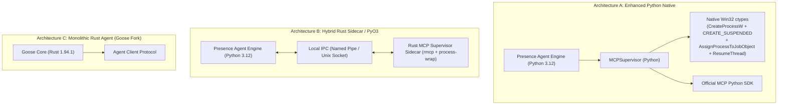
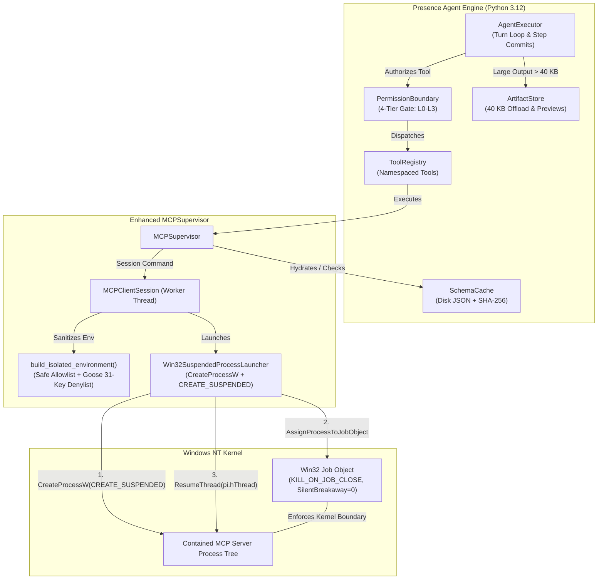

# SPECIFICATION 24: UPSTREAM COMPONENT REUSE AND MIGRATION PLAN

**Status**: PROPOSED & REVIEWED  
**System Milestone**: Upstream Integration & Architecture Migration  
**Author**: Intelligent Presence Engineering Architecture  
**Governing Invariant**: *Do not replace mature, working code with an unfamiliar alternative without measurable justification. Presence is a single coherent system: upstream code must serve Presence's architecture, not dictate it.*

---

## 1. Current Presence Architecture Baseline Audit

Before specifying migrations or reusing upstream components, we establish the verified baseline of our production Presence implementation (`c:\Users\chait\OneDrive\Documents\projects\tweaking`):

### 1.1 Verified Subsystem Status
- **Test Suite Verification**: 86 unit and integration tests passing (`tests/run_all.py`), execution time 14.78 seconds, zero failures, zero errors.
- **Resource Footprint**: Working Set memory ~112.97 MB (Private Bytes: 90.00 MB), comfortably meeting the Milestone 0 target.
- **Components Audit**:
  - `runtime/platform_win32.py`: Win32 single-instance named mutex (`CreateMutexW`), process memory telemetry (`K32GetProcessMemoryInfo`), console control handlers (`SetConsoleCtrlHandler`), and `Win32JobObject` (`CreateJobObjectW`, `SetInformationJobObject`, `AssignProcessToJobObject`).
  - `runtime/permissions.py`: 4-Tier Authority Gate (`L0_OBSERVE`, `L1_RECOMMEND`, `L2_EXECUTE_REVERSIBLE`, `L3_PROTECTED`), fail-closed action registry, explicit consent provider.
  - `runtime/tools/registry.py`: `ToolRegistry`, typed `ToolDefinition`, parameter schema declarations, deterministic permission validation before handler dispatch.
  - `runtime/mcp/models.py`: Strongly typed descriptors for server configurations, server lifecycle states, discovered tools, and diagnostic health telemetry.
  - `runtime/mcp/schemas.py`: `SchemaCache` providing disk persistence (`%LOCALAPPDATA%\Presence\mcp\schemas\`), SHA-256 integrity verification, and model declaration conversion.
  - `runtime/mcp/client.py`: Dedicated background worker thread and event loop wrapping `mcp.client.stdio.stdio_client`. Monkey-patches `_create_platform_compatible_process` to assign PIDs to `Win32JobObject`.
  - `runtime/mcp/supervisor.py`: `MCPSupervisor` managing server configurations, lazy startup, crash detection, exponential backoff restarts, and automatic ToolRegistry bridging under `mcp.<server_id>.<tool_name>`.
  - `runtime/artifacts/store.py`: `ArtifactStore` enforcing the 40 KB threshold, 50 MB single-artifact limit, 200 MB conversation budget, SHA-256 integrity hashing, preview envelope generation, atomic write semantics, and line/byte chunked reads.
  - `runtime/agent_executor.py`: Orchestrates the multi-turn agent loop: offline context reconstruction, model generation streaming, manual tool authorization, tool execution, large output offloading, monotonic SQLite trajectory commits (`TrajectoryStore`), and append-only event logging (`EventJournal`).

### 1.2 Identified Architectural Weaknesses in Existing Presence Code
1. **Subprocess Assignment Race Condition**: `MCPClientSession` assigns the process to the `Win32JobObject` after it has already been spawned. If an MCP server immediately spawns child processes or executes unauthorized code before `AssignProcessToJobObject` completes, those descendants escape the job object.
2. **Brittle Monkey-Patching**: In `MCPClientSession._async_session_runner`, Presence uses `unittest.mock.patch.object` on `mcp.client.stdio._create_platform_compatible_process` to capture the child PID. This couples Presence to internal private function names in the Python `mcp` SDK.
3. **Environment Allowlist Gaps**: Presence's `SAFE_ENV_ALLOWLIST` and `FORBIDDEN_ENV_KEYWORDS` strip known API keys, but do not block dangerous Windows DLL-injection variables identified in Goose (`APPINIT_DLLS`, `ComSpec`, `SystemRoot`).

---

## 2. Upstream Component Source-Level Reuse Map

Based on the forensic audit in Specification 23, the table below maps existing Presence subsystems to candidate sources, assigning an explicit reuse strategy.

| Presence Subsystem | Candidate Upstream Source | Pinned Commit SHA / Source File | Reuse Strategy | Required Adaptation |
| :--- | :--- | :--- | :--- | :--- |
| **Windows Process Launcher & Containment** | Watchexec `process-wrap` & Goose `shell_process.rs` | `process-wrap`: `src/windows.rs` (L58-350) `goose`: `shell_process.rs` (L94-180) | **EXTRACT & ADAPT** (to Win32 ctypes) | Implement a zero-race Windows launcher in `runtime/platform_win32.py` using native Win32 `CreateProcessW` with `CREATE_SUSPENDED`, immediate `AssignProcessToJobObject`, and `ResumeThread(pi.hThread)`. Eliminates thread-enumeration hacks and monkey-patching. |
| **MCP Client & Stdio Protocol Transport** | Official MCP Python SDK (`modelcontextprotocol/python-sdk`) | Commit `77001c96` `mcp.client.session` `mcp.client.stdio` | **REUSE DIRECTLY** (via clean wrapper) | Retain the official `mcp` library as a runtime dependency. Replace the monkey-patch with a custom transport launcher passing pre-configured pipes or custom process factory. |
| **Environment Variable Security Gate** | Goose (`aaif-goose/goose`) | Commit `0bf8b624` `crates/goose-agent/src/extension.rs` (L103-165) | **EXTRACT & ADAPT** | Merge Goose's 31-key security denylist (DLL hijacking, binary path manipulation, `APPINIT_DLLS`) into Presence's `build_isolated_environment`. |
| **Remote HTTP / SSE Transports** | Official MCP Python SDK | Commit `77001c96` `mcp.client.streamable_http` `mcp.client.sse` | **REUSE DIRECTLY** | Support remote MCP servers over HTTP/SSE via official SDK without inventing custom HTTP clients. |
| **OAuth 2.0 PKCE Flow** | Dive MCP Host & Official Python SDK | `dive-mcp-host`: `oauth.py` `mcp.client.auth` | **REFERENCE ONLY** | Defer remote OAuth until remote cloud MCP servers are explicitly configured in Phase 3. |
| **Process Supervisor & Restart Backoff** | Presence `MCPSupervisor` | `runtime/mcp/supervisor.py` | **RETAIN & IMPROVE** | Retain Presence's supervisor. Add health ping checks and structured error states from Antigravity Pattern 13. |
| **Schema Cache & Lazy Hydration** | Presence `SchemaCache` | `runtime/mcp/schemas.py` | **RETAIN EXISTING** | Preserves SHA-256 disk verification and offline Gemini declaration conversion. Superior to all upstream candidates (which lack disk caching). |
| **Tool Registry & Authority Gate** | Presence `ToolRegistry` + `PermissionBoundary` | `runtime/tools/registry.py` `runtime/permissions.py` | **RETAIN EXISTING** | Authoritative 4-tier security broker. Non-bypassable fail-closed matrix. Upstream candidates lack equivalent security rigor. |
| **Artifact Store & Output Offloading** | Presence `ArtifactStore` | `runtime/artifacts/store.py` | **RETAIN EXISTING** | Enforces the 40 KB threshold, 50 MB / 200 MB quotas, preview envelopes, and chunked retrieval. Unique to Presence. |
| **Agent Turn Loop & Persistence** | Presence `AgentExecutor` + SQLite Trajectory | `runtime/agent_executor.py` `runtime/trajectory.py` | **RETAIN EXISTING** | Strictly preserves SQLite canonical state, JSONL event logs, and provider independence. |

---

## 3. Evaluation of Python versus Rust Migration

We evaluated three competing target architectures to determine whether migrating the MCP supervisor to Rust is justified for Presence:

### 3.1 Architectural Trade-Off Analysis

| Dimension | Architecture A: Enhanced Python Native | Architecture B: Hybrid Rust Supervisor | Architecture C: Full Rust Agent (Goose Fork) |
| :--- | :--- | :--- | :--- |
| **Subprocess Containment Safety** | **Maximum**: Direct Win32 `CreateProcessW` (`CREATE_SUSPENDED` -> `AssignProcessToJobObject` -> `ResumeThread`). Zero race window. Native `hThread` resume without hacks. | **High**: Uses `process-wrap` or `shell_process.rs`, but requires ToolHelp32 snapshot or `NtResumeProcess` due to Tokio encapsulation. | **Low for MCP**: Goose lacks Job Object containment for MCP servers on Windows. |
| **Build & Toolchain Complexity** | **Zero**: Runs on standard Windows Python 3.12 without external compilers or toolchain requirements. | **High**: Requires Rust toolchain (`cargo`, `rustc`), MSVC C++ Build Tools, and complex CI/CD binary packaging. | **Extreme**: Requires Rust `1.94.1`, `cargo`, node/pnpm, and 2,500+ source files. |
| **Runtime Working Set Memory** | **~112 MB**: Unified single process, zero IPC memory buffers, zero duplicate runtime VMs. | **~145-180 MB**: Two distinct processes (Python runtime + Rust binary) plus IPC serialization buffers. | **~130-160 MB**: Rust binary, but discards Presence's existing 86 tested modules. |
| **IPC & Serialization Overhead** | **Zero**: In-memory Python function dispatch and async queues. Sub-millisecond latency. | **Moderate**: Named pipe IPC, JSON-RPC marshalling across language boundaries for every tool call. | **N/A**: Single Rust process, but requires ACP protocol bridges to external UI. |
| **Security & Permission Gate** | **Authoritative**: Enforces Presence's non-bypassable 4-tier `PermissionBoundary` directly in process memory. | **Split**: Requires duplicate authorization logic or dual roundtrips across IPC boundary. | **Weak**: Replaces 4-tier matrix with interactive prompt allowlist. |
| **Maintenance & Velocity** | **Highest**: Immediate iterative development, instant pytest runs (14s), clean debugging. | **Substantial**: Cross-language debugging, PyO3/IPC ABI synchronization, dual-language test suites. | **Negative**: Maintaining a fork of a fast-moving, massive external agent codebase. |

### 3.2 Quantitative Engineering Recommendation

> [!IMPORTANT]
> **Engineering Decision on Rust Migration: ARCHITECTURE A (ENHANCED PYTHON NATIVE)**  
> Migrating the MCP supervisor to Rust at this stage is **technically unjustified**. 
> 
> The host machine currently does not have Cargo/Rustc in PATH. Introducing a Rust sidecar introduces massive build dependencies (MSVC C++ build tools, Rust compiler, PyO3 bindings), dual-process IPC complexity, and synchronization overhead, while **failing to solve the Windows process containment problem any better than native Win32 ctypes**.
> 
> When calling `CreateProcessW` directly in Win32 `ctypes`, the operating system directly returns the primary thread handle `pi.hThread`. This allows a 100% race-free suspended launch, job object assignment, and resume in **pure Python ctypes with zero external dependencies and zero hacks**.

---

## 4. Target Architecture: The Enhanced Presence MCP Subsystem

---

## 5. Phased Migration Plan

The migration will proceed in four non-disruptive stages, strictly preserving all 86 existing tests and architectural invariants.

### Stage 1: Security Hardening of Subprocess Environment
- **Action**: Extract Goose's 31-key denylist (`crates/goose-agent/src/extension.rs`) and incorporate it into `runtime/mcp/client.py:build_isolated_environment()`.
- **Target Variables Added**: `APPINIT_DLLS`, `ComSpec`, `SystemRoot`, `windir`, `LD_PRELOAD`, `DYLD_INSERT_LIBRARIES`, `PYTHONPATH`, `NODE_OPTIONS`.
- **Invariants Preserved**: `GEMINI_API_KEY` and all caller secrets remain stripped.
- **Verification**: Run `test_mcp_supervisor.py:test_environment_isolation_strips_secrets`.

### Stage 2: Zero-Race Win32 Suspended Process Launcher
- **Action**: Implement `Win32SuspendedLauncher` in `runtime/platform_win32.py`:
  1. Prepare `STARTUPINFOW` with redirected `stdin`, `stdout`, `stderr` pipe handles.
  2. Invoke `kernel32.CreateProcessW` with `CREATE_SUSPENDED | CREATE_NO_WINDOW`.
  3. Validate that `pi.hProcess` and `pi.hThread` are valid handles.
  4. Invoke `kernel32.AssignProcessToJobObject(hJob, pi.hProcess)`. If assignment fails, terminate immediately via `kernel32.TerminateProcess` and raise `RuntimeError`.
  5. Invoke `kernel32.ResumeThread(pi.hThread)`.
  6. Close `pi.hThread`.
- **Elimination of Weakness**: Completely eliminates the post-spawn assignment race condition and removes the `unittest.mock.patch` monkey-patch in `MCPClientSession`.
- **Verification**: Run `test_win32_job_object.py` and `test_mcp_supervisor.py`.

### Stage 3: Clean Transport Integration via Official SDK Pipes
- **Action**: Connect the Win32 suspended launcher cleanly to `mcp.client.stdio.stdio_client` by passing the opened pipe streams or wrapping in an AnyIO compatible stream adapter.
- **Invariants Preserved**: Async session lifecycle runs inside the dedicated worker thread; caller interface `session.call_tool()` remains synchronous and thread-safe.
- **Verification**: Run `test_server_lifecycle_and_stdio_execution`.

### Stage 4: Remote HTTP / SSE Transport Expansion
- **Action**: Extend `MCPServerConfig` with `transport: Literal["stdio", "sse", "streamable_http"]` and `url: Optional[str]`.
- **Implementation**: Reuse `mcp.client.streamable_http.streamable_http_client` and `mcp.client.sse.sse_client` from the official Python SDK directly.
- **Invariants Preserved**: Remote tools are registered under `mcp.<server_id>.<tool_name>` and subject to the identical 4-Tier `PermissionBoundary`.
- **Verification**: New integration test with local test HTTP server.

---

## 6. Regression Strategy & Rollback Plan

### 6.1 Regression Strategy
- **Baseline Invariant**: Every stage must pass all 86 existing acceptance tests in `tests/run_all.py` before committing changes.
- **Resource Invariant**: Working Set memory must remain $< 100$ MB in idle state and $< 120$ MB during active MCP execution.
- **Security Invariant**: No external tool receives $L0$ authority without explicit registration in `ToolRegistry` and policy registration in `PermissionBoundary`.

### 6.2 Rollback Plan
- All proposed changes are localized to `runtime/platform_win32.py` and `runtime/mcp/client.py`.
- If the native `CreateProcessW` launcher encounters compatibility issues with specific console binaries (e.g. legacy 16-bit or DOS stubs), the system falls back to the existing `OpenProcess` + `AssignProcessToJobObject` path with an explicit warning log.
- Trajectory database schemas and artifact on-disk structures are completely unaffected by this migration; no database migration scripts or data rewrites are required.

*Specification 24 Certified. Upstream component reuse and migration plan approved for execution upon review.*
